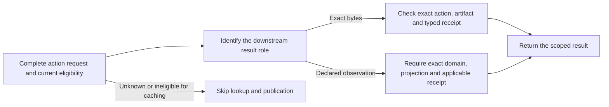

# Downstream requirements for action result reuse

**Scope.** PLAN §3.3 and [#300](https://github.com/aivibeflow/LLMLang/issues/300), research/all at `0d845c854b290999f05aeccfe86c2ec3f388b907`. The check composes the downstream consequences of existing native receipts. It compares execution, exact artifact and runtime-closure roles at their archived identities.

A cache consumer can request bytes, a named pure observation, or execution with externally observable effects. Each interface determines what it needs to receive. An upstream action key binds the action inputs and requested result type. A downstream consumer must also bind its own required roles. This includes ordering and exact payload identity where needed. [Action result envelopes](RESEARCH-SCENARIO-93-CACHE-SOUNDNESS-RESULT-ENVELOPES-AND-TRUST.md)



| Consumer role | Candidate rule | Checked discriminator |
| --- | --- | --- |
| Exact artifact or a pair of results containing exact bytes | Bind the producer request, ordered input/output roles and artifact digests. Require the exact result record and current eligibility. | Only the 12 identity pairs among 72 within-profile ELF comparisons have equal exact bytes. Changing source while producing identical compile bytes retains the separate link receipt. Matching payload bytes in a wrong role are refused. |
| Finite return observation | Bind a complete input domain, a named observation projection, and an applicable directional receipt for the origin and destination identities. A proof of a narrower result can support an explicitly narrower request. | All 72 ELF pairs agree on normal observations under the tested profile. When the consumer also requires self-inspection, only the 12 identity pairs agree. The cross-toolchain bridge admits wrapping returns, while an input-0–254 bridge refuses the full request, which includes the disambiguating input 255. |
| Effectful or incompletely known request | Withhold cache lookup and publication when an effect has no approved reuse semantics, a material input is unknown, or authority fails. Execution requires its own authorization. | Two requests with incomplete closure can report native diagnostic result 29 and have no action key. Two policy refusals and two loader failures remain separate dispositions. |

Eligibility and equivalence are independent. A deterministic scalar observation can be useful after byte output changes. It cannot satisfy a combined request for that observation and the new exact artifact. Conversely, valid byte equality cannot substitute for current eligibility, input-role admission or an observation projection that includes a missing effect.

The [ELF study](RT-11-ELF-METADATA-REUSE-2026-11-25.md) covers x86-64 Linux with six distinct metadata variants at each of two optimization levels. The report counts directed pairs including the identity comparisons. The [cross-toolchain study](RT-11-CROSS-TOOLCHAIN-CACHE-COMPATIBILITY-2026-11-25.md) checks 1,024 bounded native returns. The [native runtime closure](RT-11-NATIVE-RUNTIME-CLOSURE-2026-11-25.md) covers 14 requests. The [typed pipeline study](RT-11-TYPED-ACTION-RECEIPTS-2026-11-25.md) supplies the ordered input and result roles. These archives do not authorize caching effects or prove the complete production dependency extraction or lookup algorithm.

## Reproduce

Run from the branch checkout with CPython 3.12.14 and Git 2.56.1 on Linux x86-64 6.18.57. The [ledger](DETERMINISM-DOWNSTREAM-01/evidence.json) binds all four source artifacts and summarizes the recalculated comparisons. The check reads native receipts rather than rerunning their separate producers. Hash seeds 3 and 17 produce identical bytes.

```sh
study=research/toolchain-and-collaboration/RT-11/DETERMINISM-DOWNSTREAM-01
PYTHONHASHSEED=17 python3 -B "$study/check.py" | cmp "$study/evidence.json" -
```
