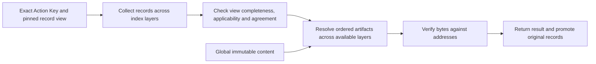

# RT-11 — Layered cache lookup, completeness and promotion

## Question and model

Which facts may process, workspace, team and global content caches contribute to one exact action result? The [semantic cache proposal](SEMANTIC-COMPILATION-CACHE.md#10-local-shared-and-remote-caches) distinguishes Action Key lookup from artifact retrieval. The [index merge comparison](RT-11-CACHE-INDEX-MERGE-ADMISSION-2026-11-25.md) checks exact candidate and trust rules for a merged index. This fixture reuses its validator and varies where the relevant records and bytes are present. [PLAN §3.3](../../../PLAN.md#33-semantic-build-and-cache-graph) · [#300](https://github.com/aivibeflow/LLMLang/issues/300)

A byte-exact action request has a pinned authoritative view that lists the applicable record identities for consideration. An authenticated view is a fixture input. Records can be mirrored across process, workspace and team layers. The global content layer supplies immutable bytes by artifact digest. The consumer collects the exact record set, applies its current producer and evidence policy, checks agreement, and acquires the required outputs with digest verification. A hit may promote both checked bytes and the immutable original records into the process layer.



The pinned view defines a specific agreement policy. Searching for the first individually valid result is an alternative that requires a different authority model. In the fixture, first-layer admission returns a hit for the same local record that participates in a cross-layer conflict or lacks a required record in the scoped view.

## Results

| Outcome | Controls |
| --- | ---: |
| `hit` | 9 |
| `miss` | 1 |
| `view-unavailable` | 1 |
| `artifact-missing` | 1 |
| `artifact-integrity-error` | 1 |
| `conflict` | 1 |
| `records-unavailable` | 1 |
| `no-applicable-attestation` | 2 |

With an exact workspace record, global content can rematerialize an evicted output. Global bytes alone do not establish that any action produced them. A corrupt nearest copy is bypassed when a lower layer supplies verifiable bytes, while corruption in the only copy fails the request. Two in-scope authorized receipts that disagree still produce a conflict after one payload is evicted. Restricting the allowed producer scope changes the agreement inputs.

An unreachable team layer blocks the request when a required record is missing from the pinned view. A workspace mirror of that record permits an offline hit. The promotion control keeps the original producers when their record and verified bytes are copied into process storage. Offline access then works under the original scope. Revoking those producers or changing the required evidence scope prevents reuse on that promoted copy.

These controls support an explicit distinction between a complete index miss, an unavailable authoritative view, and missing or corrupt artifact content. The placement of bytes enables retrieval without granting stronger authority. A signed or otherwise authenticated view, scoped agreement policy and safe artifact lifetime would need production guarantees.

## Reproduce and limits

The baseline was `b24cc66d6cc1a87ecdfc591e6d32550c0ba40951` on `research/all`. The replay used CPython 3.12.14 on Debian 13 x86-64 Linux 6.18.57. Run from the repository root:

```sh
fixture=research/toolchain-and-collaboration/RT-11/LAYERED-CACHE-01
out=$(mktemp)
python3 -B "$fixture/run.py" > "$out" &&
  cmp "$fixture/evidence.json" "$out" &&
  python3 -B "$fixture/chart.py" &&
  (cd research/packages-and-ecosystem/PROTOTYPES/PACKAGE-IDENTITY-01 &&
    python3 -B -m unittest -q test_language_version_cache_index)
```

The [ledger](LAYERED-CACHE-01/evidence.json) records all 17 controls and the process-only comparator. The 16 existing index tests pass. The [runner](LAYERED-CACHE-01/run.py) compares in-memory layers with explicit availability and supplied trust decisions. The [table generator](LAYERED-CACHE-01/chart.py) renders the categorical results. Persistent workspace storage, network protocols, actual authentication, concurrent eviction, leases and cache performance remain outside the fixture.
