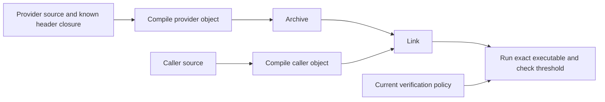

# Native cache hits by action type

## Build and key alternatives

This study extends the earlier compilation-only timing fixture with an executable build graph. Two C programs each compile a caller and provider, archive their provider object, link an executable and run a local verification action. The verification action records the program's integer output and checks an explicit minimum. Each stage has four compiler actions, two archive actions, two link actions and two verification actions. The cache stores exact output bytes and verifies the stored digest on each hit. [Earlier synthetic C++ timing study](RT-11-SYNTHETIC-CXX-CACHE-TIMINGS-2026-11-25.md)



The exact-payload route uses output digests for downstream dependencies. The producer-key route propagates dependency action identities, including changes that regenerate the same bytes. A negative control keys verification by executable bytes alone and omits its policy. The forced route rebuilds all ten jobs every stage and supplies the independent exact artifact comparison. Each route uses a separate working directory.

## Results

The exact-payload and producer-key routes both match the forced-build manifest in all seven stages. The main comparison below shows hits per action for exact payloads and total hits for propagated producer keys. The same route has 20 of 28 compile hits, 9 of 14 archive hits, 9 of 14 link hits and 8 of 14 verification hits across the complete fixture. [Evidence ledger](MULTI-ACTION-HITS-01/evidence.json) · [Table generator](MULTI-ACTION-HITS-01/chart.py)

| Stage | Compile | Archive | Link | Verify | Producer-key route total |
| --- | ---: | ---: | ---: | ---: | ---: |
| `cold` | 0/4 | 0/2 | 0/2 | 0/2 | 0/10 |
| `warm` | 4/4 | 2/2 | 2/2 | 2/2 | 10/10 |
| `comment_only` | 3/4 | 2/2 | 2/2 | 2/2 | 6/10 |
| `local_value` | 3/4 | 1/2 | 1/2 | 1/2 | 6/10 |
| `verification_policy` | 4/4 | 2/2 | 2/2 | 1/2 | 9/10 |
| `shared_header` | 2/4 | 0/2 | 0/2 | 0/2 | 2/10 |
| `restore_materialization` | 4/4 | 2/2 | 2/2 | 2/2 | 10/10 |

The comment edit changes the provider compile action key and preserves the object bytes. Propagating its producer identity adds three misses, one each for archive, link and verification. A real edit to the provider value recompiles and rechecks only the affected executable. Editing the shared header invalidates both providers and their downstream actions. After deleting every materialized output, the exact cache route restores ten artifacts and passes the clean-byte comparison.

Raising the verification minimum to 1,000 leaves program A's output at 9 and changes its status from accepted to refused. The negative route returns the former acceptance. This is one false extra hit from an incomplete verification key. The experiment treats verification as the local threshold test and records its exact receipt bytes.

The result measures reuse in a declared serial graph with an in-process cache on one pinned Linux host. The runner identifies the compiler, archiver, assembler, linker and target. System headers, runtime libraries and inherited environment are held fixed in the fixture environment. General dependency discovery, durable cache behavior, representative workload distributions and performance measurements remain open.

## Reproduction

From repository root, use CPython 3.12.14, GCC Debian 14.2.0-19 and GNU Binutils 2.44 on x86-64 Linux. The evidence pins the tool executable digests as well as all emitted artifact and action identities. A different tool or system installation can change artifact bytes.

```sh
set -eu
fixture=research/toolchain-and-collaboration/RT-11/MULTI-ACTION-HITS-01
out=$(mktemp)
trap 'rm -f "$out"' EXIT
python3 -B "$fixture/run.py" > "$out"
cmp "$fixture/evidence.json" "$out"
python3 -B "$fixture/chart.py"
```

[PLAN §3.4](../../../PLAN.md#34-quantify-compilation-speedup) · [Issue #318](https://github.com/aivibeflow/LLMLang/issues/318)
