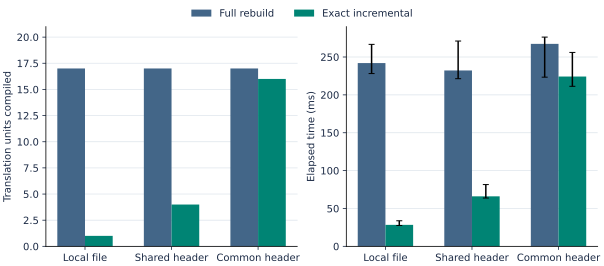

# RT-11 — Native rebuild cost for local, shared and broad edits

The [native action-key study](RT-11-SIX-STAGE-PROPAGATION-2026-11-25.md) distinguishes changes in consumed inputs from equality of outputs. This benchmark measures the selected recompilation work and paired elapsed times for three edit scopes. It applies to [PLAN §3.2](../../../PLAN.md#32-incremental-analysis-and-invalidation) and [#299](https://github.com/aivibeflow/LLMLang/issues/299).

The fixture has 16 C units, four group headers, a shared common header and a separate driver. Each edit changes an observed numeric result. A local edit changes one source file. A group header edit affects four translation units. An edit to the common header affects all 16 library units. The driver depends on neither header.

Each pair starts from a copy of the same prepared baseline. The full route recompiles all 17 translation units and links. The incremental route hashes the declared dependencies of each unit, verifies retained object bytes, recompiles dirty units and links. The timer starts after the edit and includes the incremental lookup and verification, compilation, and linking. Preparation, copying and post-build checks are outside the timer. Runs alternate route order. The runner compares linked bytes within each pair and checks the executable's result against a separate arithmetic formula.

## Results

Seven paired blocks on one logical CPU in a shared Linux environment produce 21 byte-identical comparisons. Each route links once per edit.

| Edit | Compiles, full / incremental | Median elapsed, full / incremental | Median paired full-to-incremental ratio | Observed ratio range |
| --- | ---: | ---: | ---: | ---: |
| Local file | 17 / 1 | 242.0 / 28.4 ms | 8.31× | 7.54–9.16× |
| Shared group header | 17 / 4 | 232.2 / 66.1 ms | 3.41× | 3.32–3.55× |
| Broad common header | 17 / 16 | 267.4 / 224.2 ms | 1.13× | 1.04–1.21× |



The full and incremental executables report 170, 204 and 480 for the respective edits. Only the driver avoids compilation on the broad edit. Its observed timing gap is smaller than with a local or group edit. An initial run before correcting CSV serialization had one broad-edit block in which incremental checking was slower. The published sample uses the corrected runner throughout.

These observations apply to the exact fixture, declared inputs and toolchain. The test starts with locally available verified objects and runs GCC serially. Dependency discovery, distributed cache overhead, populated production workspaces, parallel build scheduling and representative hardware require separate measurements. The wall-time ratios do not calibrate the LLMLang stage-weight model. [DEP-011 and DEP-012](../../research-management/RESEARCH-DEPENDENCY-MAP.md#3-directed-dependency-register)

## Reproduce

Use CPython 3.12.14, GCC Debian 14.2.0-19 and Matplotlib 3.10.8 on x86-64 Linux. The [raw samples](EDIT-LOCALITY-BENCHMARK-01/evidence/samples.csv), [summary](EDIT-LOCALITY-BENCHMARK-01/evidence/summary.json) and [host profile](EDIT-LOCALITY-BENCHMARK-01/evidence/profile.json) preserve the sampled run. Fresh timings vary. Use an available CPU in the first command if CPU 4 is outside the current affinity.

```sh
set -eu
fixture=research/toolchain-and-collaboration/RT-11/EDIT-LOCALITY-BENCHMARK-01
out=$(mktemp -d)
trap 'rm -rf "$out"' EXIT
LC_ALL=C PYTHONHASHSEED=1 taskset -c 4 python3 -B "$fixture/measure.py" --blocks 7 --out-dir "$out/fresh"
MPLCONFIGDIR="$out/mpl" LC_ALL=C PYTHONHASHSEED=1 \
  python3 -B "$fixture/summarize.py" "$fixture/evidence" --plot "$out/comparison.svg" > "$out/summary.json"
cmp "$fixture/evidence/summary.json" "$out/summary.json"
cmp "$fixture/evidence/comparison.svg" "$out/comparison.svg"
```
