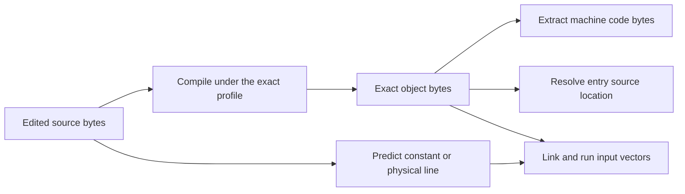

# RT-11 — Native output and source-location reuse after metadata edits

## Question and method

When can an edit to comments or physical source lines preserve a native execution result, exact object, or debugger location? The [typed pipeline comparison](RT-11-TYPED-PIPELINE-INVALIDATION-2026-11-25.md) separates an abstract emitted artifact from its source map. The [compile action study](../../compiler-and-translation/RT-13/RT-13-COMPILE-ACTION-DETERMINISM-2026-11-25.md) tests native path and clock inputs. This fixture varies the physical source revision under an unchanged logical compile recipe. [PLAN §3.2](../../../PLAN.md#32-incremental-analysis-and-invalidation) · [#299](https://github.com/aivibeflow/LLMLang/issues/299)

One GCC C17 function adds a constant to a 32-bit unsigned input. The location-dependent profile instead adds the C preprocessor's `__LINE__` at the return expression. For each profile, compile with or without DWARF and test the baseline, a same-line comment replacement, two leading blank lines, and a trailing comment. Map the physical working directory to `/fixture` in debug output. The check compares exact object digests, extracted `.text` bytes, the `addr2line` result for the selected entry address and 15 native outputs for every configuration. An independent integer expression predicts each result, including unsigned wraparound.



## Results

Sixteen builds produce 240 observations. All outputs agree with the oracle. Replacing the same-line comment or appending the trailing comment preserves the object digest, code bytes, mapped location and execution results in all four profiles. The original source digest differs for every edit.

| Profile | Exact object | Machine code bytes | Source location | Native output |
| --- | --- | --- | --- | --- |
| Constant, no DWARF | same | same | same | same |
| Constant, DWARF | changed | same | changed | same |
| __LINE__, no DWARF | changed | changed | same | changed |
| __LINE__, DWARF | changed | changed | changed | changed |

The table compares the two-leading-lines edit with the baseline. In the constant DWARF profile the entry moves from `/fixture/input.c:9` to `/fixture/input.c:11` and the object changes even though execution and the tested code section are unchanged. Without DWARF both lookups return `??:?`. In the location-dependent profile the added blank lines increase the returned offset by two, including in the absence of debug data. Path remapping preserves the virtual path while retaining the shifted source lines.

A cache for byte-exact debug objects must account for source location in this fixture. A consumer with a verified complete execution projection can retain a result across the constant-profile edit. Keeping an old source-location receipt would still report the wrong line. Compiler profiles that expose `__LINE__` require physical source position in the input relevant to executable behavior. The experiment does not establish that `.text` bytes alone identify a linked executable or that all comments are semantically inert under other profiles.

## Reproduce and limits

The baseline was `9fd3b5d8f11459aeb853ff3e140ccb0dccfdc719` on `research/all`. The run used CPython 3.12.14, Debian GCC 14.2.0-19 and GNU Binutils 2.44 on Debian 13 x86-64 Linux 6.18.57. The runner uses `/usr/bin:/bin`, records tool digests and compares the fixed fixture across separate temporary source directories.

```sh
fixture=research/toolchain-and-collaboration/RT-11/SOURCE-METADATA-REUSE-01
out=$(mktemp)
python3 -B "$fixture/run.py" > "$out" &&
  cmp "$fixture/evidence.json" "$out" &&
  python3 -B "$fixture/chart.py"
```

The [ledger](SOURCE-METADATA-REUSE-01/evidence.json) preserves the per-profile source, object and code digests, commands, locations and output vectors. The [table generator](SOURCE-METADATA-REUSE-01/chart.py) reproduces the leading-lines comparison. The study leaves general preprocessing, source projection certification, external macros, other compiler/target profiles and production cache admission open. [Runner](SOURCE-METADATA-REUSE-01/run.py)
