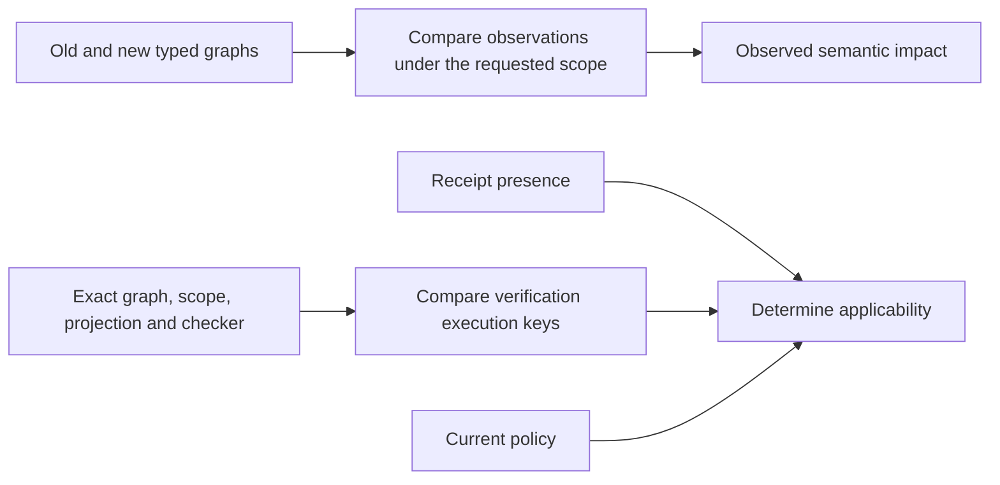

# RT-11 — Observational impact and evidence applicability

Scope is PLAN §3.2 and [#299](https://github.com/aivibeflow/LLMLang/issues/299), using typed-graph sources at `41ca1e1b2722abc9889d949f0b4a9f8da8310999` on `research/all`.

An edit can leave observable behavior intact while changing which verification receipt applies. Conversely, a program can change behavior before any receipt exists. LLMLang needs separate decisions for semantic invalidation, current evidence applicability, and the authority to consume a receipt.

## Model

The closed typed SPG fixture returns an integer and emits two ordered events. The five bodies are the original, a formatting-only variant, a body with an added zero, a reversal of event order, and an increment of the returned value. The checker validates each typed graph and observes it at five integers from −2 to 2. The rows compare two observation projections, value alone and value with trace, and two admitted scopes, the full input sample and its nonnegative subset.

The fixture models an existing receipt for the original full observation under the old checker. The execution key uses the existing `verification_key` function with the implementation hash, the closed graph snapshot, the checker identity, observation projection, and assumption label. A separate policy controls whether the matching receipt is authorized. The hash of the concrete source text is retained for provenance. An execution receipt for this fixture makes no source-location claim.



The diagram distinguishes behavior from receipt status. The comparison is finite, while equality of verification keys is an exact identity test. Explicit proof transport could justify a fresh applicability decision in other cases. This fixture uses exact matching and makes no such transport inference.

## Results

There are 160 cases across the five bodies, two projections, two Lean checker identities, two scopes, two policies, and receipt presence or absence.

| Observed impact | Current | Exact, policy denies | Stale | Absent |
| --- | ---: | ---: | ---: | ---: |
| No change within the tested projection and scope | 2 | 2 | 52 | 56 |
| A changed observation exists | 0 | 0 | 24 | 24 |

Formatting preserves the typed graph. Adding zero changes the graph while preserving all tested observations. Reversing events changes the full trace but preserves the value projection. Changing only the verifier or assumption label changes the exact execution key. Changing only authorization leaves the execution key and its result identity intact. Consequently a subject-only applicability check would confuse distinct propositions, verifier identities and authorization decisions.

A separate Lean artifact control compiles the same handwritten integer-identity proof under Lean 4.34.0 and 4.36.0. Both kernels check the proof without extra axioms. The two matching imports succeed and both cross-version `.olean` imports fail with an incompatible header. This independently reproduces the portability boundary in the [semantic impact and proof freshness study](RT-11-SEMANTIC-IMPACT-AND-PROOF-FRESHNESS-2026-11-25.md). The handwritten proof exercises import compatibility. It does not certify the typed graph or its trace.

## Reproduction and limits

Use CPython 3.12.14, the two Lean versions pinned in the [ledger](SEMANTIC-IMPACT-AND-EVIDENCE-01/evidence.json), and a checkout that contains the source revision above. The [runner](SEMANTIC-IMPACT-AND-EVIDENCE-01/run.py) verifies the prototype source hashes against that revision and records the graph observations, per-case outcomes, compiled object hashes and import diagnostics.

```sh
fixture=research/toolchain-and-collaboration/RT-11/SEMANTIC-IMPACT-AND-EVIDENCE-01
LC_ALL=C PYTHONHASHSEED=1 python3 -B "$fixture/run.py" \
  --lean-old "$LEAN_434" --lean-new "$LEAN_436" > /tmp/llmlang-impact-and-evidence.json
cmp "$fixture/evidence.json" /tmp/llmlang-impact-and-evidence.json
```

The observations cover a closed scalar fragment. The authorization flag is a synthetic policy input. Production proof transport, signed receipts, complete dependency capture, and general observation equivalence remain open. The table gives exact finite counts, with no timing or sampling results. Mermaid syntax was inspected directly.
