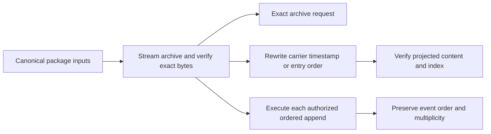

# Package artifacts, projected results and ordered action effects

**Scope.** PLAN §3.3 and [#300](https://github.com/aivibeflow/LLMLang/issues/300), research/all at `d4e0ba59695dfdd9e43f1227cab75c4940b0bb39`. Compare exact LLPKG archive bytes, a package-content projection, and an append operation whose ordered writes are part of the request.

The [downstream role study](RT-11-DOWNSTREAM-DETERMINISM-2026-11-25.md) derives reuse requirements from the receiving action. This experiment uses the existing streamed LLPKG builder and package verifier to test the package case. The observation consists of the verified logical index and content identities plus digests of all named expanded entries. It leaves ZIP transport metadata and entry order outside this pure observation. The write test uses one exact valid archive and records the ordered events for real appends to a temporary local file.



| Action class | Verified observation | Candidate cache rule |
| --- | --- | --- |
| Byte-deterministic | Six canonical builds in separate directories using three in-memory record limits produce identical verified archives. | Reuse the exact result only under an eligible complete action key and a validated artifact receipt. |
| Deterministic under a named observation | Two timestamp choices and two ZIP entry orders yield four different byte identities. All validate and match every expanded-entry digest, the logical index and the content root. An altered object fails package verification. | A named content result can be reused for a consumer that declares that observation and checks its applicable receipt. Exact archive requests keep the full byte obligation. |
| Non-cacheable under the tested contract | Four invocations all return the same status and exact package hash. Five of six schedule pairs differ in order or multiplicity even though all have the same set of event names. Performing all calls writes nine events. Reusing a previous result by package hash writes only two. | Preserve each requested append. Cache admission cannot suppress the effect under this contract. Execution authority is a separate decision. |

These observations compare one two-object package in the prototype ZIP transport and four sequential calls. They do not establish canonical transport across tool versions, a production event schema, idempotence, atomic publication, or an authority policy. The verification concern is whether a caller can distinguish requested effects or exact bytes even when a narrower result is equal.

## Reproduce

Use Git 2.56.1, CPython 3.12.14, its `zipfile` implementation, and GNU tar 1.35 on Linux x86-64 6.18.57. The [runner](PACKAGE-ACTION-DETERMINISM-01/run.py) exports the exact package prototypes into a temporary tree. The [receipt](PACKAGE-ACTION-DETERMINISM-01/evidence.json) retains the source digests, exact archive hashes, projection, per-call dispositions and ordered event records. Two hash seeds gave the same receipt. No runtime costs were measured.

```sh
study=research/toolchain-and-collaboration/RT-11/PACKAGE-ACTION-DETERMINISM-01
out=$(mktemp)
PYTHONHASHSEED=2 python3 -B "$study/run.py" > "$out" &&
  cmp "$study/evidence.json" "$out"
```
