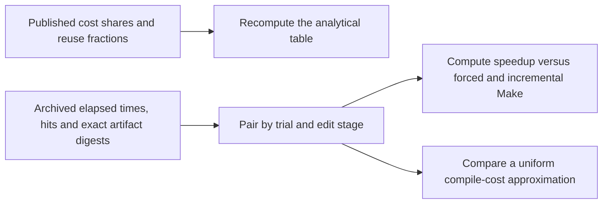
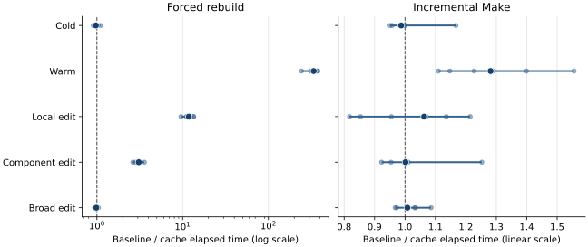

# Paired build-cache speedups and the analytical estimate

## Model and comparison

The analytical estimate uses `S = 1 / (1 - R + O)`, with avoided baseline work `R` and cache overhead `O` measured relative to the uncached baseline. This replay recomputes the documented table from its nine stage weights, three nonzero reuse scenarios and three overhead assumptions. It then applies the same equation to a deliberately simpler workload, using the archived three-route C++ fixture. Both inputs are read from `research/all` at `bbfb97ac4e4cf659d8fdcedebe8279325ed7659f`. [Analytical estimate](COMPILATION-CACHE-SPEEDUP-ESTIMATE.md) · [Original timing study](RT-11-SYNTHETIC-CXX-CACHE-TIMINGS-2026-11-25.md)



The published decimal results all match. At two percent overhead the estimated speedups are 7.33× for local edits, 2.32× for component edits, 25.64× for identical warm builds and 0.98× cold. These scenarios assume an LLMLang stage mix. The archived C++ timing workload has twelve equally counted translation units, three components, fixed include dependencies, serial compilation and an in-process object cache. It uses GCC-compatible Clang 19.1.7 and Make 4.4.1 on a shared x86-64 Linux host. It excludes linking, a network cache and LLMLang frontend and proof work.

## Paired results

There are seven trial blocks for each stage. Every block contains a forced rebuild, conventional incremental Make and a content-keyed route in shuffled order. The replay verifies that the three artifact manifests match within all 35 blocks. Each paired speedup divides that exact baseline trial's elapsed time by its paired cache elapsed time. A ratio below one means the cache was slower for that pair. [Machine-readable ratios and exact manifests](PAIRED-CACHE-SPEEDUP-01/evidence.json) · [Plot generator](PAIRED-CACHE-SPEEDUP-01/plot.py)



Points are paired trials. Larger dots mark medians, lines mark the observed range, and the dashed line marks equal elapsed time. The forced baseline uses a logarithmic horizontal axis.

| Scenario | Forced median [min, max] | Cache slower vs forced | Make median [min, max] | Cache slower vs Make |
| --- | ---: | ---: | ---: | ---: |
| Cold | 0.972 [0.908, 1.102] | 5/7 | 0.988 [0.951, 1.167] | 5/7 |
| Warm | 337.856 [243.344, 378.326] | 0/7 | 1.281 [1.110, 1.556] | 0/7 |
| Local edit | 11.829 [9.578, 13.444] | 0/7 | 1.063 [0.817, 1.214] | 3/7 |
| Component edit | 3.075 [2.630, 3.581] | 0/7 | 1.002 [0.923, 1.252] | 3/7 |
| Broad edit | 0.984 [0.946, 1.042] | 5/7 | 1.008 [0.968, 1.086] | 2/7 |

Cold and broad edits have no cache hits and each loses to forced rebuild on five trials. The component-edit cache and Make medians are close to the same time in this sample, with three cache losses and four wins. The very large warm speedup against forced rebuild reflects avoiding all 12 compiler invocations. Conventional Make also avoids them, and its paired ratio is much smaller. The ranges describe these seven observations per stage.

For a simple application of the equation to the same timing blocks, the estimate uses the forced wall time multiplied by the fraction of compile actions still run, then adds the measured combined cache and verification overhead. Its median signed residuals, predicted time minus cache time, are −9.502 ms cold, −0.051 ms warm, 1.512 ms for a local edit, 4.959 ms for a component edit and −2.343 ms for a broad edit. Individual cold residuals range from −37.951 to 41.548 ms. Equal compiler counts and one overhead measurement cannot identify how much time belongs to each action or to each build runner. The replay verifies the equation and provides a scoped prediction diagnostic from archived measurements. It leaves representative LLMLang costs, model calibration, controlled hardware and parallel critical paths open.

## Reproduction

Use CPython 3.12.14, Git 2.56.1 and Matplotlib 3.10.8. Run from the repository root with the pinned commit available. This regenerates the derived evidence and plot without timing another build.

```sh
set -eu
fixture=research/toolchain-and-collaboration/RT-11/PAIRED-CACHE-SPEEDUP-01
scratch=$(mktemp -d)
trap 'rm -rf "$scratch"' EXIT
python3 -B "$fixture/run.py" > "$scratch/evidence.json"
cmp "$fixture/evidence.json" "$scratch/evidence.json"
MPLCONFIGDIR="$scratch" python3 -B "$fixture/plot.py" \
  --input "$scratch/evidence.json" --output "$scratch/speedups.svg"
cmp "$fixture/speedups.svg" "$scratch/speedups.svg"
```

[PLAN §3.4](../../../PLAN.md#34-quantify-compilation-speedup) · [Issue #318](https://github.com/aivibeflow/LLMLang/issues/318)
