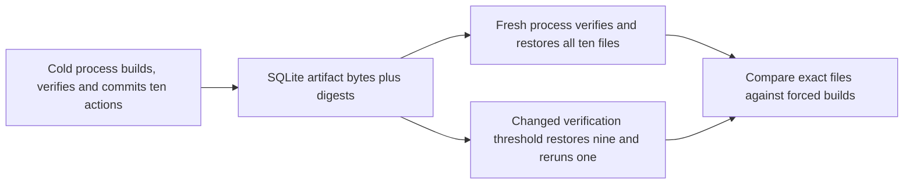
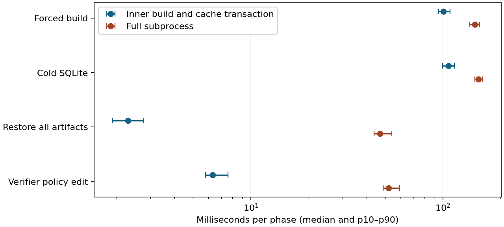

# RT-11 fresh-process restoration from a persistent build cache

The earlier native fixture stores compile, archive, link and local verification results in a process-local map. This pilot reuses the same key and verification logic with a SQLite adapter. It measures a cold fill, restoration into an empty output tree by a fresh process, and a verifier-only policy change. A forced build supplies exact byte comparisons. [Native multi-action cache](RT-11-MULTI-ACTION-CACHE-HITS-2026-11-25.md) · [C++ timing study](RT-11-SYNTHETIC-CXX-CACHE-TIMINGS-2026-11-25.md)



One transaction retains the results of a completed build in a local database configured with SQLite's rollback journal and full synchronous mode. Each process uses an empty output tree. A hit's bytes are hashed before materialization. The raised verification threshold leaves the linked executable unchanged, so exactly one verification action reruns. Its fresh receipt refuses the previously accepted output of 9. Both restored builds match their independent forced-build artifact digests across the relevant phase.

## Observations

Ten trials each recreate a fresh database. The forced build runs before or after the cache sequence according to a recorded seed. The inner timer starts before database opening and ends after the build, inspection and cache commit and close. The full subprocess timer includes the Python launch, module initialization and receipt transmission. Independently forced policy variants and corrupted cache controls are outside the reported phase timers. Each row reports the median and p10–p90 over ten processes, in milliseconds.

| Phase | Verified hits | Inner build | Full subprocess |
| --- | ---: | ---: | ---: |
| Forced | 0/10 | 100.86 [95.27, 109.16] | 147.02 [138.15, 155.61] |
| Cold SQLite | 0/10 | 106.81 [99.56, 114.90] | 153.12 [146.68, 161.68] |
| Restored | 10/10 | 2.29 [1.90, 2.75] | 47.05 [43.88, 54.09] |
| Verifier policy change | 9/10 | 6.33 [5.81, 7.60] | 52.19 [48.88, 59.59] |



The persisted database uses 65,536 bytes after the policy edit in every trial. A separate copy corrupts the first action's stored bytes while retaining its recorded digest. All ten fresh consumers refuse before materializing the affected artifact. The currently observed hot-cache interval mainly reflects startup at this workload size. The experiment covers a serial local filesystem and fresh processes with an existing database. It leaves power loss, filesystem cache effects, concurrent readers and writers, eviction, larger projects and distributed artifact trust open. [Raw samples](PERSISTENT-BUILD-CACHE-01/evidence/samples.csv) · [Distributions](PERSISTENT-BUILD-CACHE-01/evidence/summary.json) · [Environment and tool hashes](PERSISTENT-BUILD-CACHE-01/evidence/config.json)

## Reproduction

Use CPython 3.12.14 with SQLite 3.53.1, GCC 14.2.0, GNU Binutils 2.44 and Matplotlib 3.10.8. The recorded trial pinned logical CPU 4 on AMD EPYC 9V74 under Linux 6.18.57, with zero cgroup throttled periods. Choose a CPU allowed by your runner. Timings vary across runs.

```sh
study=research/toolchain-and-collaboration/RT-11/PERSISTENT-BUILD-CACHE-01
build=$(mktemp -d)
LC_ALL=C PYTHONHASHSEED=37 PYTHONDONTWRITEBYTECODE=1 python "$study/measure.py" \
  --cpu 4 --trials 10 --seed 20261125 --output "$build/evidence"
LC_ALL=C MPLBACKEND=Agg MPLCONFIGDIR="$build/plot-cache" python "$study/summarize.py" \
  --evidence-dir "$build/evidence"
```

[Collector](PERSISTENT-BUILD-CACHE-01/measure.py) · [Summarizer](PERSISTENT-BUILD-CACHE-01/summarize.py)
