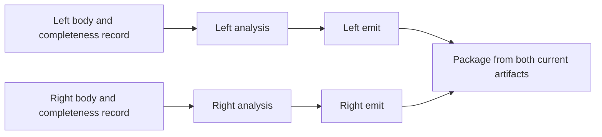

# RT-11 — Scoped fallback for unknown dependency completeness

## Question and assumptions

Can a build retain exact results from one part of its action graph when another has stale or missing completeness evidence? The [incremental invalidation review](../../formal-verification/RT-32/RT-32-INCREMENTAL-INVALIDATION-RECHECK-2026-11-23.md) identifies conservative revalidation and non-cacheable execution as fallback choices. This study compares their placement in one finite action graph. [PLAN §3.2](../../../PLAN.md#32-incremental-analysis-and-invalidation) · [#299](https://github.com/aivibeflow/LLMLang/issues/299) · [LL-021](../../../PLAN.md#ll-021--define-semantic-action-caching-and-incremental-compilation)

Two independent module branches each have a source-and-environment body action, a deterministic analysis that consumes the body result, and a deterministic emitter that consumes the analysis result. Packaging joins the two artifacts. Each body action has current exact dependency evidence, an obsolete extractor receipt covering only the source, or no receipt. Downstream actions have complete declared byte-level inputs. The initial cache contains exact baseline outputs.



Three policies are compared. Optimistic recorded-edge reuse accepts a baseline hit from the source alone when evidence is absent or stale. Whole-graph fallback recomputes available actions when either body is uncertain. Scoped fallback evaluates only the uncertain body without creating a reusable entry for its incomplete request. A deterministic consumer can still compare its complete key against the fresh input it actually receives. When current evaluation is unavailable and no exact hit is justified, the body is blocked. Its consumers and the join wait for a current result. The independent branch may proceed.

## Results

The fixture enumerates all 576 combinations of four source/environment change bits, two three-way completeness states and two execution-availability bits. An independent from-scratch evaluator checks every produced value. A separate admission oracle checks where either conservative policy can produce a current body result or must block its consumers.

| Policy | Executed actions | Admitted packages | Stale packages | Stale available results |
| --- | ---: | ---: | ---: | ---: |
| Optimistic recorded-edge reuse | 840 | 289 | 120 | 696 |
| Whole-graph fallback | 1792 | 153 | 0 | 0 |
| Scoped fallback | 1224 | 169 | 0 | 0 |

The optimistic policy can reuse a stale body, analysis, emitted value and package after an environment edit that its obsolete receipt left out. Both conservative policies have zero stale results in the model. Scoped fallback executes 568 fewer actions than whole-graph fallback and admits 16 more packages. These package cases can use a justified hit in an independent scope whose runner is unavailable. Uncertain bodies remain non-cacheable under both conservative policies.

A worked control edits both inputs of an uncertain body while keeping its fresh output equal to the old value. Scoped fallback reruns the body and reuses the deterministic analysis from its complete fresh input. A second control blocks an unavailable uncertain branch while an independent complete branch retains its valid emitter result. Package admission still depends on both branches. The archived inputs and all decisions for these controls are in the ledger.

## Boundary and reproduction

The fixture relies on a frozen input world, correct classification of the current completeness receipt, complete deterministic downstream keys, and a current fallback runner when needed. It does not infer completeness from an equal output. If fallback execution cannot establish a current value, a dependent exact result stays unavailable. Publishing or sharing reusable cache entries, concurrent input changes, external effects and production dependency discovery need separate evidence.

The baseline was `7f3a845867e468cb998f7e8dbc6e0ece235661c9` on `research/all`. The check ran with CPython 3.12.14 on Debian 13 x86-64 Linux 6.18.57. Run from the repository root:

```sh
fixture=research/toolchain-and-collaboration/RT-11/SCOPED-FALLBACK-01
out=$(mktemp)
python3 -B "$fixture/run.py" > "$out" &&
  cmp "$fixture/evidence.json" "$out" &&
  python3 -B "$fixture/chart.py" &&
  (cd research/PROTOTYPES/DEPENDENCY-GRAPH-01 &&
    python3 -B -m unittest -q tests.test_impact_planning tests.test_dependency_discovery tests.test_semantic_dependency_index)
```

All 72 existing prototype tests passed. The [ledger](SCOPED-FALLBACK-01/evidence.json) stores the exact baseline, counts and witnesses. The [runner](SCOPED-FALLBACK-01/run.py) deterministically regenerates the full profile set, and the [table generator](SCOPED-FALLBACK-01/chart.py) renders the counts. They count logical action executions and do not measure compile time.
