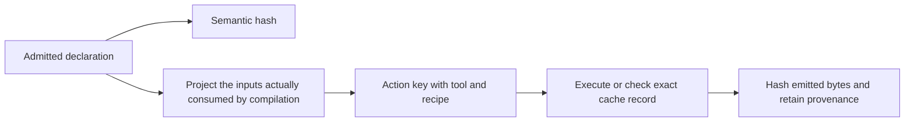

# RT-11 — Semantic, action and artifact identities

Scope is PLAN §3.3 and [#300](https://github.com/aivibeflow/LLMLang/issues/300), using branch baseline `017d2e73e32b3fe050ff62f41d145d871781c21e`.

A cache must answer three distinct questions. The semantic hash identifies the exact admitted representation of a declaration. The action key identifies a particular computation under its declared inputs. The artifact hash identifies the exact output bytes. Confusing them can import a result that belongs to another request or prevent byte-level deduplication.

| Identity | Fixture envelope | Consumer |
| --- | --- | --- |
| Semantic hash | Domain, increment, and declared input scope | Exact declaration or contract lookup |
| Action key | Domain, projected C body, compiler identity, and recipe flags | Request and lookup for an object compilation |
| Artifact hash | SHA-256 of the emitted object bytes | Verify storage identity and deduplicate identical objects |

The compile action uses a projection of the semantic declaration. The scope is metadata in this particular adapter and does not affect emitted C. An implementation that optimizes using a precondition would need the applicable contract in its code-generation inputs. Contract evaluation remains a distinct action even when two declarations share a compilation result.



The projection in the diagram is specific to this fixed C generator. A canonical production encoding and complete dependency capture require further validation.

## Native comparison

The fixture builds one C function in five cells and calls each linked result at 0, 1, 31 and 255. All 20 calls match the independent arithmetic expectation. Each comparison below is with the `-O2` baseline.

| Intervention | Same semantic hash | Same action key | Byte-identical object | Same tested returns |
| --- | --- | --- | --- | --- |
| Switch to `-O3` | yes | no | yes | yes |
| Add `-g` | yes | no | no | yes |
| Restrict the declared input scope to bytes | no | yes | yes | yes |
| Change the increment from one to two | no | no | no | no |

The flags-omission control produces one incomplete action key for the baseline and debug build despite their different object hashes. The `-O3` cell establishes the reverse boundary: two valid action keys can map to one exact stored object without merging their result records. The restricted-scope cell preserves compilation identity but changes the declared contract. Its four calls all lie in the common domain and establish only the displayed observation comparison.

This complements the [path and time input study](../../compiler-and-translation/RT-13/RT-13-COMPILE-ACTION-DETERMINISM-2026-11-25.md), where missing context gave false hits, and the [cross-toolchain study](RT-11-CROSS-TOOLCHAIN-CACHE-COMPATIBILITY-2026-11-25.md), where matching return observations did not imply identical full objects. The new ledger pins both archives by SHA-256. A compatibility receipt for a declared projection is a separate result. It provides neither the destination object's bytes nor fresh build provenance.

## Reproduce and limits

Use CPython 3.12.14, Debian GCC 14.2.0-19, GNU Binutils 2.44, and Linux x86-64 with glibc 2.41. The runner builds PIC objects from a fixed file name, maps scratch paths to a fixed virtual debug path, and fixes the source epoch to zero.

```sh
fixture=research/toolchain-and-collaboration/RT-11/THREE-CACHE-IDENTITIES-01
LC_ALL=C PYTHONHASHSEED=1 python3 -B "$fixture/run.py" > /tmp/llmlang-cache-identities.json
cmp "$fixture/evidence.json" /tmp/llmlang-cache-identities.json
```

The [runner](THREE-CACHE-IDENTITIES-01/run.py) generated the exact categorical comparisons and [machine-readable ledger](THREE-CACHE-IDENTITIES-01/evidence.json); hash seeds 1 and 2 produce identical ledgers. The comparison table is sufficient for the five discrete cells. No latency or sampling inference was measured. Mermaid source was inspected directly. The fixture leaves production environment capture, nondeterministic output, packaging, and cache-record authorization to their respective gates.
