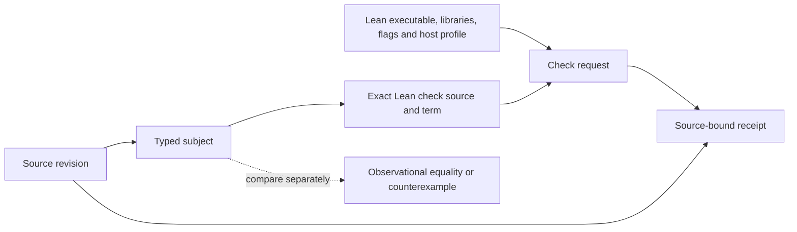

# RT-11 — Semantic impact and proof receipt freshness

## Question and method

Which changes require a new proof check or source-bound receipt even when the observable behavior is unchanged? The [verification reuse audit](../../research-management/RT-00/RT-00-C-VERIFICATION-REUSE-IDENTITY-RECHECK-2026-11-24.md) distinguishes verification execution identity from current applicability. Its outlined kernel-version compatibility route had no measured recheck. This experiment checks one deterministic natural-number operation, an explicit Lean proof term source, and two pinned Lean releases. [PLAN §3.2](../../../PLAN.md#32-incremental-analysis-and-invalidation) · [#299](https://github.com/aivibeflow/LLMLang/issues/299) · [LL-021](../../../TODO.md#ll-021--define-semantic-action-caching-and-incremental-compilation)

The baseline returns `x + 1`, and the property is strict increase. Four variants change whitespace, reorder the operands, change the increment to two, or return the input directly. The restricted source adapter parses the finite syntax family and renders a closed Lean checking unit for each variant. The proof input combines the exact rendered definition and an explicit proof term. Whitespace is removed by this adapter. The operand reorder remains a distinct typed subject. The source-bound receipt identity additionally commits to the original source bytes.



The check key binds Lean's executable, selected shared libraries, Init module manifest, flags and recorded host profile. The source term for the baseline is the same in both checkers. Each checker freshly elaborates and kernel-checks it. That verifies a portable source route for this fixture. It does not imply compatibility of opaque proof certificates or compiled modules.

## Results

The ten fresh checking units give eight proofs and two refusals, one identity-body refusal per checker. All eight successful `increases` theorems have empty axiom lists. A separate Lean unit checks result equality of the reordered body for every natural number, and checks that increment two changes the result at zero despite satisfying the strict-increase property. It also checks that the identity body cannot meet the property at zero. All three semantic controls have empty axiom lists under both releases.

| Intervention | Same typed subject | Same check request | Same source-bound receipt | Fresh check |
| --- | --- | --- | --- | --- |
| Whitespace | yes | yes | no | proved |
| Equivalent operand reorder | no | no | no | proved |
| Increment changed from one to two | no | no | no | proved |
| Identity body | no | no | no | refused |
| Checker version only | yes | no | no | proved |

Comparisons are against the baseline under Lean 4.34.0. The whitespace result distinguishes reuse of an exact check request from applicability of its source-bound receipt. The reordered result distinguishes a checked behavioral equivalence from equality of the submitted proof request. Conversely, the increment-two result demonstrates a semantic difference even though the same declared property still passes.

An additional import control compiles the same baseline source to `Saved.olean` in each release. Both same-version imports succeed. Both cross-version imports fail with `incompatible header`. Import probes module load compatibility and exposes the imported axiom metadata. A fresh source check verifies the elaborated declaration in the selected kernel. Successful saved-term source checking provides a route here even where the compiled form fails to load.

## Reproduce and limits

The baseline was `904050edbe4482692f1cce35e5bbabc788c5547f` on `research/all`. The replay host ran Debian 13 x86-64 Linux 6.18.57 with glibc 2.41 and CPython 3.12.14. The Lean releases are 4.34.0 at `293d5d0c0c3f3dded4688b3ccd6a33939ac5102b` and 4.36.0 at `611c117bfaf7b7ae1cfcf246ce6fba31e8f509e9`. Set `LEAN_434` and `LEAN_436` to their respective executable paths:

```sh
fixture=research/toolchain-and-collaboration/RT-11/PROOF-FRESHNESS-01
out=$(mktemp)
python3 -B "$fixture/run.py" --lean-434 "$LEAN_434" --lean-436 "$LEAN_436" > "$out" &&
  cmp "$fixture/evidence.json" "$out" &&
  python3 -B "$fixture/chart.py"
```

The [ledger](PROOF-FRESHNESS-01/evidence.json) preserves exact generated check-input digests, artifact digests, checker manifests, outcomes and import diagnostics. The [table generator](PROOF-FRESHNESS-01/chart.py) reproduces the categorical results. The fixture checks a closed natural-number model and source adapter. It leaves general proof-artifact migration, authenticated receipt admission, production source correspondence and complete host dependency capture open. [Runner](PROOF-FRESHNESS-01/run.py) · [Lean semantic controls](PROOF-FRESHNESS-01/SemanticControls.lean)
