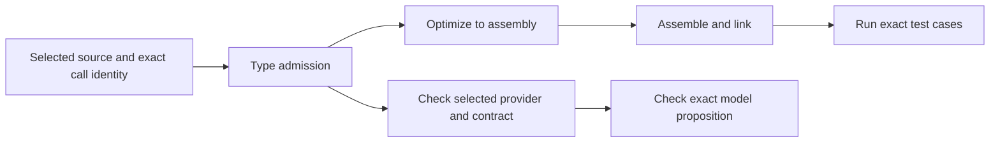

# RT-11 — Stage-specific invalidation after an implementation edit

An implementation edit can change a caller's semantic identity, the exact artifacts a stage consumes, or both. The [typed pipeline study](RT-11-TYPED-PIPELINE-INVALIDATION-2026-11-25.md) separates six action keys for an abstract target. This experiment uses native C, GCC assembly and objects, and a checked Lean bound. It covers [PLAN §3.2](../../../PLAN.md#32-incremental-analysis-and-invalidation) and [#299](https://github.com/aivibeflow/LLMLang/issues/299).

The caller either incorporates a direct provider body or compiles separately against the provider's interface and links the selected object. In the direct model, the caller's candidate implementation preimage contains the exact child implementation. In the contract-bound model, the caller retains the abstract operation identity while executable, concrete conformance and proof requests bind the selected provider. The separate invocation contract is an upper bound on results. The exact identity definitions are scoped to the fixture. General semantic identity is still a project choice. [Exact dependency propagation](../../semantic-representation/RT-05/RT-05-EXACT-DEPENDENCY-PROPAGATION-2026-11-25.md)

| Stage | Evidence and consumed inputs |
| --- | --- |
| Type | GCC C11 syntax and type check on the selected source closure and expected interface. |
| Contract | Exact caller and provider identities and the finite input/output bound. |
| Optimize | Selected source identities, compiler release and language/options. The output is exact emitted assembly. |
| Code generation | Assemble and link using exact assembly, fixed driver and pinned native tool versions. |
| Tests | Exact linked executable, selected input cases and expected values. |
| Proof | Exact contract obligation, selected provider and proof-policy identity. Lean checks the mathematical bound or its exact endpoint counterexample. |



## Results

Both modes build and run seven admitted variants, with 17 native calls per variant. All 238 observations agree with independent integer arithmetic. An eighth variant returns a string through the same C interface. Both modes reject it at type admission and withhold the five downstream results. Under a key that used only the declared interface, the previous positive type result would still match.

| Edit | Changed stage keys | Evidence |
| --- | --- | --- |
| Replace `n+(1+1)` with `n+2` | Type, contract, optimize, proof | Exact assembly, object and executable bytes are preserved in both modes. Code and test requests remain equal. |
| Replace the provider with `n+3` | All six | Direct caller identity changes. The contract-bound caller identity and object remain equal, while its selected provider, executable and checked evidence change. |
| Increase the contract upper bound | Contract and proof | The binary and test case identity remain equal. |
| Edit an unselected candidate | None | The selected closure is unchanged. |
| Change the checker policy identity | Proof | Checks run with the same actual Lean toolchain in this case. |
| Change the selected test inputs | Tests | The executable remains equal. |

With the initial bound of 10 and input maximum 8, the changed provider returns 11 at the endpoint. Lean checks a refutation of that exact model claim. For the other admitted variants, it proves the mathematical upper bound for all integers at or below 8. The native comparison covers only `[-8,8]`, where the arithmetic is defined and matches the model. The kernel proof does not establish C-to-Lean correspondence outside this finite check.

The result supports output-based reuse after a stage recomputes identical bytes. A proof or conformance result can still become stale because it addresses a different subject or trust policy. The integrated workflow should retain these separate applicability checks. This fixture leaves automatic dependency extraction, distribution of action results, target environments and production compiler integration open. [DEP-015](../../research-management/RESEARCH-DEPENDENCY-MAP.md#3-directed-dependency-register)

## Reproduce

Use CPython 3.12.14, GCC Debian 14.2.0-19, GNU Binutils for Debian 2.44 and Lean 4.36.0 at `611c117bfaf7b7ae1cfcf246ce6fba31e8f509e9` on x86-64 Linux. Run from the repository root. The [ledger](SIX-STAGE-PROPAGATION-01/evidence.json) includes candidate identities, exact executable hashes, proof scopes and test outcomes.

```sh
set -eu
fixture=research/toolchain-and-collaboration/RT-11/SIX-STAGE-PROPAGATION-01
out=$(mktemp)
trap 'rm -f "$out"' EXIT
LC_ALL=C PYTHONHASHSEED=1 python3 -B "$fixture/run.py" > "$out"
cmp "$fixture/evidence.json" "$out"
```
