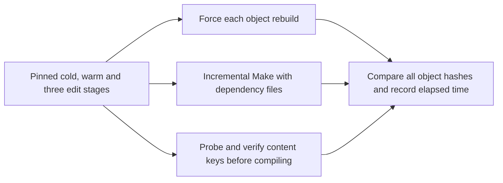
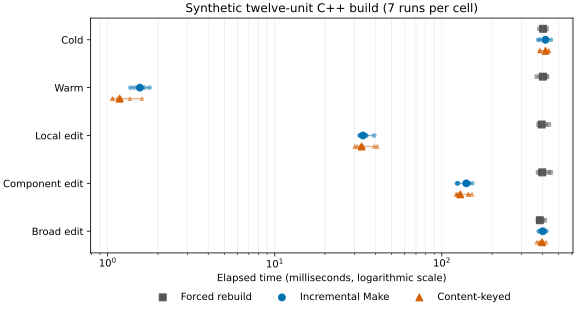

# Measure a synthetic C++ compile cache against Make

**Scope:** PLAN §3.4 and [#318](https://github.com/aivibeflow/LLMLang/issues/318). Twelve generated C++ translation units, one target, serial compilation, and a managed Linux host. Base revision `be361f9e4e4617f7440ec015e4b76a3c71c9368b` on `research/all`.

## Question and workload

The [action-count recheck](RT-11-CACHE-SPEEDUP-MODEL-RECHECK-2026-11-23.md) shows that correctly scoped inputs can reduce compiler invocations. Does that reduction also appear in elapsed time, and how does an existing conventional incremental build compare? This workload has three components of four units each. Every unit consumes a shared header and one component header. The edits change one source, one component header, and the global header. Each test starts with a cold action cache and empty object directory. The series then runs a no-change warm build and all three edits.

| Method | Rule used |
| --- | --- |
| Forced rebuild | GNU Make uses `-B` with the same compile recipe at every step. |
| Incremental Make | GNU Make uses ordinary timestamp checks and emits include dependencies. |
| Content-keyed | Recompute a key over the fixed recipe, exact source and two known headers, pinned compiler and fixed environment. Verify a hit's bytes before reusing the object, then compile only misses. |



The content cache is an in-process map, with current objects already materialized after prior stages. There is no linking, distributed storage, eviction, or discovery of include paths by the content route. The cache is cold in the cold phase. The operating system's file and process caches were not flushed. Each trial imposes the same operations on three separate trees. Method order is shuffled within each scenario using seed 318.

## Observed results

All 35 trial/stage comparisons yield the same sorted manifest of twelve exact object digests across all methods. Conventional incremental and content-keyed routes each compile 12, 0, 1, 4 and 12 units across the five stages. The content route records 0, 12, 11, 8 and 0 hits. Forced rebuilding compiles all twelve in every stage.



The plot shows all seven observations per cell, a large median marker and a line spanning the observed range. The elapsed-time axis is logarithmic. The table reports medians and observed minimum/maximum bounds in milliseconds.

| Scenario | Forced rebuild | Incremental Make | Content-keyed |
| --- | ---: | ---: | ---: |
| Cold | 404.14 [384.30, 422.94] | 416.82 [376.99, 450.43] | 417.27 [383.75, 437.09] |
| Warm | 402.47 [370.19, 425.54] | 1.56 [1.37, 1.78] | 1.18 [1.07, 1.61] |
| Local edit | 395.57 [379.39, 436.30] | 33.70 [32.22, 39.40] | 33.10 [30.10, 41.10] |
| Component edit | 398.93 [377.06, 448.01] | 140.00 [123.11, 152.33] | 129.02 [121.63, 151.68] |
| Broad edit | 385.77 [377.20, 413.27] | 401.79 [379.69, 423.06] | 397.95 [370.07, 419.99] |

The incremental routes avoid the same compiler processes. Warm, local, and component edits are visibly faster than forced rebuilds. The content-keyed and incremental Make ranges overlap at every stage. The content route's median combined key, lookup, verification and necessary materialization time ranges from 1.13 ms warm to 2.41 ms for the broad edit. The [raw timing data](COMPILE-CACHE-TIMINGS-01/evidence.json) record all 105 elapsed observations in nanoseconds, exact manifest identities, compiler counts, cache hits, the measured combined cost and machine configuration.

The forced-rebuild baseline clarifies savings from avoiding work. Comparing with a conventional incremental build shows how much of the saving an existing dependency model already captures. This small run cannot establish a production performance advantage for either incremental route. The shared host, declared include graph, single target, serial builds, small source corpus and in-process cache constrain how the timings can be used. Representative Rust, Go and C++ projects, controlled measurement hardware, parallel scheduling, distribution, linking and verifier overhead remain open. The ranges do not estimate a confidence interval or a population distribution.

## Reproduce

Observed with CPython 3.12.14, Clang 19.1.7 from Debian `1:19.1.7-3+b1`, GNU Make 4.4.1, Linux 6.18.57 on x86-64, and five visible logical CPUs on AMD EPYC 9V74. The [benchmark runner](COMPILE-CACHE-TIMINGS-01/run.py) regenerates the full workload, checks compile counts and compares exact outputs. Set `CLANG` to the pinned executable with its matching LLVM libraries available. For plotting, use Matplotlib 3.10.8 and the [chart generator](COMPILE-CACHE-TIMINGS-01/chart.py).

```sh
set -eu
fixture=research/toolchain-and-collaboration/RT-11/COMPILE-CACHE-TIMINGS-01
scratch=$(mktemp -d)
python3 -B "$fixture/run.py" --clang "$CLANG" --make /usr/bin/make \
  --trials 7 --seed 318 > "$scratch/evidence.json"
MPLCONFIGDIR="$scratch/matplotlib" python3 -B "$fixture/chart.py" \
  --input "$scratch/evidence.json" --output "$scratch/timings.svg"
```

To regenerate the published figure exactly with this plotting toolchain, point the chart generator at `$fixture/evidence.json`. Fresh observation times vary. Check correctness using the benchmark's exact manifest assertions and compare the new timings as a separate run. The published plot was rendered locally for inspection.
