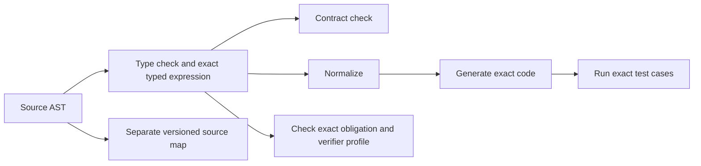

# RT-11 — Invalidate pipeline actions by exact consumed artifacts

## Question and method

Which action results can be retained when a source edit changes its typed tree, its compiled output, or only its presentation? This study models six action classes over a closed expression language. The baseline is `d36444a8aeb3d51b557e250d70f3a805426b6cf1` on `research/all`. [Scope and evidence staleness](../../semantic-representation/RT-06/RT-06-DEPENDENCY-EVIDENCE-CLASSES-2026-11-25.md) · [Scoped fallback](RT-11-SCOPED-UNKNOWN-DEPENDENCY-FALLBACK-2026-11-25.md)

The fixture accepts mathematical integer literals, an integer argument and addition. It uses a structured AST for type checking, normalizes supported sums to an affine pair, and emits an abstract stack-profile artifact. An independent tree interpreter and instruction executor agree on every input in the selected finite domain. The contract check validates a maximum return value, and the finite verification action records the same exact obligation under a separately versioned checker profile. The source map is keyed separately from those six actions.

| Action | Inputs in the candidate key |
|---|---|
| Type checking | Structured source AST and expected interface |
| Contract checking | Exact typed expression, contract and finite-domain profile |
| Optimization | Exact typed expression and optimizer version |
| Code generation | Exact optimized output and target profile |
| Tests | Exact emitted code and test-case fixture |
| Finite verification | Exact typed obligation, domain and verifier profile |



The study compares key equality and artifact equality separately. A key can change even when its action emits identical bytes. When subsequent actions bind to the exact output they consume, that identical output can support reuse along the downstream path.

## Results

| Edit | Action keys that change |
|---|---|
| Formatting only | None of the six. The exact source-map key changes. |
| Replace `x+(1+1)` with `x+2` | Type, contract, optimization and finite verification. The optimized and generated bytes stay the same. |
| Change the result to `x+3` | All six. The upper-bound contract is refuted at input five and both existing tests fail. |
| Change the return bound or finite analysis domain | Contract and finite verification. |
| Change target profile | Code generation and tests. |
| Change test fixture | Tests. |
| Change verifier profile | Finite verification. |

An input edit from `x+(1+1)` to `x+"bad"` keeps the declared interface while invalidating its body. A type cache keyed only by the signature would collide with the earlier success. The typed-input gate rejects the new expression and withholds all five downstream actions. [Exact keys and control records](TYPED-PIPELINE-INVALIDATION-01/evidence.json)

These controls define a candidate distinction between source-provenance staleness, a change in an action's consumed inputs, and equality of its output. An equivalent rewrite can recheck its source and translation obligations while retaining identical compiled and test artifacts in this fixture. A changed contract can still withhold approval or publication of an artifact whose bytes are unchanged. The experiment covers closed integer addition and an abstract target profile. Actual compiler identities, source correspondence, environment and resource inputs, proof issuance and action orchestration remain open. [Incremental analysis tracking](https://github.com/aivibeflow/LLMLang/issues/299)

## Reproduction

Use CPython 3.12.14. The [runner](TYPED-PIPELINE-INVALIDATION-01/run.py) checks all eight edit outcomes, the negative typing control and the tree/instruction correspondence. Hash seeds 1 and 2 produced byte-identical bytes. The diagram was checked as Mermaid source.

```bash
fixture=research/toolchain-and-collaboration/RT-11/TYPED-PIPELINE-INVALIDATION-01
LC_ALL=C PYTHONHASHSEED=1 python3 -B "$fixture/run.py" > /tmp/llmlang-rt11-typed-invalidation.json
cmp "$fixture/evidence.json" /tmp/llmlang-rt11-typed-invalidation.json
```
