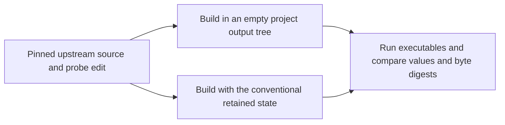
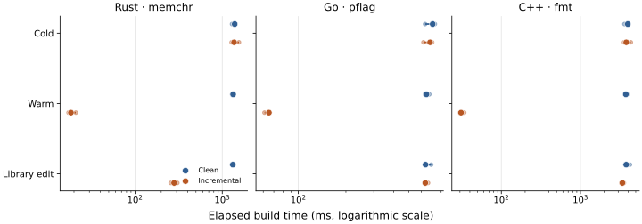

# Conventional clean and incremental builds in three upstream projects

## Workloads and pairing

The experiment supplies clean and ordinary incremental baselines for three upstream libraries. Each pinned archive builds through its normal build system, with a small added consumer that checks one library operation. Cold trials begin without project outputs. A warm trial keeps the previous project build in the incremental route, while the clean route starts in a fresh output tree. An edited trial changes one constant in the library probe and expects a result one greater in both routes. The order of the two methods is randomized within each trial and stage with seed 318.

| Project | Upstream revision | Build recipe and probe |
| --- | --- | --- |
| Rust `memchr` 2.7.4 | `8ad339524d857a2dd9e7231b497ed92aa0f5c334` | Cargo release build with default library features and incremental compilation enabled. The probe finds byte `b` in `abc`. |
| Go `pflag` 1.0.6 | `5ca813443bd2a4d9f46a253ea0407d23b3790713` | Serial `go build` with VCS stamping disabled. The probe sets one named Boolean flag and counts explicitly set flags. |
| C++ `fmt` 11.1.4 | `123913715afeb8a437e6388b4473fcc4753e1c9a` | CMake Release, Unix Makefiles, static library, tests and docs disabled. The probe formats the integer 42 and counts the characters. |



Cargo's registry is prefetched and the timed invocations are offline. Both Go routes receive the same separately built standard-library cache. Only the incremental route has the preceding project entries. The runner excludes CMake configuration, Go cache seeding and copying, environment preparation, and execution of the post-build probe from the elapsed build sample. The clean route controls project reuse while holding tool and prerequisite setup fixed. The host is shared and all measured build commands run serially on one pinned logical CPU.

## Measured results

All 54 executables return the expected value. The SHA-256 digests agree within every one of the 27 clean/incremental pairs. The Go seed contains 73 standard-library packages for the probe. [Raw trials and identities](UPSTREAM-BUILD-BASELINES-01/evidence.json) · [Plot generator](UPSTREAM-BUILD-BASELINES-01/plot.py)



The panels use separate logarithmic scales. Small dots are individual observations and larger dots mark medians.

| Project | Stage | Clean median (ms) | Incremental median (ms) | Paired clean / incremental | Exact byte matches |
| --- | --- | ---: | ---: | ---: | ---: |
| memchr | Cold | 1387.90 | 1364.83 | 1.01 [0.89, 1.02] | 3/3 |
| memchr | Warm | 1332.37 | 18.44 | 70.25 [63.42, 78.69] | 3/3 |
| memchr | Library edit | 1321.59 | 280.92 | 4.70 [4.37, 5.05] | 3/3 |
| pflag | Cold | 707.20 | 681.20 | 1.02 [1.01, 1.07] | 3/3 |
| pflag | Warm | 645.77 | 65.18 | 10.33 [9.62, 10.57] | 3/3 |
| pflag | Library edit | 637.05 | 634.89 | 1.01 [1.00, 1.05] | 3/3 |
| fmt | Cold | 3971.96 | 3797.27 | 1.01 [0.92, 1.05] | 3/3 |
| fmt | Warm | 3750.94 | 30.93 | 120.71 [114.91, 123.47] | 3/3 |
| fmt | Library edit | 3790.91 | 3393.00 | 1.16 [1.04, 1.24] | 3/3 |

Warm conventional builds avoid most of the work in all three fixtures. The effect of a library edit varies. Cargo reuses enough of the same project build to reach a 4.70× paired median. The edited Go build and its clean comparison are near parity, and the edited C++ target still recompiles its formatting source. The cold ratios cluster near one.

These three projects give concrete conventional baselines. They do not exercise LLMLang's proposed cache, remote artifact delivery, a varied project population, library tests, or parallel build policy. Ratios are paired by trial and stage, and each reported range spans three observations.

## Reproduction

Use CPython 3.12.14, Cargo and Rust 1.85.1, Go 1.23.6, CMake 3.31.6, Debian G++ 14.2.0-19, GNU Make 4.4.1 and Matplotlib 3.10.8. The observations use x86-64 Linux 6.18.57, overlayfs and logical CPU 4. Adjust the CPU selection to a permitted CPU on a different host. The ledger records the invoked executable digests and version output. The Rust tool commands in the published run used Rustup shims selecting version 1.85.1.

From the repository root, set up a scratch directory and retrieve the exact archives. The runner checks their SHA-256 digests before extracting them. Use the checked-in Rust lock to populate a scratch Cargo registry.

```sh
set -eu
fixture=research/toolchain-and-collaboration/RT-11/UPSTREAM-BUILD-BASELINES-01
scratch=$(mktemp -d)
trap 'rm -rf "$scratch"' EXIT
mkdir "$scratch/sources" "$scratch/prefetch" "$scratch/cargo-home"
curl -fsSL https://codeload.github.com/BurntSushi/memchr/tar.gz/8ad339524d857a2dd9e7231b497ed92aa0f5c334 \
  -o "$scratch/sources/memchr.tar.gz"
curl -fsSL https://codeload.github.com/spf13/pflag/tar.gz/5ca813443bd2a4d9f46a253ea0407d23b3790713 \
  -o "$scratch/sources/pflag.tar.gz"
curl -fsSL https://codeload.github.com/fmtlib/fmt/tar.gz/123913715afeb8a437e6388b4473fcc4753e1c9a \
  -o "$scratch/sources/fmt.tar.gz"
printf '%s  %s\n' b4e3ce5b8830a5a7ca0c1b41d4962039dd5d4d30491328fe7e5e67020b856c2f \
  "$scratch/sources/memchr.tar.gz" | sha256sum -c -
tar -xzf "$scratch/sources/memchr.tar.gz" --strip-components=1 -C "$scratch/prefetch"
cp "$fixture/memchr-Cargo.lock" "$scratch/prefetch/Cargo.lock"
CARGO_HOME="$scratch/cargo-home" cargo fetch --locked --manifest-path "$scratch/prefetch/Cargo.toml"
taskset -c 4 python3 -B "$fixture/run.py" --trials 3 --seed 318 \
  --sources "$scratch/sources" --cargo-home "$scratch/cargo-home" \
  --cargo "$(command -v cargo)" --go "$(command -v go)" --cmake "$(command -v cmake)" \
  > "$scratch/evidence.json"
MPLCONFIGDIR="$scratch" python3 -B "$fixture/plot.py" \
  --input "$scratch/evidence.json" --output "$scratch/build-times.svg"
```

Use the published evidence as plot input to reproduce the archived figure byte for byte. A fresh run checks the same probe values and produces its own timing samples. The executable digests are an observation of the pinned build configuration.

[PLAN §3.4](../../../PLAN.md#34-quantify-compilation-speedup) · [Issue #318](https://github.com/aivibeflow/LLMLang/issues/318)
