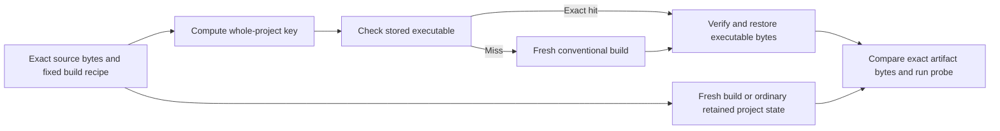
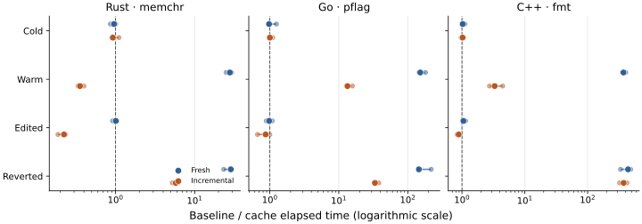

# Whole-project executable cache against conventional build systems

## Workload and cache scope

This study adds a content cache to the pinned `memchr`, `pflag` and `fmt` workload previously measured with clean and ordinary incremental builds. Its key covers the exact relative paths and bytes of all files in the staged source tree, the upstream archive, the selected tool executables and versions, and the build recipe and fixed environment settings. The cache is in process and stores one complete linked executable per key. Its hit path rehashes the source tree, checks the stored executable digest, writes the output file and sets its executable mode. A miss runs the project's ordinary toolchain in a fresh build directory and publishes the executable to memory. [Pinned upstream workload and prerequisites](RT-11-UPSTREAM-BUILD-BASELINES-2026-11-25.md)



A trial runs cold, warm, edited and reverted stages. The edit changes one library probe constant and the revert restores its exact original file. Each method has its own output directory and sees the same source state. The runner times setup and build or cache restoration, including CMake configuration and the copy of Go's standard-library seed when a fresh directory needs preparation. Computing the tool manifest, seeding the Go standard-library cache, editing sources and running the post-build checks are outside the measured interval. The established compiler, language, standard-library and host dependencies are held fixed within each trial. The experiment exercises no cross-host transfer, general path-sensitive input discovery or parallel scheduling.

## Results

All 108 post-build executions return the expected result. The clean, incremental and cached executables match byte for byte in all 36 project/stage blocks. The cache hits in all 18 warm and reverted runs and misses on every cold and edited run. The input manifests hash 170 staged files for memchr, 78 for pflag and 133 for fmt. [Raw trials and exact subjects](UPSTREAM-CONTENT-CACHE-01/evidence.json) · [Plot generator](UPSTREAM-CONTENT-CACHE-01/plot.py)



The panels use separate logarithmic scales. The dashed line marks equal elapsed time. Larger dots mark medians and lines span the observations.

| Project | Stage | Cache hits | Cache median (ms) | Fresh / cache median [min, max] | Incremental / cache median [min, max] |
| --- | --- | ---: | ---: | ---: | ---: |
| memchr | Cold | 0/3 | 1420.562 | 0.957 [0.863, 1.007] | 0.927 [0.900, 1.107] |
| memchr | Warm | 3/3 | 47.711 | 27.788 [24.959, 29.258] | 0.356 [0.336, 0.401] |
| memchr | Edited | 0/3 | 1351.462 | 1.008 [0.919, 1.044] | 0.224 [0.188, 0.235] |
| memchr | Reverted | 3/3 | 46.426 | 28.549 [23.271, 29.062] | 5.777 [5.217, 6.150] |
| pflag | Cold | 0/3 | 757.378 | 0.974 [0.971, 1.246] | 1.002 [0.990, 1.102] |
| pflag | Warm | 3/3 | 5.023 | 151.875 [146.329, 180.631] | 13.379 [12.843, 15.768] |
| pflag | Edited | 0/3 | 755.958 | 0.977 [0.889, 1.084] | 0.869 [0.662, 1.001] |
| pflag | Reverted | 3/3 | 4.911 | 144.934 [142.697, 218.204] | 33.447 [32.896, 38.031] |
| fmt | Cold | 0/3 | 4042.671 | 1.026 [1.003, 1.115] | 1.022 [0.969, 1.057] |
| fmt | Warm | 3/3 | 11.055 | 371.429 [361.962, 404.053] | 3.310 [2.738, 4.443] |
| fmt | Edited | 0/3 | 3844.011 | 1.053 [1.041, 1.143] | 0.886 [0.832, 0.931] |
| fmt | Reverted | 3/3 | 8.895 | 440.238 [334.372, 483.682] | 374.344 [322.233, 424.195] |

Warm Cargo is faster than the whole-project memchr cache in all three trials, including cache hits. It retains finer-grained local build state while the executable cache rereads its staged sources and restores the artifact. An edited cache miss rebuilds from an empty project output tree. It loses to ordinary incremental builds in every memchr and fmt edit trial. Across all three projects, restoring the original source revives its original cache key and produces the same observable result and executable bytes.

Each ratio compares one measured baseline with the paired cache run. Values below one mean the baseline completed sooner for that pair. Timing observations apply to this closed setup, three fixed projects, one shared host and a serial build. The experiment does not measure LLMLang compilation, remote storage, cache persistence, or broad workload representativeness.

## Reproduction

Prepare the three exact source archives and the offline Cargo registry using the preceding workload's documented setup. Use CPython 3.12.14, Cargo and Rust 1.85.1, Go 1.23.6, CMake 3.31.6, Debian G++ 14.2.0-19, GNU Make 4.4.1 and Matplotlib 3.10.8. The measured host used Linux 6.18.57 on x86-64 and one logical CPU. Set the variables below to the absolute source archive directory, Cargo registry and tool paths. [Upstream source preparation](RT-11-UPSTREAM-BUILD-BASELINES-2026-11-25.md#reproduction)

```sh
set -eu
fixture=research/toolchain-and-collaboration/RT-11/UPSTREAM-CONTENT-CACHE-01
scratch=$(mktemp -d)
trap 'rm -rf "$scratch"' EXIT
taskset -c 4 python3 -B "$fixture/run.py" --trials 3 --seed 318 \
  --sources "$SOURCE_ARCHIVES" --cargo-home "$CARGO_REGISTRY" \
  --cargo "$CARGO" --go "$GO" --cmake "$CMAKE" > "$scratch/evidence.json"
MPLCONFIGDIR="$scratch" python3 -B "$fixture/plot.py" \
  --input "$scratch/evidence.json" --output "$scratch/speedups.svg"
```

Use the published evidence as plot input to regenerate its figure. A fresh run must pass the exact output and hit checks and produces its own time samples.

[PLAN §3.4](../../../PLAN.md#34-quantify-compilation-speedup) · [Issue #318](https://github.com/aivibeflow/LLMLang/issues/318)
