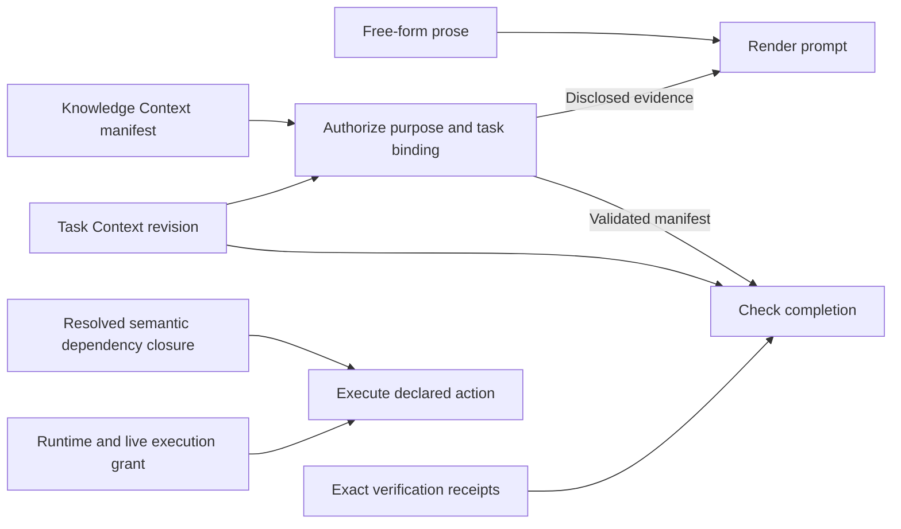

# RT-14 Knowledge Context consumer boundaries

[LL-026 / #339](https://github.com/aivibeflow/LLMLang/issues/339)

A request can contain prose and a typed purpose. The former guides the agent. The latter identifies the exact evidence required under a read policy for the request. The Knowledge Context manifest binds references that policy permits the agent to see. Program execution consumes a resolved dependency closure and a separately authorized runtime binding. Task Context supplies the active work revision and its verification obligations. Each consumer validates its relevant input and may refuse fairly different changes.



The graph shows the prototype's validation inputs. In particular, the prompt renderer consumes disclosed evidence after the read check. Runtime execution in this fixture is a separate, predeclared operation. Actions that depend on a task or prompt would declare those inputs on their own contract.

| Record | Information it owns in the model |
| --- | --- |
| Free-form prompt text | Agent-facing discussion and instructions as data. |
| Knowledge Context | Purpose, pinned snapshot, selected evidence and provenance. |
| Semantic dependency closure | Required program inputs and dependencies for the exact action. |
| Runtime context | Tool and execution grant for the specified host action. |
| Task Context | Baseline, active task revision, pinned Knowledge Context and receipts required for completion. |

## Observations

The fixture reuses the pinned Knowledge Context assembler and Task Context completion gates. It checks 256 combinations of eight mutations and compares three consumers against explicit outcomes. Across 128 prose-only pairs, the prompt bytes change and all three gate decisions stay the same. Thirty-two reads disclose exact evidence. In the remaining 224, the prompt contains only the supplied prose. The equal-rendered-text alternate Knowledge Context has a different manifest identity and is refused by the old task. Sixteen of the admitted reads can settle the active task. The other sixteen carry superseded receipts.

Thirty-two native CPython subprocesses executed the predeclared calculation under the named matching runtime and full dependency tuple. An omitted dependency refused 128 cases. A changed runtime or expired execution grant refused a further 96. Task completion and execution can each proceed while the other's conditions do not hold. This is the intended separation for the fixture's independent operation and completion receipts.

A single record holding arbitrary prose and all capabilities would obscure which producer owns each fact. The fixture tests explicit consumer contracts with a closed example and a simulated live-grant check. The accepted Python invocation is fixed and takes no prompt input. The experiment establishes neither host sandboxing, automatic dependency closure extraction, agent behavior in response to misleading prose, nor the authority to publish a result.

## Reproduce

Run with CPython 3.12 from the repository root. The verifier checks the three reused implementation blobs against their recorded supporting revision. [Executable fixture](CONTEXT-BOUNDARIES-01/run.py) · [Evidence](CONTEXT-BOUNDARIES-01/evidence.json)

```sh
python -B research/toolchain-and-collaboration/RT-14/CONTEXT-BOUNDARIES-01/run.py /tmp/rt14-boundaries-replay.json
cmp /tmp/rt14-boundaries-replay.json research/toolchain-and-collaboration/RT-14/CONTEXT-BOUNDARIES-01/evidence.json
```
