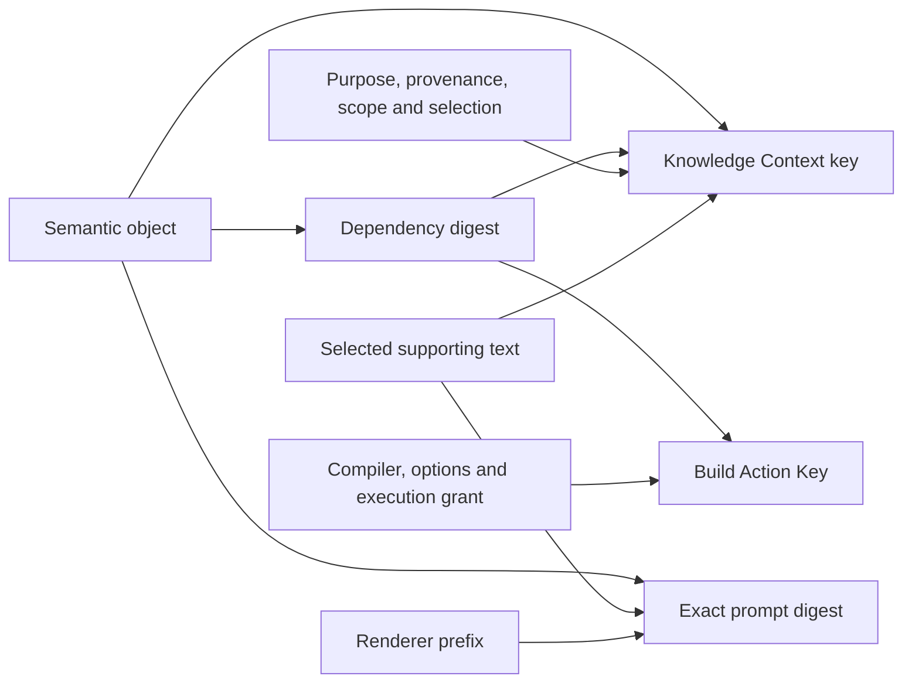

# RT-14 Knowledge Context identity and reuse

[LL-026 / #339](https://github.com/aivibeflow/LLMLang/issues/339)

A Knowledge Context manifest binds a declared purpose, recipient, authority revision, snapshot, selection rule, approved source provenance, required object and closure references, and selected supporting content. Its identity permits exact manifest reuse under current authorization. The references in the manifest retain their own identities, and the serializer emits the exact bytes passed to the prompt consumer.

| Identity | Inputs checked in this fixture | Reuse decision |
| --- | --- | --- |
| Semantic object | Typed object kind and canonical definition | Equal identity identifies the same definition. |
| Dependency closure | Exact object and required dependency | Equal identity identifies the same recorded closure. |
| Knowledge Context | Snapshot, purpose, recipient, read grant revision, selection rule, evidence provenance, required object and closure, supporting content | Equal identity and a currently authorized read permit reuse of the previously assembled manifest. |
| Rendered prompt | Exact UTF-8 bytes | Equal bytes and a current disclosure decision permit reuse of those bytes. The authorization check pertains to the current request and its current evidence. |
| Build Action Key | Exact dependency closure, compiler, build options, execution grant revision | Equal key and current execution authority permit use of the recorded result under the fixture's deterministic action contract. |

Snapshot/supporting-evidence changes and evidence approval changes invalidate the manifest. Some leave the rendered bytes identical. A prefix change can alter the prompt without changing the manifest. A build dependency can change while the displayed object and optional explanation stay the same. A build-only tool or option change does not change the manifest or prompt. In this study the build action consumes the dependency closure and explicit build inputs. An action that consumes a prompt or context manifest needs the identity of its actual inputs in its action contract.



The arrows show inputs to the fixture's five keys. The live disclosure and execution gates apply when the consumer attempts reuse.

## Observations

The checker compares 8,192 combinations of 13 single-field transitions to a separate expected invalidation table. It repeats the reuse decisions under all four read/build authority combinations, for 32,768 combined states. Every key comparison and authorization decision matched. Substituting prompt equality for manifest equality would incorrectly reuse the manifest in 1,016 combinations. Substituting manifest equality for prompt equality would reuse stale rendered bytes in eight. Substituting dependency closure equality for Action Key equality would incorrectly reuse a build in 1,792 combinations. Matching keys with revoked read or execution authority were refused by the corresponding gate.

Absolute key layouts and conservative invalidations in this fixture are research choices. The authority flags model the outcome of a trusted live check. No remote authorization, actual build cache, action replay or nondeterministic model call was exercised. Reusing a result of a nondeterministic action requires its separately established replay and acceptance rules. The receipt for rendered bytes alone conveys no authority to disclose those bytes or to treat their contents as current evidence. [Source trust and completeness](RT-14-SOURCE-TRUST-2026-11-25.md)

## Reproduce

Run with CPython 3.12 from the repository root. [Model](CONTEXT-IDENTITY-01/run.py) · [Recorded decision matrix](CONTEXT-IDENTITY-01/evidence.json)

```sh
python -B research/toolchain-and-collaboration/RT-14/CONTEXT-IDENTITY-01/run.py /tmp/rt14-identity-replay.json
cmp /tmp/rt14-identity-replay.json research/toolchain-and-collaboration/RT-14/CONTEXT-IDENTITY-01/evidence.json
```
