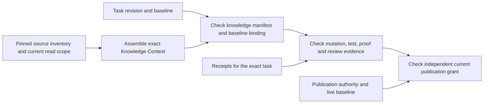

# RT-14 Joint Knowledge Context and Task Context validation

**Issue** [#341](https://github.com/aivibeflow/LLMLang/issues/341)

Knowledge Context records the information assembled for a task. Task Context records intended work and completion obligations. A coherent Toolchain workflow must connect the same baseline, task revision and knowledge manifest while preserving the separate authority of each record. This experiment composes the existing assembly and completion models for a quota-review fixture. [Knowledge Context assembly](RT-14-KNOWLEDGE-CONTEXT-ASSEMBLY-2026-11-25.md) · [Task Context completion](RT-14-TASK-CONTEXT-COMPLETION-2026-11-25.md)

## Joint validation boundary

The knowledge assembler gets the snapshot, exact required references, read scope and budget independently. It returns a manifest with provenance, omissions, the scope revision and pinned contents, or it refuses an incomplete context. The task binding carries the baseline, candidate, task revision, knowledge manifest digest and evidence policy. Before validating task obligations, the coordinator compares the knowledge snapshot with the task baseline and the exact reassembled manifest with the task's pinned digest.

Mutation, test, proof and review records bind the task revision and its context. Refreshing a required context does not transfer evidence from the previous task revision without checking its applicability. The fixture uses fresh evidence for a new exact binding, and a separate current publication grant after completion. The task does not grant authority to read a source or publish a change. The knowledge manifest also does not authorize edits. A rendered-prompt identity is useful for byte reproduction, while manifest identity includes access scope and evidence provenance that the rendering may omit.



The candidate flow preserves responsibility boundaries from the [Development Engine](RFC-DEVELOPMENT-ENGINE.md). The fixture uses supplied evidence and authority labels. It exercises neither live agent performance nor authenticated publication.

## Results

The runner evaluates fourteen joint controls. The [ledger](CONTEXT-INTEGRATION-01/evidence.json) preserves the task bindings, selected knowledge facts, evidence rows, grant fields and decisions. Six source orders and 24 evidence orders reproduce the same original combined outcome, for 144 equivalent permutations.

| Control | Observed result |
| --- | --- |
| Exact original context, task and evidence | Completes and separately passes the grant check. |
| Same prompt bytes after scope renewal or provenance change | Both manifests change, so both old-task bindings are refused. |
| Tighter budget omits the optional note | The context can still assemble but cannot satisfy the previous task binding. |
| Required source missing, denied or digest-mismatched | Refuses before task evidence evaluation. Missing and denied have the same public unavailable status in this fixture. |
| Task refreshed to the new manifest | Previous receipts leave obligations unsatisfied. Fresh exact receipts complete the new revision. |
| Exact completion with no grant or revoked grant | Completion remains valid, and publication is refused. |
| Knowledge from another baseline, moved workspace or out-of-scope mutation | Refuses completion. |

The equal-prompt controls show why a byte-identical rendering alone would permit two invalid reuses. Explicit manifest selection allows a refreshed context to be reviewed independently without weakening the old task. The ledger records four completions and two allowed publication decisions. It performs no publication and includes no time or usability measurements.

Joint integration beyond this fixture still needs independently established required-source completeness, authorization and isolation for reading, exact workspace and Git coordination, evidence acquisition, recovery of concurrent changes and controlled task trials. Any production deployment must specify the policy for harmless scope changes and reusing evidence across task revisions. [Toolchain service and Change Sets](../RT-19/RT-19-TOOLCHAIN-SERVER-AND-SEMANTIC-DEVELOPMENT-API.md) · [Task settlement experiments](RT-14-TASK-CONTEXT-SQLITE-2026-11-25.md)

## Reproduction

Use CPython 3.12.14 and Git from the repository root. The runner pins the two reused models at `971f11e4f6e05bffbbb814062f16e7ecd1e30990`. Runs with hash seeds 1 and 2 produce byte-identical ledgers. Relative links and Mermaid source structure were checked. GitHub visual rendering was not manually verified.

```sh
study=research/toolchain-and-collaboration/RT-14/CONTEXT-INTEGRATION-01
PYTHONHASHSEED=1 python -B "$study/run.py" >/tmp/llmlang-context-integration.json
cmp "$study/evidence.json" /tmp/llmlang-context-integration.json
```
