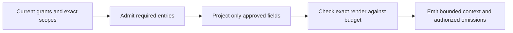

# RT-14 permission-aware context selection and minimization

A context assembler should authorize entries, project only approved fields, and then budget the rendered output. A missing mandatory permission leaves the whole requested context unavailable. An omission report can name authorized items excluded for budget without listing entries the reader cannot access.

## Candidate pipeline

| Step | Checked rule |
| --- | --- |
| Current authorization | Check the grant epoch and required scopes before assembly. |
| Field projection | Use approved excerpts and stable keys. Exclude private fixture fields before rendering. |
| Mandatory coverage | If a mandatory scope is absent, return unavailable. If its approved projection exceeds the budget, return over-budget. |
| Optional selection | Sort by declared priority with stable ties, then include authorized entries that fit the exact rendered budget. |
| Omission report | List authorized optional entries skipped for budget. Denied entries are absent from the rendered body and report. |



The fixture budgets UTF-8 bytes in a fixed JSON projection. The companion study checks the exact tokenizer and compares deterministic greedy versus exhaustive relevance choices. Production framing and a real task relevance model are separate requirements. [Pinned tokenizer study](RT-14-CONTEXT-TOKENS-2026-11-25.md) · [Live permission and pagination](RT-14-KNOWLEDGE-CONTEXT-PAGES-2026-11-25.md)

## Results

Across 504 rendering decisions over seven budgets and all entry orders, 96 return a bounded context, 72 refuse over-budget mandatory content and 336 return unavailable. The 1,512 synthetic private-field checks detect no private material in responses or omission reports. Rotation of hidden fixture fields leaves the full authorized projection unchanged. Every successful context accounts for all authorized entries through selection or a budget omission.

The fixture assumes excerpts have already been approved and classified. It provides no detection guarantee for secrets embedded in arbitrary approved text, side channels, concurrent grant changes or application-specific authority. Real tokenizer framing and relevance or recall from actual tasks remain open.

## Reproduce

Use CPython 3.12.14. Python hash seeds 37 and 71 produce evidence SHA-256 `7a0127a47573dfc911b31013a0249948de10e0f2f45933b18fe6b6a87e8982d5`. [Evidence ledger](CONTEXT-MINIMIZATION-01/evidence.json)

```sh
LC_ALL=C PYTHONHASHSEED=37 PYTHONDONTWRITEBYTECODE=1 \
  python research/toolchain-and-collaboration/RT-14/CONTEXT-MINIMIZATION-01/check.py > /tmp/rt14-context-minimization.json
```
