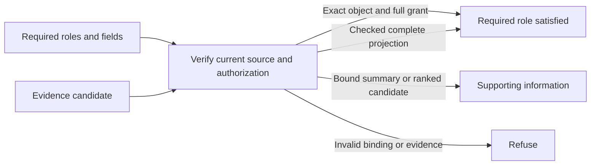

# RT-14 Knowledge Context evidence forms

[LL-026 / #339](https://github.com/aivibeflow/LLMLang/issues/339)

For a declared purpose, Knowledge Context records the required source roles and fields before retrieval. An exact reference satisfies a role when it resolves to the expected canonical object at the requested snapshot and the reader may access that object. A field excerpt can satisfy the role when the reader may see that approved projection and an authoritative check binds the original object digest, snapshot, purpose, reader, role, field list, and exact projected values. A summary or ranked candidate retains its source reference and may accompany that evidence. Its presence does not satisfy a required role.

The model uses two synthetic revisions, two purposes, and two roles. Call validation requires contract precondition and error plus test assertion and edge case. Recovery audit requires contract error and effects plus test edge case and settlement. The same object can therefore supply different minimum views. A projection grant permits the approved field tuple, and a full grant also permits the original. The selection policy reports completeness only when every required role is satisfied.



The form-specific checks run after the shared source and authorization checks. A task counts only the required-role outcomes toward purpose completeness.

## Observations

The executable model compared four forms under nine mutations or controls and three grant levels. All 864 classifications matched a separate expected-outcome table.

| Form | Satisfies required role | Supporting only | Refused |
| --- | ---: | ---: | ---: |
| Exact object | 24 | 0 | 192 |
| Checked field excerpt | 16 | 0 | 200 |
| Summary | 0 | 80 | 136 |
| Ranked candidate | 0 | 80 | 136 |

The two mutations specific to projection checks leave original objects and suggestions untouched. A current excerpt with a rehashed but incomplete or modified field tuple still fails, including when the receipt has the correct snapshot and purpose. A permitted exact object plus a permitted checked excerpt completes this fixture. Exact-plus-summary and excerpt-plus-ranked leave a role unsatisfied. The same summary text occurs at both revisions despite different contract digests. A baseline admitting every supplied required-role candidate produces 824 false mandatory decisions. Checking source and request bindings and grant first reduces that count to 240, which still includes incomplete projections and contextual suggestions.

The fixture compares canonical, typed values and checks against a trusted in-process source. A deployed reader still needs authenticated projection authority, a field disclosure policy, and source observations as defined by the production protocol. The fixture does not measure ranking quality, agent outcomes, or the completeness of any real task's requirements. The earlier token-budget fixture checks how an approved view fits into the exact rendered prompt. [Token-budget evidence](RT-14-CONTEXT-TOKENS-2026-11-25.md)

## Reproduce

Run from the repository root with CPython 3.12. The script uses the standard library. [Executable model](CONTEXT-PROJECTIONS-01/run.py) · [Recorded evidence](CONTEXT-PROJECTIONS-01/evidence.json)

```sh
python -B research/toolchain-and-collaboration/RT-14/CONTEXT-PROJECTIONS-01/run.py /tmp/rt14-projections.json
cmp /tmp/rt14-projections.json research/toolchain-and-collaboration/RT-14/CONTEXT-PROJECTIONS-01/evidence.json
```
