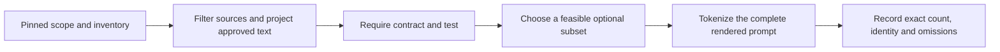

# RT-14. Exact token budgets for a Knowledge Context

Can a context assembler preserve mandatory evidence, honor the tokenizer budget and choose useful optional material after projecting what the caller can see? This experiment compares additive greedy counting, greedy selection with exact full-prompt counts and exhaustive selection over five optional sources. It uses four synthetic topics, including Cyrillic and Japanese content, and a pinned `cl100k_base` encoder. [Issue #339](https://github.com/aivibeflow/LLMLang/issues/339) · [Byte-budget assembly](RT-14-KNOWLEDGE-CONTEXT-ASSEMBLY-2026-11-25.md)

The fixture requires a contract and test from the current scope. It excludes denied and stale sources before counting or ranking and replaces one permitted redacted source with an explicitly approved excerpt. The deterministic renderer sorts entries and includes their labels and delimiters. Exhaustive selection maximizes predeclared optional utility, then item count, then resolves ties by names. It always checks the complete rendered byte sequence with the tokenizer. Every successful context records the renderer, encoder vocabulary hash, exact prompt digest, budget, a fixed eight-token reserve, selected projection digests and applicable omission reasons. The approved-excerpt receipt carries the excerpt digest without a digest of the original text.



## Results

The fixture uses 13 budgets for each of four topics. It assembles 48 contexts, and four budgets cannot fit mandatory evidence. Six shuffled input orders per case produce identical decisions and receipts in all 312 checks. Denied, stale and conflicting mandatory sources fail before assembly. [Token and receipt ledger](CONTEXT-TOKENS-01/evidence.json)

| Selection comparison | Observed count |
| --- | ---: |
| Exact greedy selects less optional utility than exhaustive selection | 8 of 48 |
| Additive greedy selects less optional utility than exhaustive selection | 28 of 48 |
| Additive counts differ on the exact selections | 48 of 48 |
| Additive greedy exceeds the final budget with the delimited renderer | 0 of 48 |

The additive estimate is one to six tokens larger than the exact count on the selected delimited contexts. An undelimited control shows that counts can differ in either direction. The independent counts of `evidence` and `test` sum to three tokens, while `evidencetest` uses four. The independent counts of `scope:` and `test` also sum to three, while `scope:test` uses two. For the 63-token quota case, the exhaustive selection has optional utility 25 and exact greedy chooses 12. The weights are fixture inputs.

This study counts the exact rendered text under one pinned encoder. The eight-token reserve is a fixture budget. Live provider framing, tool-schema charges, production relevance labels, general-purpose redaction and scalability beyond five optional items remain open.

## Replay

Source baseline `51a3f0e` on `research/all`. Replay used CPython 3.12.14 and tiktoken 0.12.0. The Linux x86-64 CPython 3.12 wheel has SHA-256 `edde1ec917dfd21c1f2f8046b86348b0f54a2c0547f68149d8600859598769ad`. The vocabulary bytes below are available in the pinned Rust crate and match the expected digest in the Python release. [Python package](https://pypi.org/project/tiktoken/0.12.0/) · [Vocabulary archive](https://static.crates.io/crates/tiktoken-rs/tiktoken-rs-0.7.0.crate)

```sh
data=research/toolchain-and-collaboration/RT-14/CONTEXT-TOKENS-01
scratch=$(mktemp -d)
mkdir "$scratch/wheels" "$scratch/site" "$scratch/cache"
python -m pip download --no-deps --only-binary=:all: -d "$scratch/wheels" tiktoken==0.12.0
wheel="$scratch/wheels/tiktoken-0.12.0-cp312-cp312-manylinux_2_28_x86_64.whl"
printf '%s  %s\n' edde1ec917dfd21c1f2f8046b86348b0f54a2c0547f68149d8600859598769ad "$wheel" | sha256sum -c
python -m pip install --no-deps --no-compile --target "$scratch/site" "$wheel"
curl -fsSL https://static.crates.io/crates/tiktoken-rs/tiktoken-rs-0.7.0.crate -o "$scratch/encoding.crate"
encoding="$scratch/cache/9b5ad71b2ce5302211f9c61530b329a4922fc6a4"
tar xOzf "$scratch/encoding.crate" tiktoken-rs-0.7.0/assets/cl100k_base.tiktoken > "$encoding"
printf '%s  %s\n' 223921b76ee99bde995b7ff738513eef100fb51d18c93597a113bcffe865b2a7 "$encoding" | sha256sum -c
PYTHONPATH="$scratch/site" TIKTOKEN_CACHE_DIR="$scratch/cache" \
  python -B "$data/run.py" "$scratch/evidence.json" --encoding-file "$encoding"
cmp "$data/evidence.json" "$scratch/evidence.json"
```
