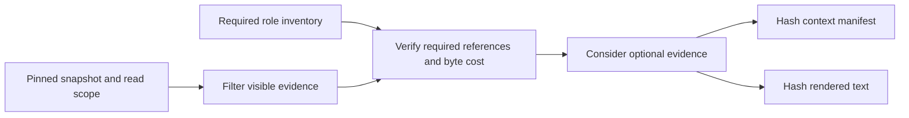

# RT-14 — Revision-bound Knowledge Context assembly

- **Date** — 2026-11-25
- **Tracking** — [PLAN §7.8](../../../PLAN.md#78-knowledge-context-and-task-context-rt-14) · [#339](https://github.com/aivibeflow/LLMLang/issues/339)
- **Status** — Reproduced for a finite evidence inventory

## Question and assumptions

Can a bounded prompt attest that an agent received the evidence required for a declared task? The fixture models one quota review. A contract and a test are mandatory. A design note is optional. The experiment supplies an external inventory of required roles and their exact references, a pinned snapshot, a precomputed source-read scope and a budget. Each reference binds an occurrence identifier and the digest of its actual text. Budget costs use UTF-8 bytes and one newline per entry, with no tokenization or summarization. [Request Change design](RFC-REQUEST-CHANGE.md)

The relevance policy sorts visible records by rank and greedily fills the budget. The exact policy validates mandatory records under the declared snapshot and read scope before considering any optional material. It rejects missing, conflicting, changed-byte or collectively over-budget mandatory inputs. Optional ambiguity and exhaustion produce omission reasons. The resulting manifest binds scope revision, snapshot, purpose, budget, role references and omissions. The rendered prompt has a separate digest.



## Observations

Each policy was checked across every distinct arrival order for 15 inventories, for 164 orderings per policy. Exact selection reports ready in nine inventories and refuses six. For the six refusal cases, missing, inaccessible and stale-only evidence are unavailable, incompatible claimed contract references conflict, a changed test fails the byte check and a 22-byte budget cannot contain both mandatory records.

| Control | Relevance policy | Exact policy |
|---|---|---|
| Complete inventory with 23-byte limit | Takes a higher-ranked optional note and omits the mandatory test | Keeps both mandatory records and reports the optional omission |
| Two visible conflicting contract records | Feeds both versions | Refuses the required conflict |
| Required duplicate and fresh-plus-stale input | Can feed redundant or stale records | Produces the same manifest as the complete baseline |
| New scope revision or equal text from a different optional source | Produces equal prompt text | Produces equal prompt bytes and a different manifest |
| One optional role with two visible sources | Feeds both when they fit | Reports ambiguity and keeps the required evidence |
| Missing versus inaccessible required source | Produces a partial prompt | Returns the same unavailable status for both |

Relevance selection produces a prompt lacking at least one exact required record in six inventories. This set differs from the exact policy's refusal set. Relevance fails one feasible mixed-priority case, while the exact policy detects the conflicting mandatory case even though the expected references are present. An unauthorized conflicting source has no effect on the chosen text after visibility filtering. Input arrival order changes neither policy's results. [Evidence ledger](KNOWLEDGE-CONTEXT-01/evidence.json)

## Boundaries

For this profile, declare mandatory evidence before ranking and expose omissions when a successful prompt lacks optional material. A rendered prompt digest alone loses source and scope distinctions. Successful assembly attests the supplied inventory, snapshot and visible scope. Determining whether that inventory is complete for a real task requires an independent producer and review. Candidate omissions do not prove the absence of hidden sources. Token budgets, concurrent scope changes, source provenance validation, summaries and measured agent outcomes remain open.

## Reproduction

Run from the repository root with CPython 3.12.14. The runner enumerates the inventories and writes a deterministic receipt. [Runner](KNOWLEDGE-CONTEXT-01/run.py)

```sh
set -eu
dir=research/toolchain-and-collaboration/RT-14/KNOWLEDGE-CONTEXT-01
observed=$(mktemp)
trap 'rm -f "$observed"' EXIT
python3 -B "$dir/run.py" > "$observed"
cmp "$dir/evidence.json" "$observed"
```
