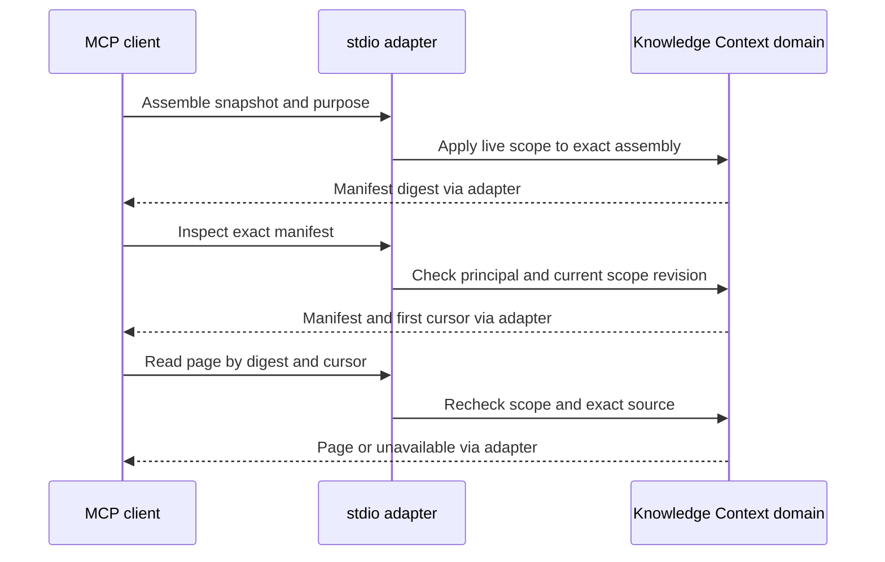

# RT-14 Knowledge Context over RT-19 MCP stdio

[LL-026 / #339](https://github.com/aivibeflow/LLMLang/issues/339)

The candidate API separates assembly, inspection, and retrieval. The existing domain model owns the manifest and authorization decisions. A transport adapter binds the current principal and obtains a live scope from the host. The caller supplies the desired snapshot and purpose, the resulting manifest digest, or a cursor linked to that digest. Direct Python, JSON serialization, and MCP stdio can carry the same decisions.

| Operation | Request | Successful result |
| --- | --- | --- |
| `assemble_context` | Exact snapshot and declared purpose | Manifest digest after checking source availability and current scope. |
| `inspect_context` | Exact manifest digest | Versioned read-scoped manifest and first session cursor. |
| `read_context_page` | Exact manifest digest and session cursor | One exact reference and its bytes as text. The final page includes the SHA-256 of the complete rendering. |



Successful and unavailable domain decisions use MCP structured content plus equivalent JSON text for clients following the fallback. The recorded public schemas describe the wire structure, and the domain enforces exact snapshot, role, digest, principal and scope revision semantics. An invalid wire shape uses a tool error. A valid request lacking live authority or a matching record returns `unavailable` without an entry or a final digest. Inspection reports a recorded manifest under the current scope. Reading rechecks the source blob, so inspection alone cannot promise that every page is available.

## Observations

A real MCP SDK client drove ten separate local stdio server processes using negotiated protocol `2025-11-25`. All opened/fresh inspections and 30 page positions matched the pinned direct model after normalizing random cursor values to presence. Fourteen page positions disclosed entries. The unchanged case and the new-snapshot case that retained the original version completed all three pages. Removing the source, retaining only a different revision, or changing source bytes each prevented completion. Both revocations and an equivalent scope rotation stopped the old cursor.

The changed requester, unknown cursor, wrong manifest, and nine transfers of a previously valid cursor between sessions were refused. Both output representations matched for every domain response. In each session the schema also refused a client-supplied actor and the implementation refused assembly with a different snapshot or purpose. A fresh assembly of the fixed fixture was unavailable after either revocation, scope rotation, principal change, or loss of authoritative source bytes.

The SDK's scope is one local protocol version and one synthetic reader per child process. The parent changes fixture observations between calls and the client has no tool for changing them. Random in-memory cursors are local to each process and the reported replay omits their values. Production identity binding, cursors for several concurrent manifests, expiry/storage, and atomic coordination between policy updates and response delivery require separate checks. [Earlier direct and JSON replay](RT-14-KNOWLEDGE-CONTEXT-PAGES-2026-11-25.md) · [RT-19 workspace MCP replay](../RT-19/RT-19-MCP-STDIO-SCHEMA-INTEROPERABILITY-2026-11-24.md)

## Reproduce

Run from the repository root with CPython 3.12.14 and MCP 1.29.0, AnyIO 4.14.2, jsonschema 4.26.0, and Pydantic 2.13.4. The checker verifies the two exact reference artifacts before launching the adapter. [Server](KNOWLEDGE-CONTEXT-MCP-01/server.py) · [Replay client](KNOWLEDGE-CONTEXT-MCP-01/verify.py) · [Evidence](KNOWLEDGE-CONTEXT-MCP-01/evidence.json)

```sh
python -B research/toolchain-and-collaboration/RT-14/KNOWLEDGE-CONTEXT-MCP-01/verify.py /tmp/rt14-mcp-replay.json
cmp /tmp/rt14-mcp-replay.json research/toolchain-and-collaboration/RT-14/KNOWLEDGE-CONTEXT-MCP-01/evidence.json
```
