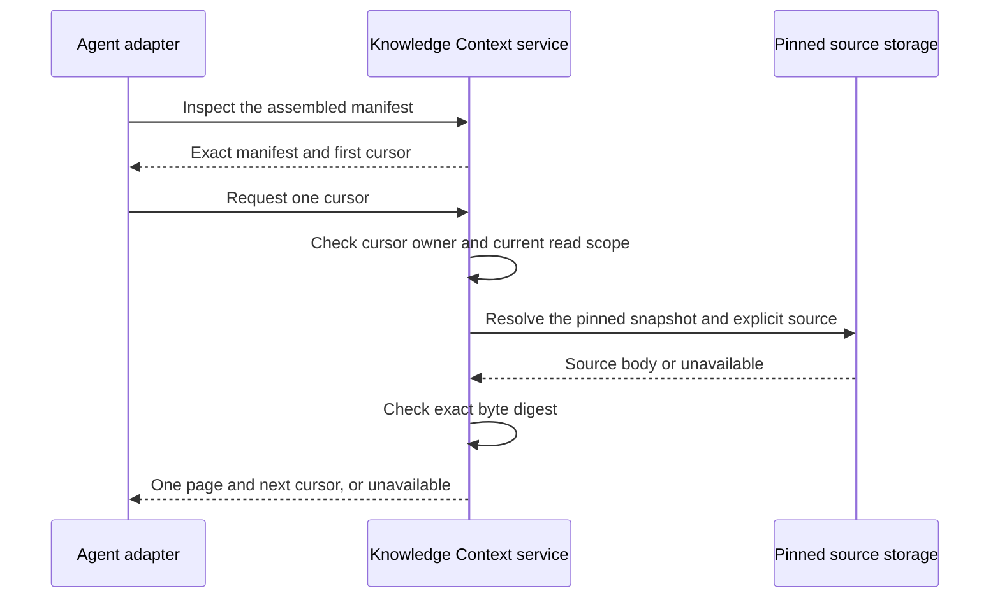

# RT-14 Snapshot-pinned Knowledge Context retrieval

**Issue** [#339](https://github.com/aivibeflow/LLMLang/issues/339)

An agent may read a Knowledge Context incrementally after assembly fixes its source references and read scope. The server needs to preserve the exact bytes while handling permission changes and lost source revisions between pages. This experiment defines a transport-neutral read API for one assembled quota-review context and compares three permission policies. It extends the [exact assembly study](RT-14-KNOWLEDGE-CONTEXT-ASSEMBLY-2026-11-25.md).

## Candidate API and trust inputs

Assembly returns an exact manifest or a refusal using the prior immutable input inventory. The experiment adds two read operations.

- `inspect()` returns the manifest, its digest and the first cursor for the assembled view. It does not return source bodies or promise that stored bytes remain available.
- `page(cursor)` returns one declared role, its pinned reference, source text and the next cursor. The final page includes the expected aggregate text digest. The consumer can verify that the bytes it collected reproduce that digest.

The caller identity and current scope come from a trusted runtime input, separate from query JSON. Each cursor is registered for one manifest, principal, role order and position. Repeating the same authorized cursor under unchanged conditions gives the same page. Its content is read from the pinned snapshot and checked against the recorded byte digest. The fixture's generic unavailable response covers an unknown cursor, another caller, missing bytes, changed bytes or a failed permission check. The model uses a server-local cursor table and fixes the role order to contract, test and optional note. It does not implement authentication or persistent cursor issuance.

The comparison varies only how current authorization is checked. An assembly-grant policy retains the initial grant for the authorized principal. A live-page policy verifies each page's current read permission before returning it. Inspection under live-page checks all listed references. The exact-scope policy additionally requires the same grant revision as assembly. The last policy gives a single scope for the assembled transcript and can require reassembly even where a renewed scope contains all the same rights.



The illustrative sequence depicts the proposed live read boundary. The same operations and result structures can be carried by a local adapter or by JSON. The test compares direct calls and JSON serialization in process. It does not run an MCP server or a network transport.

## Results

The runner compares three policies in ten schedules, with identical results across direct and JSON-serialized calls. Each schedule delivers the first page before its named control. The [ledger](KNOWLEDGE-CONTEXT-PAGES-01/evidence.json) preserves exact source and manifest records, cursor decisions and whether the aggregate could be verified.

| Change after the first page | Assembly grant | Live page | Exact scope |
| --- | ---: | ---: | ---: |
| No change, or a new snapshot that retains the pinned bytes | 3 of 3 | 3 of 3 | 3 of 3 |
| Revoke only the optional note | 3 of 3 | 2 of 3 | 1 of 3 |
| Revoke the mandatory test | 3 of 3 | 1 of 3 | 1 of 3 |
| Rotate to an equivalent read scope | 3 of 3 | 3 of 3 | 1 of 3 |
| Another principal, unknown cursor, missing pinned source, only newer source, or changed pinned bytes | 1 of 3 | 1 of 3 | 1 of 3 |

The counts are pages actually returned. The assembly-grant policy returns a revoked item's body in both revocation controls. Both live policies refuse those requests. With an equivalent scope rotation, the live-page policy completes the transcript while the exact-scope policy requires reassembly. A missing pinned record still prevents completion if a newer record has the same text. The current snapshot can coexist with a retained exact snapshot. A verified final digest establishes the byte transcript when the consumer can compare the whole stream. Earlier delivered pages remain delivered when a later request fails. No elapsed time or byte-budget performance was measured.

For RT-19, the manifest is a snapshot-bound domain resource and page requests are read operations under separately trusted permissions. Deployment must define when a change in the permission revision requires reassembly and what a transcript can attest. Concurrent revocation at the point of serving bytes, cursor integrity and expiry, source retention, authentic transport, pagination limits and human or agent outcomes remain open. [Toolchain API](../RT-19/RT-19-TOOLCHAIN-SERVER-AND-SEMANTIC-DEVELOPMENT-API.md)

## Reproduction

Use CPython 3.12.14 and Git at repository root. The runner checks the assembly source at `4678c1535b6136e3c667f8eca8511ef06b3089d3`. Runs with hash seeds 1 and 2 produce byte-identical ledgers. Relative links and Mermaid source structure were checked. GitHub visual rendering was not manually verified.

```sh
study=research/toolchain-and-collaboration/RT-14/KNOWLEDGE-CONTEXT-PAGES-01
PYTHONHASHSEED=1 python -B "$study/run.py" >/tmp/llmlang-context-pages.json
cmp "$study/evidence.json" /tmp/llmlang-context-pages.json
```
