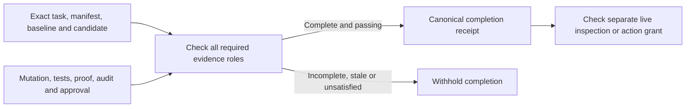

# RT-14 exact completion obligations and inspectable joint context

Completion requires a checked outcome for every required evidence role at the current task revision, baseline, Knowledge Context, candidate and policy. Reproducible receipts support inspection of that binding. Permission to read the context or perform an external change remains a separate live decision.

## Candidate checks

| Record | Admission condition |
| --- | --- |
| Required mutation | The Toolchain maps the exact candidate and observed mutation to the obligation. |
| Test evidence | The test runner binds its outcome and input scope to the exact subject. |
| Proof evidence | The configured checker supplies an applicable passing result. |
| Audit evidence | An independent auditor checks declared completeness and scope. |
| Approval | A currently authorized reviewer supplies a passing disposition for that subject. |
| Completion receipt | All five roles supply applicable passing evidence. The receipt binds the current subject and role-indexed evidence digests. |
| Inspection and action | Check current permissions before exposing context or performing work. A completion receipt carries no commit or push grant. |



## Results

Across 1,024 combinations, one complete passing set issues a receipt, 781 are incomplete and 242 contain an unknown or failed verdict. All 120 permutations of the passing set yield one receipt digest. An exact duplicate approval is idempotent. A conflicting approval is unsatisfied, and an audit from the wrong issuer is incomplete. Changed manifest and baseline controls block the previous receipt.

Existing joint checks cover the separately rendered Knowledge Context, exact task binding and live authorization. In fourteen joint cases and 144 input permutations, four complete and two pass the separate grant gate. These results cover the fixture subject and supplied evidence. Actual producer authentication, live current state and atomic external action remain outside this test. [Joint context validation](RT-14-CONTEXT-INTEGRATION-2026-11-25.md) · [Independent action grant](RT-14-TASK-AUTHORITY-2026-11-25.md) · [Earlier completion model](RT-14-TASK-CONTEXT-COMPLETION-2026-11-25.md)

## Reproduce

Use CPython 3.12.14. Python hash seeds 37 and 71 produce evidence SHA-256 `7a316d2d393f64c83885594df8df4f8a458f8ae41b8568ed971b6daaaa9384f0`. [Evidence ledger](OBLIGATION-ROSTER-01/evidence.json)

```sh
LC_ALL=C PYTHONHASHSEED=37 PYTHONDONTWRITEBYTECODE=1 \
  python research/toolchain-and-collaboration/RT-14/OBLIGATION-ROSTER-01/check.py > /tmp/rt14-obligations.json
```
