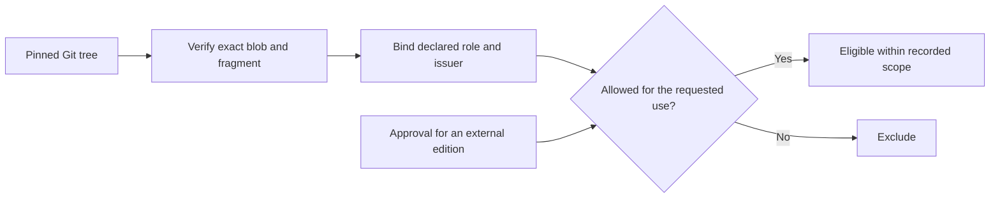

# RT-14 Knowledge Context source inventory

[LL-026 / #339](https://github.com/aivibeflow/LLMLang/issues/339)

The contents of a Git tree can supply eligible Knowledge Context material. Eligibility depends on the purpose and the evidence role, even when the file has good provenance. This inventory identifies a concrete specimen for each class in the plan. It uses commit `9f205b677bd0cba9b3806ccb54ab992a3face722` on `research/all`. Each positive fixture binds the commit, path, regular Git blob, SHA-256 of the exact bytes, fragment location, issuer class, and intended evidence use.



Git establishes the bytes and path used by this fixture. The curated catalog supplies the role and applicable scope. A broad file-based inventory would find the same paths but could treat provisional design or a tool diagnostic as proof of the implemented claim. A typed system can use the catalog as a discovery layer while recording the accepted object, contract, authority or receipt from the system that owns it.

| Source class | Exact specimen | Supported interpretation |
| --- | --- | --- |
| Specification | [Integer Calculator](../../../examples/0003-calculator.md) | The example's declared behavior. |
| Design | [Canonical semantic diff and merge](../RT-24/RT-24-CANONICAL-SEMANTIC-REPRESENTATION-DIFF-AND-MERGE.md) | A candidate technical contract and algorithm. |
| Implementation | [Candidate calculator implementation](../../../draft/examples/0003-calculator/main.llmlang) | Illustrative LLMLang source with an explicitly limited execution status. |
| Contracts | [Public interfaces and contract refinement](../../semantic-representation/RT-05/PUBLIC-INTERFACES-AND-CONTRACT-REFINEMENT.md) | A proposal for exact contract identity. |
| Requirements | [Withdrawal requirements](../../language-design/RT-02/REQUIREMENT-BACKENDS-01/requirements.json) | The finite requirement fixture and its exact wording. |
| Dependency records | [Typed difference ledger](../RT-24/TYPED-SEMANTIC-DIFF-01/evidence.json) | An archived identity for a difference over two pinned semantic inputs. |
| Diagnostics | [Lean false claim output](../../formal-verification/PROOF-OBLIGATION-BENCHMARK/lean-transition-state-results/false-claim-output.txt) | A specific negative-control diagnostic. |
| Tests | [Call-site refactor test](../../PROTOTYPES/DEPENDENCY-GRAPH-01/tests/test_call_site_refactor.py) | A test definition for the recorded scope. |
| Proof evidence | [Lean transition summary](../../formal-verification/PROOF-OBLIGATION-BENCHMARK/lean-transition-state-results/summary.json) | An archived checker observation with a stated version, claim scope and input digest. |
| Project documentation | [Project overview](../../../README.md) | Orientation and references. |
| Approved external references | [Curated reference ledger](../../references/README.md) | A citation to the specific SMT-LIB 2.7 edition in this fixture. |

## Observations and limits

Git resolved all 11 regular blobs at the pinned tree, and each selected fragment was unique in its blob. Forty-four role and purpose combinations admitted all 11 for catalog inspection, five for project proposals, four for the recorded-run evidence inventory, and two for reading discovery. Ten additional controls refused stale identity, mismatched blob or fragment, unknown issuer, role substitution, an unapproved citation, a changed edition locator, and sources outside the requested use. The archived proof receipt and failure diagnostic remain distinct records from a single benchmark.

The inventory freezes its local citation record. Eligibility for even that citation uses a simulated approval, and no external bytes were retrieved or admitted. Retrieval of authoritative external bytes would need current permission, edition verification and a content digest. The specimens span candidate documents and prototype records. Their Git identities prove local source correspondence only. The study does not adopt a source schema, validate a specific proof claim again, authorize the whole project tree or conduct a census of all project sources.

## Reproduce

Run with CPython 3.12 and Git 2.56.1 from a clone of `research/all` containing the pinned commit. [Catalog verifier](SOURCE-INVENTORY-01/run.py) · [Exact source ledger](SOURCE-INVENTORY-01/evidence.json)

```sh
python -B research/toolchain-and-collaboration/RT-14/SOURCE-INVENTORY-01/run.py /tmp/rt14-inventory-replay.json
cmp /tmp/rt14-inventory-replay.json research/toolchain-and-collaboration/RT-14/SOURCE-INVENTORY-01/evidence.json
```
