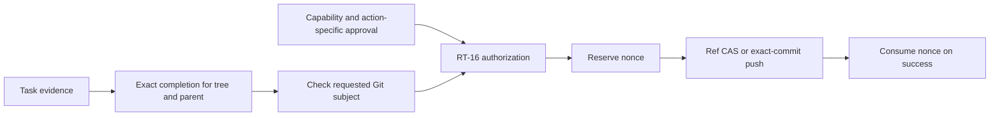

# RT-14. Task completion and independent Git action authority

Task completion states which obligations were met for an exact candidate. A Git action also needs authority for its specific actor, repository, baseline, target and operation. This replay composes the existing Task Context completion checker and the RT-16 policy prototype, then exercises native Git in disposable repositories. [Issue #340](https://github.com/aivibeflow/LLMLang/issues/340) · [Task completion evidence](RT-14-TASK-CONTEXT-COMPLETION-2026-11-25.md) · [RT-16 policy recheck](../../security/RT-16/RT-16-POLICY-RECHECK-2026-11-23.md)

The fixture checks the exact task revision, allowed mutations and all required evidence. A commit request binds the working parent and the completed candidate tree. A push request binds the exact already-created commit, whose tree and parent must match the completion. The policy gate then checks the separately supplied capability and human approval fixture. Its nonce is reserved before a native action and consumed when the action succeeds.



## Results

The 120 admission checks cross completion evidence, two Git actions, six capability states and five approval states. Exactly one combination per action passes. Complete evidence alone grants no access. An exact authority record alone cannot complete an unsatisfied task. A new task revision invalidates the old evidence even when Git objects remain unchanged. A commit approval cannot authorize a push, and a consumed push approval is refused on replay. [Admission matrix and native Git identities](TASK-AUTHORITY-01/evidence.json)

The two accepted actions create a commit from the completed tree and push exactly that commit to a local bare repository. In a controlled commit race, another writer moves the head after approval. The branch compare-and-swap refuses the stale update and the fixture releases its unused nonce. In a separate push race, the source branch moves after the request is authorized. A commit-OID refspec still sends the approved object. A branch-name refspec in a separate disposable destination sends the newer, unapproved object. All 24 existing RT-16 unit tests pass.

The replay uses local fixture actors, approvals and destinations. It leaves production identity and approval authentication, exact remote authority binding, multi-process nonce durability, and replay after uncertain remote outcomes open.

## Replay

Source baseline `81af66a` on `research/all`. Replay used Git 2.56.1 and CPython 3.12.14 on Linux. Temporary Git repositories use branch `research/all`. Run from the repository root.

```sh
data=research/toolchain-and-collaboration/RT-14/TASK-AUTHORITY-01
receipt=$(mktemp)
python -B -m unittest discover -s research/security/PROTOTYPES/RT-16-AUTHORIZATION-01
python -B "$data/run.py" "$receipt"
cmp "$data/evidence.json" "$receipt"
rm "$receipt"
```
