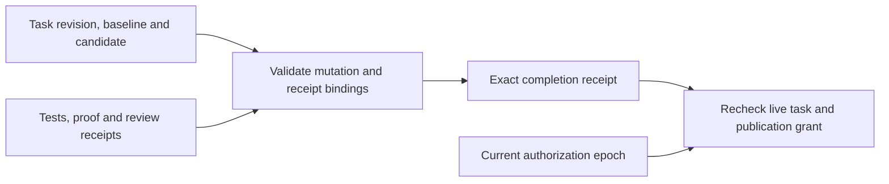

# RT-14 — Task Context completion receipts and publication

- **Date** — 2026-11-25
- **Tracking** — [PLAN §7.8](../../../PLAN.md#78-knowledge-context-and-task-context-rt-14) · [#340](https://github.com/aivibeflow/LLMLang/issues/340)
- **Status** — Reproduced in a finite obligation and grant model

## Question and candidate rules

When may a Task Context report that its obligations are satisfied, and which checks still apply when publishing its candidate? The fixture supplies an active task revision, an expected and live baseline, an immutable candidate, a Knowledge Context manifest reference, an evidence policy revision, and one intended changed operation. Four independently named obligation roles cover mutation, tests, proof and review. The supplied signer roles and observations are simulated. [Knowledge Context assembly](RT-14-KNOWLEDGE-CONTEXT-ASSEMBLY-2026-11-25.md) · [Development Engine](RFC-DEVELOPMENT-ENGINE.md)

Compare three completion rules. Matching positive labels ignores the stated evidence scope. Matching labels and task ID rejects another task's evidence but uses any revision or candidate for the same task. Exact completion additionally requires the live baseline and mutation scope, all binding fields, a designated issuer for each role, and only passing statuses among matching receipts for each role. An identical receipt can be repeated. Distinct matching pass and fail receipts leave an obligation unsatisfied.

Publication separately requires a completion receipt for the currently active binding and a fresh grant for the current subject, action and candidate. The comparison applies the same current-grant requirement to the two simpler completion rules.



## Results

Eight proof conditions, five test conditions, three workspace states, two task states and five grant conditions produce 1,200 combinations. A separate Boolean oracle determines when all obligations and the grant should hold. The exact gate agrees in every case and returns the same result after receipt order is reversed.

| Rule | Completions | Incorrect completions | Publications with a current grant | Incorrect publications |
|---|---:|---:|---:|---:|
| Positive obligation labels | 600 | 590 | 120 | 118 |
| Labels and task ID | 480 | 470 | 96 | 94 |
| Exact completion and live receipt check | 10 | 0 | 2 | 0 |

The two accepted test inputs differ only in duplicating the exact pass receipt. They generate the same completion digest. Only the current grant admits publication within either completion case. A moved baseline, cancelled task, new task revision and selected candidate replacement each cause a separately attempted reuse of the old completion receipt to fail, even with a current grant. Changing the evidence policy revision makes the old obligation evidence insufficient. [Evidence ledger](TASK-CONTEXT-COMPLETION-01/evidence.json)

## Limits

A Task Context can declare completion obligations and bind checked evidence to its subject. A publication result also depends on current authority and live state. This fixture trusts the supplied live baseline, changed-operation set and issuer labels. It models the completion receipt as an internal typed value, without signature verification or persistence. Production work still needs policy-verified evidence acquisition, atomic publication with revalidation, delegation and multi-agent handoff, recovery, and independent review of the obligation inventory.

## Reproduction

From the repository root, run the model on CPython 3.12.14 and compare its deterministic output. [Runner](TASK-CONTEXT-COMPLETION-01/run.py)

```sh
set -eu
dir=research/toolchain-and-collaboration/RT-14/TASK-CONTEXT-COMPLETION-01
observed=$(mktemp)
trap 'rm -f "$observed"' EXIT
python3 -B "$dir/run.py" > "$observed"
cmp "$dir/evidence.json" "$observed"
```
