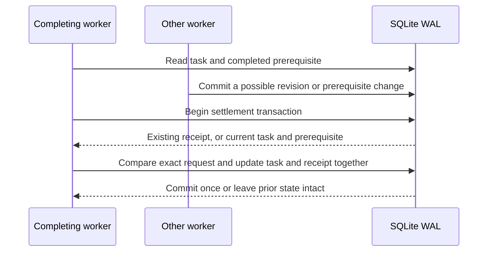

# RT-14 Concurrent Task Context settlement and recovery

**Issue** [#340](https://github.com/aivibeflow/LLMLang/issues/340)

An agent can finish work after its Task Context was revised, reassigned, cancelled, or invalidated by a changing prerequisite. The completion protocol needs to compare the state that justified the work with the state at settlement. It also needs to answer a retry after an interrupted write. This study uses two SQLite WAL connections and one parent task with one completed prerequisite. It extends the [logical completion and publication model](RT-14-TASK-CONTEXT-COMPLETION-2026-11-25.md) with local persistence.

## Candidate settlement protocol

The agent first reads the active task and compatible prerequisite in a consistent read transaction. The settlement request includes the task identity, revision, owner, baseline and monotonic epoch, the exact prerequisite receipt row, the proposed result and a stable request ID. The epoch distinguishes changes that return to the same displayed revision or artifact. The fixture assumes that another validating component supplied the proposed result and that the coordinator supplied the request identity.

Settlement starts a write transaction with `BEGIN IMMEDIATE`. It returns a recorded outcome if the same request ID and binding already have a receipt, and rejects reuse of an ID for a different binding. For a new settlement, it checks the active task row and the prerequisite receipt against the original request. It records task completion and the exact request digest in the same transaction. The comparison policies check only that the task is still active, or compare the task row without the prerequisite. The former is permissive during handoff. Task-only checks avoid stale ownership but leave cross-task dependencies unchecked.



The illustrative sequence describes the ordered schedules. The database serializes its local writes. The model has no task ownership network protocol and leaves progress under contention and replication open.

## Native results

The runner executes nine interleavings with three policies, for 27 successful experiment executions. The settled task state and receipt rows come from SQLite. The [ledger](TASK-CONTEXT-SQLITE-01/evidence.json) preserves every request and live row, the decision, and the independent expected result based on the selected task and prerequisite facts.

| Policy | Completes out of nine | Incorrect completions |
| --- | ---: | ---: |
| Require an active task | 8 | 6 |
| Compare active task and exact task row | 5 | 3 |
| Compare active task, exact task row and prerequisite | 2 | 0 |

The exact gate accepts the unchanged task and the unrelated edit. Revisions, reassignment, task epoch round trip and cancellation leave the requested result unsettled. An apparently identical child artifact with a new prerequisite epoch is also withheld. Checking only the task row completes all three changed-prerequisite controls.

A separate interruption fixture closes the writer between the task update and receipt write. An independent reader sees the old active task with no receipt while the writer is pending. Reopening after close preserves that state. Retrying then completes the task once. A separate reopen recovers the historical result for the exact request, denies the same ID with changed proposed data, and refuses a new completion ID because the task is closed. SQLite connection close and reopen are the observed interruption boundaries. Process termination, power-loss durability and stronger concurrent stress remain untested.

The completion record settles this task lifecycle. Publication requires its own live branch, authority and evidence checks. This study does not authenticate issuers or agents, prove Task Context obligation completeness, exercise a multi-child dependency graph, or perform a Git action. It uses finite outcomes with no elapsed-time measurements.

## Reproduction

Use CPython 3.12.14 and SQLite 3.53.1 at repository root. The study starts from `8e28c7cd4447ea22b49ba3ada613be574e266e57`. Runs with hash seeds 1 and 2 produced identical ledgers. Relative links and Mermaid source structure were checked. GitHub rendering was not manually verified.

```sh
study=research/toolchain-and-collaboration/RT-14/TASK-CONTEXT-SQLITE-01
PYTHONHASHSEED=1 python -B "$study/run.py" >/tmp/llmlang-task-sqlite.json
cmp "$study/evidence.json" /tmp/llmlang-task-sqlite.json
```
