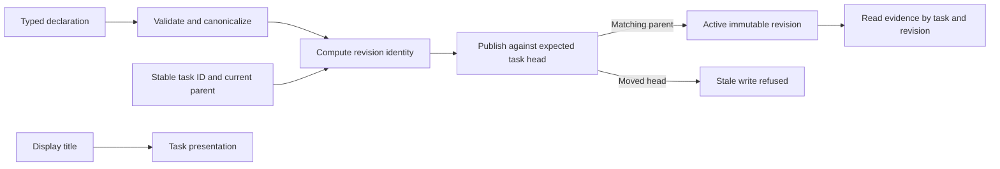

# RT-14 Task Context declaration and revision identity

[LL-027 / #340](https://github.com/aivibeflow/LLMLang/issues/340)

A stable task identifier locates the active revision and its history. A declaration describes a typed objective, exact requirement and prerequisite references, in-scope and out-of-scope objects, constraints, non-goals, assumptions, deliverables, and checks for those deliverables. A revision identifies the canonical declaration under a particular task and parent. The three values serve different consumers. Equal declaration bytes can support structural comparison across histories. Exact task and revision binding determines which completion receipts apply.

The candidate encoder records an explicit schema version on the revision envelope. It sorts unordered sets and references, rejects duplicate entries, and requires an exact revision for each linked requirement or prerequisite. It also rejects competing revisions of the same linked ID, overlapping scope, an objective target outside scope, and incomplete or orphaned acceptance criteria. The objective's verb and target are stable typed identifiers. A title is held in separate presentation data. A text edit that changes authorized intent must first change the corresponding typed declaration or requirement reference.



The prototype writes revisions and the active head in one SQLite transaction. Identical canonical bytes at the active head preserve its identity. A retry of a successful publication returns the existing active result. Reverting the semantic content through another revision produces a new descendant, so evidence from an older head cannot return as current evidence merely because the bytes match.

## Observations

The checker compares 512 combinations of reversible lists and two further object field orders. All 514 encodings match. Changing each of the ten declaration fields or its dependent pair yields a distinct canonical declaration digest. Eight invalid inputs are refused, including a moving prerequisite pointer and a deliverable with no matching acceptance checks.

An SQLite history contains four resulting revisions across two tasks. It accepts an exact retry, refuses an alternate write against an old head, and refuses a retry once the earlier result stops being active. Two task IDs and a restored declaration share the same original declaration bytes while retaining distinct revision identities. An exact accepted receipt survives a display-title change. The restored content and the other task remain pending until they receive applicable evidence. Posting an exact receipt for the restored revision makes that revision accepted.

The fixture uses ASCII identifiers, set-like declaration fields, SHA-256 and one transaction store. Ordering-sensitive steps would need an explicitly ordered representation. The schema checks reference syntax and uniqueness. Resolving those references, discharging prerequisites, approving assumptions, and authenticating evidence remain responsibilities of the associated producers. Multi-store identity negotiation, migration, semantic equivalence beyond canonical equality and production receipt authority remain open.

## Reproduce

Run from the repository root with CPython 3.12.14 and SQLite 3.53.1. [Model](TASK-IDENTITY-01/run.py) · [Recorded evidence](TASK-IDENTITY-01/evidence.json)

```sh
python -B research/toolchain-and-collaboration/RT-14/TASK-IDENTITY-01/run.py /tmp/rt14-task-identity-replay.json
cmp /tmp/rt14-task-identity-replay.json research/toolchain-and-collaboration/RT-14/TASK-IDENTITY-01/evidence.json
```
