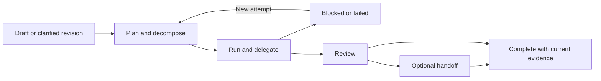

# RT-14 Task Context lifecycle, revision and attempt

A task's phase alone cannot establish whether an operation applies. The tested lifecycle keeps the current requirement revision and execution attempt distinct from the phase. It also requires applicable evidence before planning, delegating, decomposing, reviewing, handing off or completing work.

## Candidate transitions

| Transition | Required state |
| --- | --- |
| Create and clarify | Create one draft. An accepted clarification advances the task revision while retaining its lineage. |
| Plan and decompose | Bind the current requirement revision and declared work. Decomposition preserves the parent's state while adding separately validated obligations. |
| Run and delegate | Start from an admitted plan. Delegation requires current scope evidence. |
| Block or fail | Record the running attempt's outcome and reason. |
| Retry | Start a new attempt from blocked or failed state. Earlier attempt evidence keeps its original scope. |
| Review and handoff | Bind evidence and the exact candidate to the current revision and attempt. |
| Cancel or complete | Settle the active state through its own gate. Cancelled and completed states do not transition into one another. |



The comparison models semantic lifecycle admission. It assumes independent production of the evidence bit. Actual delegation, authorization and publication have distinct requirements. [Task identity and revision](RT-14-TASK-IDENTITY-2026-11-25.md) · [Delegation and cancellation schedules](RT-14-TASK-SIBLINGS-2026-11-25.md)

## Results

Across 1,144 phase, action, evidence and version combinations, the exact gate accepts 40. It refuses 238 invalid transitions, eight missing-evidence actions and 858 stale inputs. A phase-only rule admits 152 combinations that violate revision, attempt or evidence checks. The full example includes clarification, decomposition, delegation, block, failure, two retries, review, handoff and completion. Separate terminal controls refuse cancellation after completion and completion after cancellation.

The fixture does not model a persistent transactional state machine, resource cleanup, actual reviewer judgment or arbitrary dependency graphs. Those checks determine whether the candidate transition can be offered under a production policy.

## Reproduce

Use CPython 3.12.14. Both Python hash seeds 37 and 71 produce evidence SHA-256 `369f1f4badbe1b6428d74e2511d4d7a48175ebea7c8ff38482315857d170a454`. [Evidence ledger](TASK-LIFECYCLE-BOUNDARY-01/evidence.json)

```sh
LC_ALL=C PYTHONHASHSEED=37 PYTHONDONTWRITEBYTECODE=1 \
  python research/toolchain-and-collaboration/RT-14/TASK-LIFECYCLE-BOUNDARY-01/check.py > /tmp/rt14-task-lifecycle.json
```
