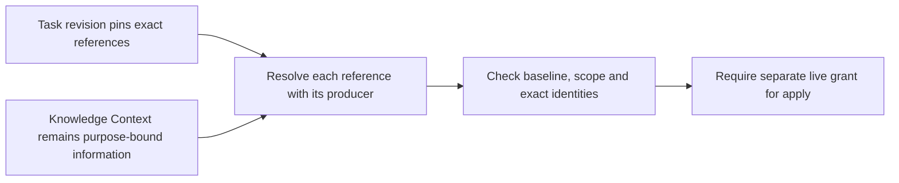

# RT-14 pinned Task Context references and producer ownership

A Task Context records its objective and obligations and binds the exact inputs it needs. Knowledge Context describes the selected information for that purpose. Its manifest identity is a task input. The task does not derive requirements from context content or derive authority from possession of the manifest.

## Producer mapping

| Producer | Authoritative input retained by the producer |
| --- | --- |
| RT-02 | Exact requirement and accepted intent boundary |
| RT-05 | Target semantic object and selected occurrence identities |
| RT-06 | Scope-bound dependency inventory and completeness evidence |
| RT-14 Knowledge Context | Authorized manifest, selected source records, checked coverage and declared purpose |
| RT-19 | Immutable baseline, workspace revision and exact Change Set |
| RT-20 | Change Impact Plan, expected mutations and plan-execution evidence |
| RT-16 | Current principal, operation, scope and policy generation for rights to read or mutate |

The task pins exact versions and checks their baseline and scope. It can refer to approved Change Set effects and plan obligations without duplicating drafts, replacing the plan or altering its producer's lifecycle. A separate current grant is necessary for mutation. Output completion receipts also need explicit current obligation bindings. [Task producer boundaries](RT-14-TASK-PRODUCERS-2026-11-25.md) · [Source-bound Knowledge Context](RT-14-KNOWLEDGE-CONTEXT-ASSEMBLY-2026-11-25.md) · [Separate action authority](RT-14-TASK-AUTHORITY-2026-11-25.md)



## Evidence

Each of seven references has an exact, changed or missing state, giving 2,187 profiles. Only the exact profile binds. It still cannot authorize a write without the separate grant. A correctly hashed Knowledge Context for another baseline fails scope matching. Inspection permission and an older grant generation fail mutation admission.

The records and source stores are synthetic. The scope fields demonstrate semantic subject binding, while actual authority and completeness come from producer integration. Current state across independent services, concurrent revocation and canonical schema adoption remain open. [Joint context checks](RT-14-CONTEXT-INTEGRATION-2026-11-25.md)

## Reproduce

Use CPython 3.12.14. Python hash seeds 37 and 71 yield evidence SHA-256 `e082aed02954ac51c75875d96dc68751faa992f1e0655f2b2d052179a7adaadc`. [Evidence ledger](TASK-PINNED-REFERENCES-01/evidence.json)

```sh
LC_ALL=C PYTHONHASHSEED=37 PYTHONDONTWRITEBYTECODE=1 \
  python research/toolchain-and-collaboration/RT-14/TASK-PINNED-REFERENCES-01/check.py > /tmp/rt14-task-pins.json
```
