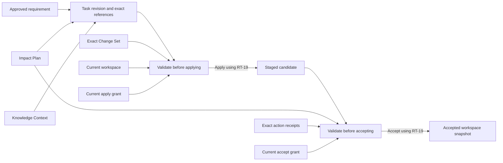

# RT-14 Task Context producer boundaries

[LL-027 / #340](https://github.com/aivibeflow/LLMLang/issues/340)

A Task Context records the active work revision and pins the evidence the task must consume. Requirements, planning, workspace edits, and permission remain independently owned. This study wires the existing RT-06 impact planner, RT-14 Knowledge Context assembler, and RT-19 workspace prototype around a change that corrects a quota from four to three.

| Producer | Authoritative subject in the fixture |
| --- | --- |
| Human intent and requirements | The approved requirement's exact immutable content hash. Free prose remains proposal discussion. |
| Change Impact Plan | Plan ID over exact baseline, candidate, policy and actions. |
| Change Set | Exact workspace, baseline revision and mutation including the target's previous object hash. |
| Workspace | Live ID, state, revision and working snapshot supplied by the Toolchain Server. |
| Knowledge Context | Evidence manifest identity. A fixture-specific binding links the manifest and its rendering to the exact workspace baseline and requirement. |
| Task Context | Task revision, approved target, expected baseline and candidate, and the exact references above. |
| Authorization | Current action-specific grant bound to the workspace and either the Change Set or the candidate. |



An exact candidate can be staged before its verification receipts are ready. Acceptance checks the current candidate, workspace revision, exact Impact Plan and action receipts, and a distinct accept grant. The accept operation here changes only RT-19 workspace state. Commit and push have their own authority checks. [Task Context action authority](RT-14-TASK-AUTHORITY-2026-11-25.md)

## Observations

The replay compared 1,024 cases to a separate outcome table. It changed ten inputs including prose, requirement approval, plan identity, patch bytes, workspace revision, evidence manifest, live baseline, both grants, and action evidence. The alternative plan concerned identical snapshots but used another policy. The alternative Knowledge Context rendered identical bytes and had a different manifest. The altered patch reused the Change Set label while changing the proposed value.

The RT-19 toolchain applied eight exact Change Sets. For each, the resulting object agreed with the requirement on the checked boundary inputs zero, three, and four. Four staged candidates remained pending because a receipt was missing. Two with complete receipts failed the accept grant gate. The other two were accepted. The 1,016 refused attempts preserved the workspace view observed before the attempt, including the effects of any independent earlier edits. All 512 prose-only pairs produced equal decisions despite differing instructions. Further checks on all eight staged candidates rejected another plan or complete-looking receipts for an earlier task revision. Nine existing toolchain tests and 36 planner tests passed.

The runtime check is a closed in-process fixture. Its requirements approval, graph completeness evidence, mapping between the example manifest and workspace baseline, grants, and action receipt issuer are fixture-defined. The arithmetic observation does not rerun a general build. The fixture does not establish authority authentication, automatic graph evidence extraction, transaction boundaries across producers, or normative schema adoption.

## Reproduce

Run with CPython 3.12.14 from the repository root. The replay compares the five reused source files to the recorded branch revision. [Executable fixture](TASK-PRODUCERS-01/run.py) · [Evidence](TASK-PRODUCERS-01/evidence.json)

```sh
python -B research/toolchain-and-collaboration/RT-14/TASK-PRODUCERS-01/run.py /tmp/rt14-task-producers-replay.json
cmp /tmp/rt14-task-producers-replay.json research/toolchain-and-collaboration/RT-14/TASK-PRODUCERS-01/evidence.json
(cd research/toolchain-and-collaboration/PROTOTYPES/TOOLCHAIN-SERVER-01 && python -B -m unittest test_toolchain)
(cd research/PROTOTYPES/DEPENDENCY-GRAPH-01 && python -B -m unittest discover -s tests -p test_impact_planning.py)
```
