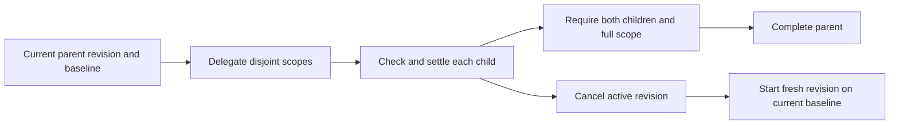

# RT-14. Task Context sibling ownership and cancellation

This fixture gives one Task Context two delegated children and four required change subjects. Each child binds its actor, exact scope, parent revision and baseline. SQLite transactions serialize ownership, evidence settlement and the parent state. A new parent revision follows cancellation and pins the current workspace baseline. [Issue #340](https://github.com/aivibeflow/LLMLang/issues/340) · [Single-child settlement](RT-14-TASK-CONTEXT-SQLITE-2026-11-25.md)

A delegation can claim only a subset of the parent scope, and a subject has at most one owner per revision. A child settles with exact evidence for mutation, tests and proof. The accepted settlement stores an operation key and digest of the full work and evidence input. An exact delivery retry recovers the prior outcome, including after cancellation, without changing the current task. A different request using that key is refused. Parent completion needs both settled children and complete coverage of the parent scope.



## Results

The lifecycle replay checks 22 requested operations. It refuses scope expansion, overlap, omitted evidence, wrong ownership, stale baseline and old evidence after restart. Partial child completion leaves the parent pending. In a separate coverage control, both children settle but omit two required subjects. The parent remains active with a scope gap. [Replay ledger](TASK-SIBLINGS-01/evidence.json)

| Concurrent or ordered control | Outcome |
| --- | --- |
| Two writers attempt overlapping delegation, eight repetitions | One delegation and one overlap refusal each time |
| Two writers attempt disjoint delegation, eight repetitions | Both delegations own all four subjects |
| Cancellation commits before child settlement | Settlement refuses and no settlement record is added |
| Child settlement commits before cancellation | One historical record survives and the cancelled parent cannot complete |

The concurrency probe uses two independently opened SQLite connections and a barrier before competing ownership changes. The cancellation controls execute both explicit transaction orders. The chosen task revision becomes complete only when both new children settle against the new baseline. An exact replay of the old accepted settlement still returns the historical outcome and does not satisfy a new child.

This fixture covers a fixed two-child roster with exclusive writes. It leaves dynamic dependency discovery, shared read/write effects, authenticated receipts, long-running external effects, multi-store recovery and production delegation authority open.

## Replay

Source baseline `22d607b` on `research/all`. Replay used CPython 3.12.14 and SQLite 3.53.1 on Linux. Run from the repository root.

```sh
data=research/toolchain-and-collaboration/RT-14/TASK-SIBLINGS-01
receipt=$(mktemp)
python -B "$data/run.py" "$receipt"
cmp "$data/evidence.json" "$receipt"
rm "$receipt"
```
