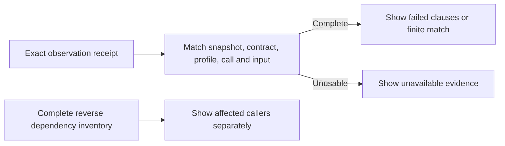

# RT-17 diagnostics for contract failures and semantic impact

A diagnostic can name the exact failed clause and observation while reporting potentially affected callers separately. The fixture distinguishes value failures, effect order failures, matching finite observations and unavailable evidence.

## Candidate diagnostic fields

| Field | Meaning |
| --- | --- |
| Context | Exact snapshot, contract revision, evaluation profile, call path and input |
| Observed failure | Stable clause code, expected value or order, and observed value or ordered effects |
| Observed match | The supplied observation satisfies all checked clauses for the declared input |
| Unavailable | A required observation is missing, incomplete or bound elsewhere |
| Affected scope | The changed provider and its reverse-reachable callers under an independently complete inventory |



An exact call-path observation can locate where a failure is witnessed. It does not by itself identify which edit caused the failure across a changing program. Affected scope describes where revalidation is needed. A repair proposal would still need its own applicability, correctness and authority checks. [Diagnostic and repair protocol](RESEARCH-SCENARIO-95-EXECUTION-2026-11-20.md) · [LSP repair application](RT-17-LSP-REPAIR-APPLICATION-2026-11-24.md)

## Results

The 576 receipt cases vary nine inputs, four result differences, two trace orders and eight receipt states. All 72 current complete observations match the fixture oracle. Eighteen satisfy both clauses, eighteen fail the value clause, eighteen fail the order clause, and eighteen fail both. The other 504 cases return unavailable without asserting a pass or failure. They cover absent data, changed snapshot, contract, profile, call path or input, and incomplete trace.

Reverse reachability includes the selected provider, its call and the entry it affects. An unrelated provider reaches only its separate audit consumer. Missing inventory yields unavailable rather than an empty impact claim. The experiment uses a static closed graph and synthetic receipts. It provides no measurement of reviewer comprehension, general dynamic call discovery or independent native evidence.

## Reproduce

Use CPython 3.12.14. Python hash seeds 37 and 71 produce evidence SHA-256 `c8a04b9fbdc9973d6a05a9eef8afbed2fd158db9a84a7860a3e4a9785bd9421f`. [Evidence ledger](CONTRACT-DIAGNOSTICS-01/evidence.json)

```sh
LC_ALL=C PYTHONHASHSEED=37 PYTHONDONTWRITEBYTECODE=1 \
  python research/toolchain-and-collaboration/RT-17/CONTRACT-DIAGNOSTICS-01/check.py > /tmp/rt17-contract-diagnostics.json
```
