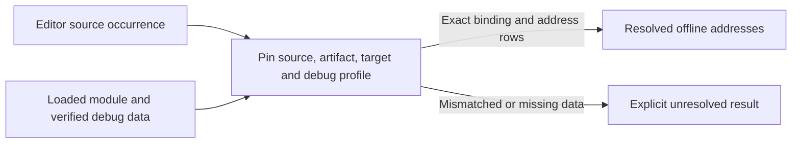

# RT-17 editor, language-server and debugging requirements

Language-server diagnostics and debugger positions depend on different exact contexts. A source position in the editor must match the loaded artifact's source and debug profile before it can resolve to addresses. In the fixture, the same numeric line in an older artifact can name a different function.

## Candidate requirements

| Boundary | Required binding |
| --- | --- |
| Editor document | Document version, negotiated position encoding and exact occurrence for a repair |
| Language-server analysis | Snapshot and read projection covering diagnostics and their cross-file dependencies |
| Debug session | Loaded artifact identity, source snapshot, target, compilation and debug profile |
| Breakpoint observation | Exact source occurrence mapped through the loaded artifact's debug data, with an explicit unresolved state when no mapping is proved |
| Runtime debugging | Runtime relocation and loaded module identity must be checked separately from an offline object address |



An editor buffer can move independently of a native execution. Cross-file diagnostics use a complete read projection, and versioned edits use exact occurrence checks. A debug adapter must provide the source of the running module or explain why a breakpoint request cannot be resolved. [LSP diagnostic freshness](RT-17-LSP-DIAGNOSTIC-FRESHNESS-2026-11-24.md) · [LSP position encodings](RT-17-LSP-POSITION-ENCODINGS-2026-11-25.md)

## Native line evidence

The runner compiles and executes eight ELF programs from two source revisions, two optimization levels and two debug profiles. The source edit moves the desired helper return from line 2 to line 4. With debugging disabled, the two unoptimized executables have identical bytes. With DWARF, the old unoptimized artifact has line 4 addresses within `main`, so looking up the new numeric line in the old artifact can select a different function.

| Outcome across the 64 session and request pairs | Pairs |
| --- | ---: |
| Exact context with DWARF addresses | 4 |
| Exact context with no debug evidence | 4 |
| Artifact, source or profile mismatch | 56 |

A separate control substitutes another target and is refused. The experiments inspect link-time addresses and symbol ranges. No interactive debugger, Debug Adapter Protocol endpoint, runtime module relocation, optimized stepping behavior or editor usability is exercised. These require separate implementation and controlled evaluation. [Native DWARF column evidence](../RT-11/RT-11-DEBUG-COLUMN-REUSE-2026-11-25.md)

## Reproduce

Use Linux x86-64, CPython 3.12.14, GCC 14.2.0-19 and GNU Binutils 2.44. Python hash seeds 37 and 71 produce evidence SHA-256 `804326e3bceb394a6ffd4828a1769b000b47016db5a14f66fa9768e12965461b`. [Evidence ledger](DEBUG-SOURCE-SCOPE-01/evidence.json)

```sh
LC_ALL=C PYTHONHASHSEED=37 PYTHONDONTWRITEBYTECODE=1 \
  python research/toolchain-and-collaboration/RT-17/DEBUG-SOURCE-SCOPE-01/check.py \
  --cc /path/to/gcc --readelf /path/to/readelf > /tmp/rt17-debug-source.json
```
