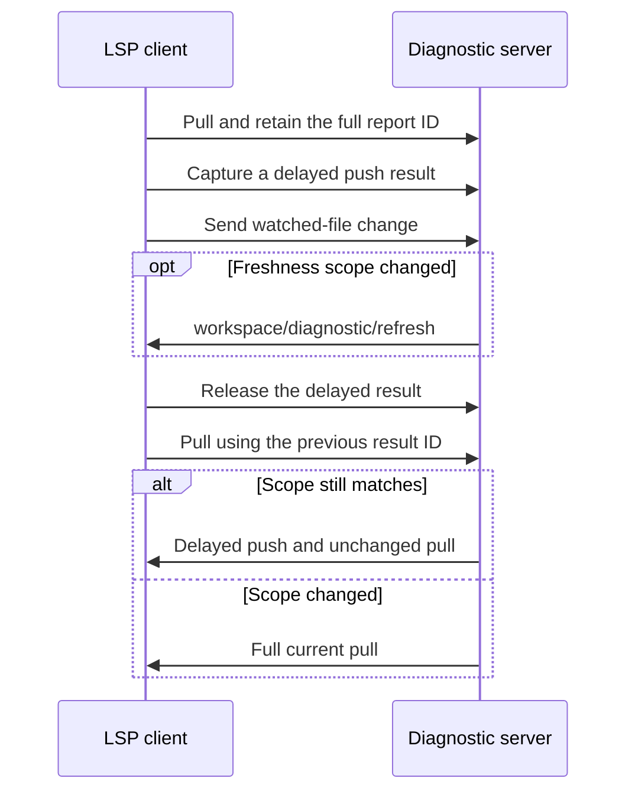

# RT-17 — Freshness of push and pull diagnostics over LSP

A document version and a document-bound result ID left the wrong diagnostics visible in four of six edit cases. The text was unchanged in each case. Binding diagnostic validity to the complete read scope detected all four changes and avoided the unnecessary invalidation observed with whole-workspace binding.

## Method

The experiment ran a Python language-server fixture over actual LSP standard input and output. The client used the pinned VS Code LSP protocol package to frame and dispatch JSON-RPC messages. It opened one ASCII document and observed native `textDocument/publishDiagnostics`, `textDocument/diagnostic` and `workspace/diagnostic/refresh` messages. The runner changed unopened files on disk and sent standard watched-file notifications. Two fixture-only requests split worker capture and release so edited and stale outcomes have a reproducible order.

The diagnostic checker reuses the existing RT-17 research fixture. Its entry calls a provider with a fallback lookup. A local override may be absent. A configuration file determines the permitted provider type. The client encodes expected diagnostic codes independently of the checker implementation.

Three server policies bind both the captured push result and the pull result ID to the same scope. Each includes the opened document version.

- **Document** adds the entry text. An unopened file can change while this scope stays equal.
- **Workspace** adds the whole fixture snapshot, including ordinary notes.
- **Projection** adds the exact entry, selected-candidate lookup scope, configuration and the presence or absence of the higher-priority override. It omits ordinary notes.



A push marked with the same document version can still contain findings for old dependencies. The pull report's opaque result ID functions as a cache key only when the server has bound it to the diagnostic reads that determine validity.

## Results

| Freshness scope | Wrong delayed pushes | Wrong conditional pulls | Unnecessary invalidations |
| --- | ---: | ---: | ---: |
| document | 4 | 4 | 0 |
| workspace | 0 | 0 | 1 |
| projection | 0 | 0 | 0 |

Each scope runs six cases, for 18 client/server sessions. Editing the provider or configuration, adding a higher-priority override and removing a formerly present override all expose the document-only error. After the override is removed, the wrong document-only result reports the old error when the current program is clean. The unrelated note edit forces a full recomputation with the workspace scope and preserves the result with the projection scope. Editing the entry itself advances its version and invalidates the report under all three policies.

Every session also checks that an unknown previous result ID returns a full current report. A partial result publishes nothing. A fresh complete push agrees with the independently specified codes, including the empty list that clears a diagnostic after the provider is fixed. Those observations distinguish lack of current evidence from a completed clean result.

## Implementation boundary

The projection is a candidate for diagnostics whose lookup scope can be established, including possible unresolved reads and higher-priority absences. With unestablished coverage, a whole-workspace snapshot is a conservative candidate. A document version alone remains suitable only when all inputs are document-local. The experiment verifies transport and client/server message contents for one checker. Watched-file notification coverage, cancellation concurrency, batching, editor UI behavior and participant review remain open. It uses both diagnostic delivery styles for comparison in the fixture.

## Reproduce

Use CPython 3.12.14, Node.js 24.22.3 and the dependency integrity values in the fixture lockfile.

```sh
fixture=research/toolchain-and-collaboration/RT-17/WIRE-DIAGNOSTIC-01
npm --prefix "$fixture" ci --ignore-scripts --no-audit --no-fund
output=$(mktemp)
node "$fixture/client.cjs" "$(command -v python3)" > "$output"
cmp "$fixture/evidence.json" "$output"
python3 "$fixture/chart.py"
```

[Server](WIRE-DIAGNOSTIC-01/server.py) · [Client](WIRE-DIAGNOSTIC-01/client.cjs) · [Pinned dependencies](WIRE-DIAGNOSTIC-01/package-lock.json) · [Evidence ledger](WIRE-DIAGNOSTIC-01/evidence.json) · [Earlier schedule model](RT-17-DIAGNOSTIC-PUBLICATION.md) · [Language Server Protocol 3.17](https://microsoft.github.io/language-server-protocol/specifications/lsp/3.17/specification/)
