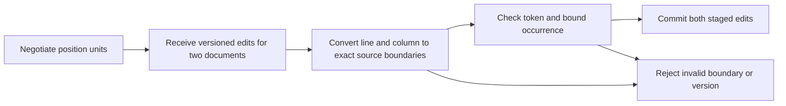

# RT-17 — Bind LSP repairs to negotiated positions and exact source occurrences

Version and range checks alone accepted 26 incorrect two-document repairs. Checking the text at the target reduced that to 12. Checking the intended occurrence too rejected all incorrect edits while preserving all 36 correct applications in each client policy.

## Method

The official VS Code language-server protocol SDK communicates over standard I/O with a Python fixture server. Each session negotiates UTF-8, UTF-16 or UTF-32 positions, or omits the preference and uses the default UTF-16. These units encode the column within a line. A Unicode scalar can occupy several UTF-8 bytes, two UTF-16 code units or one UTF-32 code unit. The fixture includes an astral character, a combining mark, mixed Unicode on the second CRLF line, and ASCII controls. [LSP 3.17 position encoding](https://microsoft.github.io/language-server-protocol/specifications/lsp/3.17/specification/#position)

Each code action sends a versioned workspace edit through a real `workspace/applyEdit` request. The intended primary edit changes the first occurrence of `bad` to `good`. A second edit changes `old` to `new` in a companion document. The server either emits the negotiated unit, always emits Python code-point counts, or always emits UTF-16 counts. Additional controls give an interior or wrong position, select a different identical token, or advance the second document version while keeping its bytes.

The clients all validate document versions and require scalar-boundary positions within the named line. The first client accepts any such range. The second also checks the expected old token. The third checks the exact intended occurrence in the pinned source. The client stages both changes before committing them. A separate exact-text oracle checks that the first occurrence alone was changed and that the companion edit matches the intended output. [Prior versioned repair study](RT-17-LSP-REPAIR-APPLICATION-2026-11-24.md)



## Results

| Client | Correct | Wrong | Invalid range | Wrong token | Wrong occurrence | Stale version |
| --- | ---: | ---: | ---: | ---: | ---: | ---: |
| range | 36 | 26 | 10 | 0 | 0 | 12 |
| token | 36 | 12 | 10 | 14 | 0 | 12 |
| occurrence | 36 | 0 | 10 | 14 | 12 | 12 |

Each row covers 84 sessions, for 252 total. The negotiated server succeeds on all ordinary inputs for all four negotiations. Fixed offsets can either land inside a scalar's representation and fail the range check, or identify a legal span with different bytes. Checking the expected token catches 14 such wrong applications. The 12 remaining token-only failures use the second identical `bad` occurrence with a valid range. An exact target occurrence distinguishes it. A stale companion version prevents both edits in every tested policy. Every rejection preserves both original document values.

## Implications for implementation choice

A versioned semantic repair needs a consistent coordinate encoding and binding to the intended source occurrence. Range safety and token equality each catch different classes of error. A source-derived occurrence check can carry intent beyond the bytes at one legal position. The pinned source version and the effect of applying the full batch still need their own checks.

The fixture covers a narrow token repair over LF and CRLF documents and implements a strict boundary policy. It leaves production editor behavior, wider Unicode and malformed-message handling, source-to-repair proof, transactional Toolchain integration and human evaluation open.

## Reproduce

Use Node 24.22.3, CPython 3.12.14 and the archived SDK lockfile from the repository root.

```sh
sdk=research/toolchain-and-collaboration/RT-17/WIRE-DIAGNOSTIC-01
fixture=research/toolchain-and-collaboration/RT-17/WIRE-POSITIONS-01
npm ci --prefix "$sdk"
output=$(mktemp)
node "$fixture/client.cjs" python3 > "$output"
cmp "$fixture/evidence.json" "$output"
python3 "$fixture/chart.py"
```

[Protocol client](WIRE-POSITIONS-01/client.cjs) · [Server](WIRE-POSITIONS-01/server.py) · [Evidence ledger](WIRE-POSITIONS-01/evidence.json)
