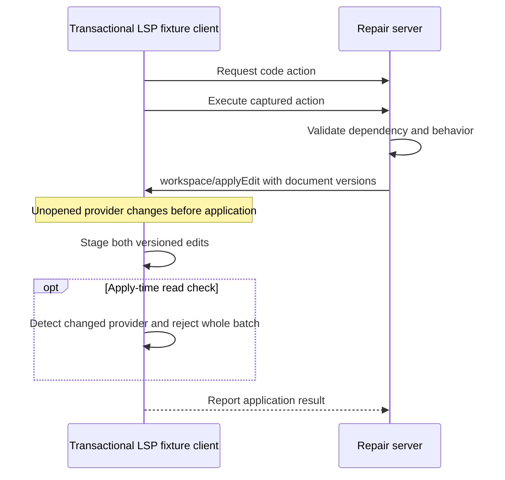

# RT-17 — Versioned editor repairs and the semantic read boundary

A transactional LSP client rejected a two-document edit when the second document's version changed and preserved the first document. The same version checks admitted a repair with wrong behavior when an unopened dependency changed. Validating the dependency before sending the edit still missed a mutation delivered between validation and application.

## Method

A CPython fixture server and the pinned VS Code LSP protocol client exchange standard `textDocument/codeAction`, `workspace/executeCommand` and `workspace/applyEdit` messages over JSON-RPC standard input and output. One edit converts a string threshold to an integer. A second edit switches the execution mode. An unopened provider file supplies the expected threshold. A separate client oracle tests actual decisions on each integer from 0 to 10.

Five policies receive the same seven changes. The legacy policy sends unversioned `changes`. The versioned policy sends `documentChanges`, and the client stages all edits before replacing either document. The workspace and preflight policies additionally validate semantics and read their expected workspace or dependency state at the server before sending the edit. The commit-bound fixture also rechecks the captured dependency immediately before applying the staged edit in the client.



## Results

| Policy | Stale applications | Applied with wrong behavior | Unnecessary rejections |
| --- | ---: | ---: | ---: |
| legacy | 2 | 3 | 0 |
| versioned | 0 | 3 | 0 |
| workspace | 0 | 1 | 1 |
| preflight | 0 | 1 | 0 |
| commit-bound | 0 | 0 | 0 |

Each policy runs seven cases, for 35 sessions. The two version staleness cases edit the second document, or edit and then restore its original bytes. Versioned edits report failure at the second document and preserve the first editable document. The unversioned policy applies both stale actions. The server's scoped preflight rejects a provider change it observes before dispatch and admits a harmless note edit. A whole-workspace check also rejects that unrelated edit.

All modes other than the apply-time read check admit the provider change injected during the application callback. The stale repair accepts inputs 4 and 5 although the new expected threshold is 3. The type-only control repairs the integer representation and enables execution while accepting five extra inputs. Neither form of version checking establishes that the resulting behavior matches the intended repair.

## Implementation boundary

The LSP edit represents the intended writes and their document versions. A separate condition binds reads needed by the semantic repair. The apply-time projection uses a fixture client extension and a single staged application callback. General external writers can still change dependencies unless the read and write conditions share a transactional publication boundary. The tested path supports comparison of optimistic version checks, conservative workspace preflight and scoped revalidation. General editor integration, URI and range encodings beyond these ASCII files, a persistent Toolchain acceptance protocol and human or agent repair effectiveness remain open.

## Reproduce

Use CPython 3.12.14, Node.js 24.22.3 and the pinned package lock from the diagnostic wire experiment.

```sh
root=research/toolchain-and-collaboration/RT-17
npm --prefix "$root/WIRE-DIAGNOSTIC-01" ci --ignore-scripts --no-audit --no-fund
fixture="$root/WIRE-REPAIR-01"
output=$(mktemp)
node "$fixture/client.cjs" "$(command -v python3)" > "$output"
cmp "$fixture/evidence.json" "$output"
python3 "$fixture/chart.py"
```

[Server](WIRE-REPAIR-01/server.py) · [Transactional client and oracle](WIRE-REPAIR-01/client.cjs) · [Evidence ledger](WIRE-REPAIR-01/evidence.json) · [Earlier diagnostic replay](RT-17-DIAGNOSTIC-REPLAY.md) · [LSP 3.17 specification](https://microsoft.github.io/language-server-protocol/specifications/lsp/3.17/specification/)
