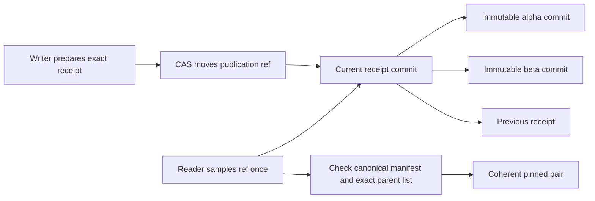

# Coherent multi-ref reads from a published Git receipt

[Tracking issue #337](https://github.com/aivibeflow/LLMLang/issues/337) · [Prepared multi-ref recovery](RT-19-MULTIREF-TRANSACTION-RECOVERY-2026-11-25.md)

A Toolchain reader can need the tips of several branches at a single logical publication point. Two separate native ref reads can straddle a successful multi-ref transaction. A reader that samples a generation ref before and after its reads can still misclassify a pair if the generation is published separately or a rollback restores the same generation value.

The fixture stores two branch-tip stand-ins under private refs in bare scratch repositories. Its candidate logical publication point is one Git ref pointing to an immutable receipt commit. The receipt names both branch commits and, after generation zero, the preceding receipt. Its commit parent list retains those exact objects. A reader samples that ref once, validates the canonical manifest and parent inventory, and loads the pair from that receipt. A later current-ref comparison can report that the pinned snapshot is no longer current. Freshness and coherence are separate properties.



The experiment compares direct reads, an unchanged-generation check, an unchanged-generation check plus exact pair-to-manifest validation, and a pinned-receipt read. It enumerates the order-preserving schedules of reader steps and one writer. The writer either commits all three ref changes in one prepared Git transaction or updates the two branch refs and then the receipt ref in three separate commands. The case with a single writer command places reads before or after it. An extra process test separately holds Git at the acknowledged `prepare` point before sending `commit`.

| Writer and reader | Schedules per profile | Observation per profile |
| --- | ---: | --- |
| Atomic writer, direct reads | 3 | One mixed pair |
| Atomic writer, generation bracket | 5 | One mixed pair before validation. The unchanged-generation check refuses all three schedules that cross publication. |
| Atomic writer, pinned receipt | 4 | All four pairs coherent. Two pinned receipts are stale by the recheck. |
| Split writer, direct reads | 10 | Three mixed pairs |
| Split writer, generation bracket | 35 | Nine mixed pairs before validation. Five mixed pairs pass the unchanged-generation check. Five more admitted pairs are coherent but differ from the named receipt. Comparing the exact pair to the receipt and checking the generation refuses 29 schedules and admits six. |
| Split writer, pinned receipt | 20 | All 20 pairs coherent. Nine pinned receipts are stale by the recheck. |

All four Git profiles agree. Across 308 checked schedules, the 96 pinned reads return the exact named pair. Forty-four of those snapshots have been superseded by the time the reader rechecks. In each profile, the raw refs retain the old vector while `git update-ref` waits at its prepared boundary and expose the new vector after commit. The harness does not model observations between internal native write steps.

A rollback control publishes generation one and restores generation zero between the reader's generation samples. The two hashes match, but the first branch read came from generation zero and the second from generation one. The exact manifest comparison detects the mismatch. The candidate avoids this ambiguity for normal publication by requiring a new immutable receipt which links its predecessor. A revert operation can describe prior content in a new receipt with a different identity.

Two writers concurrently submit different receipt OIDs against the same old head. In each profile one update succeeds, one refuses, and repeating the old-hash CAS refuses. The reader resolves the observed winning receipt directly. Malformed noncanonical JSON and a commit with manifest tips that differ from its parent list are rejected. The previous receipt and both tips remain readable after expiring reflogs and running garbage collection because the current receipt retains them through Git parent links.

The model favors a single authoritative pointer for logical reads with explicit freshness when required. Keeping old receipts through Git ancestry supplies retention at the cost of history growth. A compare-and-swap of that ref does not settle authority, corruption recovery, power-loss durability, multi-repository publication or uncoordinated readers of physical branches. The controls use bare scratch repositories and synthetic commits. Existing research covers authorization and restart behavior separately. [Recovery authority](RT-19-RECOVERY-AUTHORITY-2026-11-25.md) · [SQLite and Git process recovery](RT-19-SQLITE-GIT-PROCESS-RECOVERY-2026-11-24.md)

## Reproduce

The replay uses Git 2.56.1 and CPython 3.12.14 on Linux. It builds `files` and `reftable` repositories with both SHA-1 and SHA-256 identifiers. Each combination uses the same input bytes and deterministic author metadata. It invokes native Git for all writes and observations. The [observations](COHERENT-MULTIREF-01/observations.json) preserve schedules, per-step order, object IDs, outcomes and controls. The table displays categorical counts without a latency claim.

```sh
study=research/toolchain-and-collaboration/RT-19/COHERENT-MULTIREF-01
python3 -B "$study/run.py" --out /tmp/rt19-multiref-read.json
cmp "$study/observations.json" /tmp/rt19-multiref-read.json
```
