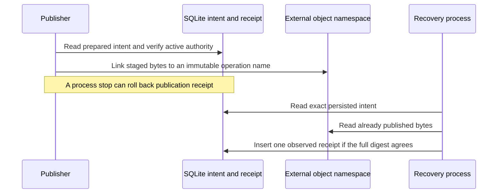

# RT-19 — Recover an external effect from exact operation bytes

An external object can exist after the publishing process dies and its SQLite receipt rolls back. Checking the stored intent against the complete object bytes recovers both eligible missing receipts in 24 native schedules. Filename-only recovery records three false successes. Two concurrent exact recovery clients leave one receipt.

## Question and scope

The [RT-19 SQLite/Git crash study](RT-19-SQLITE-GIT-PROCESS-RECOVERY-2026-11-24.md) recovers one exact Git publication from a persistent intent. This experiment compares policies for a separate filesystem object. It asks what a recovery process can establish after observing the external object and a missing database receipt.

The coordinator records a stable operation ID, exact authority revision and expected object digest before starting the publication. The object bytes include the same operation and authority identities and the requested payload. The trusted publisher reads authority inside a SQLite writer transaction and uses `link` to establish the final name without replacing an existing object. A successful original run writes a published receipt. The candidate recovery process records an observed receipt against an already present exact object. It never writes the external object.

## Native schedules

Each schedule uses a temporary SQLite WAL store and a regular-file object in the same local filesystem as its staging path. The harness stops the process before link or after link while its transaction is still open. It also tests revocation before publication, revocation after the link, a normal commit, and three name collisions. The collisions contain an altered payload, operation ID or authority revision. A separate case starts two fresh recovery clients behind a barrier. Both try to recover the same effect after the original authority has been revoked.



Receipt-only recovery trusts the original stored receipt and leaves the missing receipt unresolved. Filename-only recovery creates an observation when any bytes exist under the expected name. Exact recovery also requires equality with the persisted digest. A writer transaction and unique operation key serialize receipt insertion. The second exact client sees the first receipt after the transaction commits.

## Results

| Recovery policy | Receipt rows | False receipts | Eligible outcomes unresolved |
| --- | ---: | ---: | ---: |
| receipt_only | 1 | 0 | 2 |
| name_only | 6 | 3 | 0 |
| exact | 3 | 0 | 0 |

Each main policy uses the same eight scenarios. Eligible outcomes contain the exact expected object bytes. Three real no-replace links fail on preexisting files, and exact recovery refuses them. Receipt-only recovery retains the ordinary published receipt and cannot reconstruct the two interrupted publications. Exact recovery records both as observed, including the case where current authority has been revoked. All policies leave an absent object unresolved. The recovery processes preserve every object's bytes and do not create a missing object.

In the extra concurrency run, one client creates the observation and one reads the existing receipt. A fresh connection finds a single row with the intended digest. A revocation before publication blocks the attempted link. The fixture assigns reading previously published bytes and reconstructing an observation to the trusted reconciler.

## Implications and limits

A recovery key needs to bind the operation and the intended effect bytes. Object existence and a previously approved intent provide different evidence. An observed receipt should carry its own provenance. It establishes the observed materialization under the fixture's immutable-namespace assumption and cannot by itself prove the producer's identity, publication time or original authority decision.

This experiment tests crash recovery at explicit process barriers on one local filesystem. It leaves namespace write enforcement, authenticated receipts, power-loss durability, untrusted replacements, remote effects, mutable object stores, multi-branch toolchain integration and independent review open. No general exactly-once claim follows from the observed idempotent receipt insertion.

## Reproduce

Use CPython 3.12.14, SQLite 3.53.1, Linux 6.18.57 and overlayfs. The ledger captures operation and object hashes, publication phase, current authority, recovery result and receipts.

```sh
fixture=research/toolchain-and-collaboration/RT-19/EXTERNAL-RECEIPT-RECOVERY-01
output=$(mktemp)
python3 -B "$fixture/run.py" > "$output"
cmp "$fixture/evidence.json" "$output"
python3 "$fixture/chart.py"
```

[Native runner](EXTERNAL-RECEIPT-RECOVERY-01/run.py) · [Observation ledger](EXTERNAL-RECEIPT-RECOVERY-01/evidence.json)
