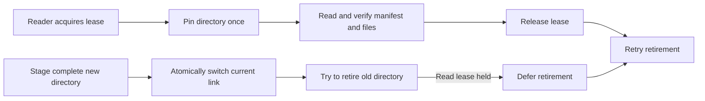

# RT-19. Multi-file publication, pinned reads and generation retirement

A reader must obtain the files and manifest of one complete export generation. Publishing a directory name atomically makes selection instantaneous. A reader still needs to pin that selection across its reads, and retirement must retain the selected files until it finishes. This experiment compares the filesystem effects of file replacement, a symlink switch, a pinned directory descriptor and a cooperative retirement lease. [Issue #337](https://github.com/aivibeflow/LLMLang/issues/337) · [Prior publication comparison](RT-19-MULTIFILE-PUBLICATION-BOUNDARY-RECHECK-2026-11-24.md)

The fixture stages three aggregate members and a SHA-256 manifest. A reader always reads the manifest first. The in-place writer publishes each file by rename and moves the new manifest last. The generation writer prepares both immutable directories before the schedule, publishes the new selection with one symlink rename, then tries to retire the old directory. Three reader variants follow the current link for each read, pin the directory with one descriptor, or acquire a shared lease before pinning it. The lease-aware collector obtains an exclusive lock before removing entries, using an independently opened stable lock file.



## Results

The harness executes every interleaving that preserves each side's operation order. The native calls run under a deterministic scheduler. They give 70 in-place schedules and 21 schedules per pointer mode.

| Reader and publication policy | Exact old | Exact new | Inconsistent | Unavailable |
| --- | ---: | ---: | ---: | ---: |
| Individual file replacement | 5 | 1 | 64 | 0 |
| Atomic generation switch with per-file link resolution | 1 | 11 | 9 | 0 |
| Pinned directory with immediate retirement | 5 | 6 | 0 | 10 |
| Pinned directory with retirement lease | 15 | 6 | 0 | 0 |

The manifest verifier rejects all inconsistent and unavailable observations. A directory descriptor preserves which directory was selected, but after retirement removes files, later opens relative to that descriptor may fail. The lease preserves both selection and availability in the tested schedules. Retirement is deferred 20 times and succeeds after the reader releases the lease in every deferred case. [Published schedules and outcomes](GENERATION-PUBLICATION-01/evidence.json)

The contents must remain immutable and the collector and readers must share a locking protocol. The single lease conservatively blocks collection of an old generation even if a reader has pinned the new one. Per-generation leases, progress under long-lived readers, network filesystems, system crash and durability, disk limits and integration with the Git/SQLite acceptance protocol remain open.

## Replay

Source baseline `b3993e5` on `research/all`. Replay used CPython 3.12.14, Linux 6.18.57 and an overlay filesystem. The probe uses Linux directory-descriptor and `flock` behavior.

```sh
data=research/toolchain-and-collaboration/RT-19/GENERATION-PUBLICATION-01
receipt=$(mktemp)
python -B "$data/run.py" "$receipt"
cmp "$data/evidence.json" "$receipt"
rm "$receipt"
```
