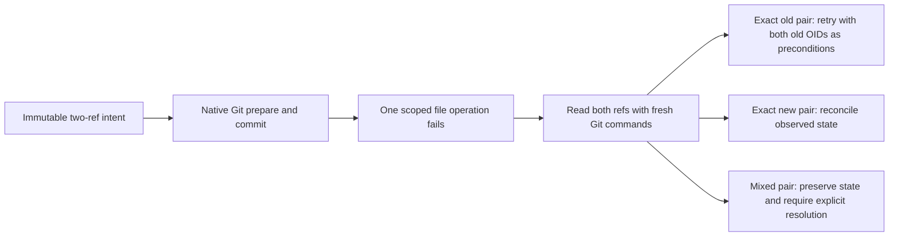

# Git ref visibility after write, sync and rename faults

[Toolchain Server issue #337](https://github.com/aivibeflow/LLMLang/issues/337) · [Prepared multi-ref recovery](RT-19-MULTIREF-TRANSACTION-RECOVERY-2026-11-25.md) · [Coherent read receipts](RT-19-COHERENT-MULTIREF-READS-2026-11-25.md)

A Toolchain caller must interpret a failed Git command alongside the stored intent and observed refs. The same status can report rejection before publication, a partial update, or failure of maintenance after the intended values are already visible.

In each trial, a bare scratch repository contains two refs at the same old commit and a prepared exact two-ref update to a new commit. A library attached only to that Git process logs calls on the named ref files or reftable files. It returns `ENOSPC` once for a targeted `write`, or `EIO` for `fsync` or `rename`. It calls through to the real libc function on every other path and occurrence. Independent fresh Git commands observe the two refs after that process exits. Every injected case records exactly one matching failed call, with its file role and ordinal.



| Storage and fault group | Fault trials | Fresh ref vector after Git exits |
| --- | ---: | --- |
| `files`, second ref write or sync, or first rename | 3 | Old, old |
| `files`, second ref rename | 1 | New, old |
| `reftable`, first temporary table or first table-list publication | 6 | Old, old |
| `reftable`, later temporary-table write, later table-list sync or later table-list rename | 3 | New, new |

All 13 injected faults exit with code 128. The `files` backend writes both lockfiles during preparation and renames them separately at commit. The second-rename fault leaves alpha advanced and beta old. The native repeat with both expected old values then refuses and preserves that mixed pair.

The reftable path writes a temporary table and switches its table list. The trace also shows a later table and table-list replacement in this exact repository shape. Faulting the later maintenance produces the same nonzero exit as a fault before the first list replacement, although both intended refs are already visible. The nine all-old faults allow the same original compare-and-swap to succeed in a fresh process. The three all-new failures can be reconciled by an authorized observer that already has the exact intent. Observed equality establishes the visible postcondition. Attribution still depends on the accepted publication protocol.

Four no-fault controls succeed and expose both new refs. With `core.fsync=reference` and `core.fsyncMethod=fsync`, the relevant calls include two lockfile syncs for `files` and four table or table-list syncs for `reftable`. The matching `core.fsync=none` controls show zero intercepted syncs on those roles. No trial leaves a lockfile. The successful and failed outcomes describe process-exit visibility. The experiment neither interrupts the filesystem nor simulates device acknowledgement, loss of dirty buffers or restart after power loss.

A production contract can avoid guessing by retaining the exact predecessor and desired ref vectors in a durable intent. Recover by observing an already visible exact result, retrying only under the verified old vector and current write authority, or blocking on conflict. Consider pinning a single logical publication ref to maintain coherent reads even if raw ref updates diverge. Add independent recovery for corruption and unavailable storage. The matrix does not generalize the observed reftable behavior to all failure points or ref backends. [Git 2.56.1 files backend](https://github.com/git/git/blob/v2.56.1/refs/files-backend.c) · [Git 2.56.1 reftable stack](https://github.com/git/git/blob/v2.56.1/reftable/stack.c)

## Reproduce

The harness ran on Linux x86-64 over overlayfs with Git 2.56.1, GCC 14.2.0, glibc 2.41 and CPython 3.12.14. It uses the C library only for the tested Git subprocess in an isolated scratch repository and verifies recovery in ordinary subprocesses. The [runner](GIT-REF-FAULTS-01/run.py) and [observations](GIT-REF-FAULTS-01/observations.json) preserve exact fault selectors, normalized relevant calls, Git diagnostics, observed values and recovery dispositions. The comparison is categorical and makes no latency claim.

```sh
study=research/toolchain-and-collaboration/RT-19/GIT-REF-FAULTS-01
python3 -B "$study/run.py" --out /tmp/rt19-git-faults.json
cmp "$study/observations.json" /tmp/rt19-git-faults.json
```
