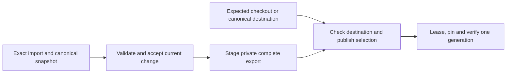

# RT-19 semantic interchange and atomic multi-file publication

The interchange contract distinguishes canonical repository state, physical checkout state and the selected export generation. Each operation checks the observation that governs its own effect.

## Candidate interfaces

| Operation | Required check |
| --- | --- |
| Import | Pin an exact canonical source and rebuild typed entities. Recompute their identities and record the selected snapshot. |
| Validate and accept | Match workspace, revision, snapshot and validation profile. Reject stale or failed evidence before accepting. |
| Export | Generate a complete private snapshot representation. Verify all members, metadata and destination witness before attempting publication. |
| Detect external edit | Compare exact checkout bytes, entry kind and mode for physical overwrite. Compare canonical tree under its declared Git attributes for repository import. Declare external referents separately. |
| Publish a multi-file generation | Select one complete immutable generation through an atomic pointer change or exact Git tree/ref publication. |
| Read and retire | Acquire a lease before pinning the selected generation. Keep its files available until the lease is released, and verify the manifest while reading. |



## Reconciled evidence

| Source | Checked result |
| --- | --- |
| Typed interaction round trips | All 864 exact runs reconstruct one root and file for each semantic variant. Stale destinations and damaged imports are covered by separate controls. |
| External checkout edits | Size and mtime miss 18 changes in 72 cases. Canonical tree normalization intentionally collapses six physical checkout changes. |
| Atomic multi-file publication | Across 133 schedules, individual replacement produces 64 inconsistent reads. Per-file pointer resolution produces nine. A pinned directory alone loses availability in ten schedules. All 21 leased reads remain exact. |

[Toolchain round trips](RT-19-TOOLCHAIN-ROUNDTRIP-2026-11-25.md) · [Checkout edit detection](RT-19-WORKTREE-EXTERNAL-EDITS-2026-11-25.md) · [Generation publication](RT-19-GENERATION-PUBLICATION-2026-11-25.md)

The fixture observations span separate implementations and do not constitute a production integration run. The candidate still needs shared transaction and recovery semantics under concurrent source mutation, remote filesystems, durable retirement, and writable worktree coordination.

## Reproduce

The reconciliation checks three inputs by SHA-256 before calculating the outcome counts. CPython 3.12.14 with both Python hash seeds 37 and 71 produces evidence SHA-256 `a705384138c5b6bcd6b5d2c113a848ba46749c37695d01b15f3ca8004b482a34`. [Evidence ledger](INTERCHANGE-BOUNDARY-01/evidence.json)

```sh
LC_ALL=C PYTHONHASHSEED=37 PYTHONDONTWRITEBYTECODE=1 \
  python research/toolchain-and-collaboration/RT-19/INTERCHANGE-BOUNDARY-01/check.py > /tmp/rt19-interchange.json
```
