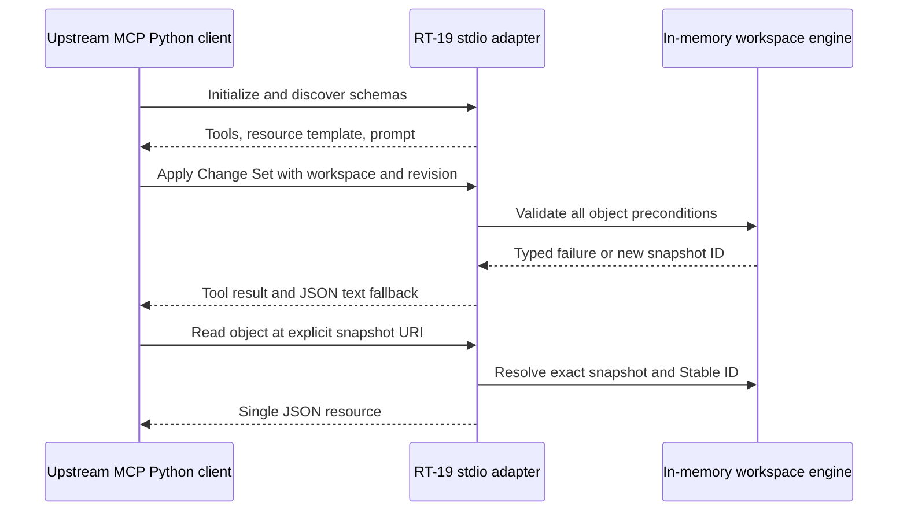

# RT-19 — MCP stdio schemas and independent client interoperability

**Evidence** — Bounded experiment with an in-memory workspace engine.
**Baseline** — LLMLang `e7d5181f72601f6c5e446beeb3b397bc90241fbc`.
**Tracking** — [RT-19](RT-19-TOOLCHAIN-SERVER-AND-SEMANTIC-DEVELOPMENT-API.md) · [Issue #337](https://github.com/aivibeflow/LLMLang/issues/337).
**Decisions** — Proposed [ADR-015](../../../draft/adr/015-toolchain-server-semantic-api.md) and accepted [ADR-017](../../../draft/adr/017-mcp-agent-object-format.md).

## Question and setup

Can an upstream MCP client discover and exercise the same revision, immutable snapshot, and complete Change Set boundaries that Prototype 01 exposes in-process? The experiment implements a Python JSON-RPC stdio adapter with a JSON Schema validator and sends requests through the upstream Python MCP SDK. The client imports neither the server nor the workspace engine. It computes expected object and snapshot digests independently for two small objects. The seed includes a reference by Stable ID and a Stable ID containing slash and plus characters.



The adapter checks wire shape before invoking the domain engine. The engine applies all changes against one baseline. An MCP prompt reads a workspace view and returns text containing its explicit workspace, snapshot and revision.

| Surface | Candidate contract |
| --- | --- |
| Tools | Open at a named snapshot, inspect a named workspace, apply a nonempty Change Set, accept at an expected revision. Apply discriminates add, update and remove. Update and remove require the previous object hash. Add requires an explicit null previous hash. Success includes a structured workspace view and equivalent JSON text. Shape and domain failures have typed `isError` results. |
| Resources | Discover a seed and the `llmlang://snapshot/{snapshot_id}/entity/{stable_id}` URI template. A read uses the exact snapshot and canonical percent-encoding of the Stable ID. It returns one JSON object with its Stable ID, kind, payload and content hash. Inter-object references use Stable IDs. Missing resources and malformed URI parameters have distinct JSON-RPC error codes. |
| Prompts | Discover `plan_change` with required `workspace_id` and `snapshot_id` arguments. The snapshot must match the workspace view. The prompt carries that scope and revision and leaves the view intact. |

## Results and implementation alternatives

The upstream client negotiated MCP `2025-11-25` and passed 42 assertions. Its SDK validated successful tool output against the advertised schema, and the fixture checked equality with the text fallback. Missing revision and a contradictory remove payload were rejected. A valid first update followed by a stale second precondition neither advanced the workspace nor exposed the independently predicted new snapshot. A valid retry advanced revision once, and replaying the old revision failed. An add and remove on the other workspace produced its expected root. Both the original and accepted snapshots retained their exact values after acceptance and subsequent changes in the second workspace. A prompt with the wrong snapshot or no workspace produced a protocol error.

| Design choice | Comparison and consequence |
| --- | --- |
| One Change Set tool versus per-object mutation calls | One request retained a single revision and prevented partial publication on a late precondition failure in this experiment. A series of per-object calls would require an additional transaction boundary to provide the same contract. The per-object design was compared analytically. |
| Snapshot-scoped resource versus ambient-current-workspace URI | Snapshot scoping preserved addressability of both versions, including an old version after acceptance. Dynamic aliases could be convenient for navigation but would need a separate freshness contract. |
| Discoverable structured output versus JSON text alone | The client checked machine-readable shape and equality with JSON text. The fallback duplicates a small result on the wire. Payload size and text-only client handling were not measured. |
| Prompt for planning versus tool for mutation | The prompt rendered scope and revision without changing state. A plan that acts must submit a separate tool request so the engine can apply current revision and object checks. |

The wire contracts are candidates. In this fixture a workspace handle locates state and provides no authorization. The results require follow-up for authenticated clients, production concurrency, transport beyond stdio, an interoperable SPG payload schema, prompts with external content, and persistent acceptance. The second-workspace remove also leaves an opaque payload reference to the removed object. Prototype 01 does not implement SPG dependency validation. The [persistent SQLite and Git experiment](RT-19-SQLITE-GIT-PROCESS-RECOVERY-2026-11-24.md) exercises a separate persistence layer.

## Reproduction

CPython 3.12.14, MCP Python SDK 1.26.0, JSON Schema validator 4.26.0 and pinned transitive dependencies in [requirements.lock](MCP-STDIO-01/requirements.lock). [Adapter](MCP-STDIO-01/server.py) · [Independent client](MCP-STDIO-01/verify.py) · [42 recorded assertions](MCP-STDIO-01/evidence.json). Five fresh process pairs produced byte-identical JSON. Workspace handles are random and the evidence records tests of their relationships.

From the repository root, create a fresh virtual environment and replay the fixture.

```sh
study=research/toolchain-and-collaboration/RT-19/MCP-STDIO-01
python3.12 -m venv /tmp/llmlang-rt19-mcp
/tmp/llmlang-rt19-mcp/bin/python -m pip install -r "$study/requirements.lock"
/tmp/llmlang-rt19-mcp/bin/python -B "$study/verify.py" > /tmp/llmlang-rt19-mcp.json
cmp "$study/evidence.json" /tmp/llmlang-rt19-mcp.json
python3.12 -B -m unittest discover -s research/toolchain-and-collaboration/PROTOTYPES/TOOLCHAIN-SERVER-01
```
