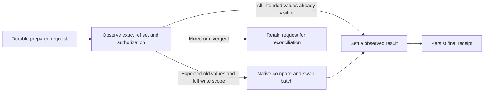

# RT-19 prepared multi-ref publication and recovery

A locally committed request can describe several exact Git ref movements. Native Git compare-and-swap can apply that batch when all old refs match. Recovery must distinguish observing an already visible result from permission to repeat a missing publication.

## Candidate local contract

| State | Required action |
| --- | --- |
| Prepared request | Record a durable request ID, ordered ref set, exact expected old commits and exact intended commits before external mutation. |
| Every ref still at its old commit | With current mutation authority for the complete ref set, attempt one native ref transaction. |
| Every ref points to its intended commit | With observation authority and a valid prepared record, record the already visible result without requesting mutation rights. |
| Mixed or diverged refs | Retain the pending request. Re-read and require explicit reconciliation before changing the batch. |
| Final receipt exists | Return the saved result to the authorized observer. Do not apply publication again. |



External observation establishes the exact visible postcondition. Attribution of that transition to a particular writer needs separate provenance. A production implementation also needs coherent reader snapshots, idempotent journal keys and explicit recovery for ambiguous filesystem durability. [Existing process-crash recovery](RT-19-SQLITE-GIT-PROCESS-RECOVERY-2026-11-24.md) · [Recovery authority](RT-19-RECOVERY-AUTHORITY-2026-11-25.md)

## Native evidence

Eight schedules use a temporary Git SHA-256 repository with two fixture refs and a SQLite journal. The runner observes after each prepared, visible or settled boundary. It reopens the journal between stages. One authorized recovery publishes both refs and records the result. A partial grant and an absent observation grant refuse. The already visible batch settles with observation authority alone, while a completed retry returns its record.

A mixed vector and an independently advanced ref both preserve the pending request. In both controls, directly submitting the original two-ref batch also fails native compare-and-swap, leaving the observed refs unchanged. These schedules prepare deterministic boundary states without injecting a process exit inside Git. The prior single-ref study covers actual process exits before or after publication. The remaining complete contract needs cross-repository or remote publication, filesystem power-loss durability, coherent concurrent read semantics and production authorization.

## Reproduce

Use CPython 3.12.14, SQLite 3.53.1 and Git 2.56.1. Hash seeds 37 and 71 produce evidence SHA-256 `e37d19650d90c7fc213f9e9c9c8182ecb3f05c17e4920d517feb7d16b4656ea3`. [Evidence ledger](MULTIREF-RECOVERY-01/evidence.json)

```sh
LC_ALL=C PYTHONHASHSEED=37 PYTHONDONTWRITEBYTECODE=1 \
  python research/toolchain-and-collaboration/RT-19/MULTIREF-RECOVERY-01/check.py > /tmp/rt19-multiref-recovery.json
```
