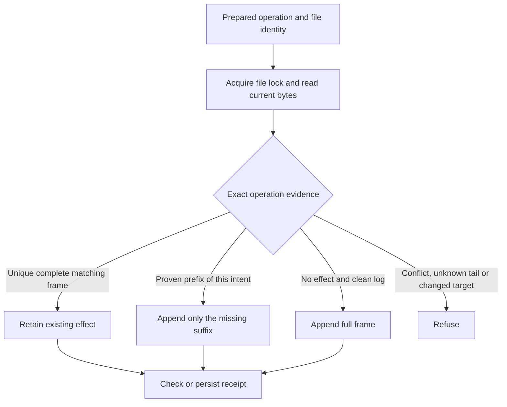

# Recover append receipts in a mutable native log

This RT-19 experiment compares recovery of an append effect when the worker process stops before its durable response. A mutable journal can contain a complete prior append, later records, a partial frame, or a receipt for state that no longer exists. The comparison extends the previously checked immutable-effect boundary to a shared, cooperating append log. [Immutable effect recovery](RT-19-EXTERNAL-RECEIPT-RECOVERY-2026-11-25.md)

## Protocol and alternatives

A local SQLite WAL database stores a prepared intent with the operation ID, exact canonical frame bytes, expected file identity and observed byte offset. The external file uses newline-framed canonical JSON. An append attempt holds a Linux `flock` on the file descriptor and uses `O_APPEND`. The worker synchronizes each written portion and may then persist a receipt. Injected process stops cover before the append, after a chosen prefix, after the complete append, and after receipt commit.

Blind retry appends when the local receipt is absent. The latest-payload heuristic treats an equal final complete payload as proof of execution. The exact policy checks the expected inode and device, decodes the canonical log, finds the complete operation ID and payload, and verifies an existing receipt against those bytes. It can complete a trailing prefix when the durable intent identifies it unambiguously. Unknown prefixes and conflicting or incomplete external state stop recovery without a write. This fixture requires a complete canonical log before claiming the result.



The concurrent retry test puts two recovery processes at a barrier before either attempts the lock. Responses count independently from effects. The same operation should have a single record and one durable receipt even if both callers get the result.

## Results

Thirteen scenarios cross three recovery policies and produce 39 process-stop and recovery sessions with 42 recovery calls. A correct success requires a unique exact frame in the original selected file and a complete canonical log. The table counts 14 calls per policy.

| Recovery policy | Reported successes | Wrong successes | Duplicate records | Refused calls |
|---|---:|---:|---:|---:|
| Blind retry | 14 | 11 | 3 | 0 |
| Latest payload | 14 | 9 | 1 | 0 |
| Exact framed operation | 8 | 0 | 0 | 6 |

Blind retry creates three duplicate records. The latest-payload heuristic duplicates an earlier matching operation after another writer advances the log and confuses another operation's identical payload with its own. Both controls return successes against changed or incomplete state. The exact policy recovers the complete effect despite later records. It completes one known prefix, refuses an ambiguous prefix and a foreign tail, and leaves the conflicting operation untouched. It rejects a replacement file even with a previous receipt, and detects truncation under the same inode. Both concurrent recoveries return a valid result with one effect and one receipt.

## Limits and replay

The log relies on cooperating appenders, small framed records and a stable local namespace during each checked operation. The experiment injects partial completion by writing a known prefix, and the recovery result makes no claim about arbitrary short-write repair or power-loss durability. Production revocation, storage firmware, external readers, uncoordinated rename and truncation, log compaction, and independent review remain open. An old local receipt gives evidence about its historical effect and must be reconciled with the current external state under this fixture's policy.

Use CPython 3.12.14, SQLite 3.53.1 and the recorded Linux kernel. The initial LLMLang baseline is `9a6882d406278f356005d6ca4276157dc3cd69f1`. The ledger records source identity, raw log bytes, true operation multiplicity, file identity checks and native outcomes. Run from the repository root.

```bash
fixture=research/toolchain-and-collaboration/RT-19/MUTABLE-LOG-RECOVERY-01
PYTHONHASHSEED=1 python3 -B "$fixture/run.py" > /tmp/llmlang-rt19-mutable-log.json
cmp "$fixture/evidence.json" /tmp/llmlang-rt19-mutable-log.json
python3 "$fixture/chart.py"
```

See the [native recovery fixture](MUTABLE-LOG-RECOVERY-01/run.py), [measured ledger](MUTABLE-LOG-RECOVERY-01/evidence.json), and [table generator](MUTABLE-LOG-RECOVERY-01/chart.py).
