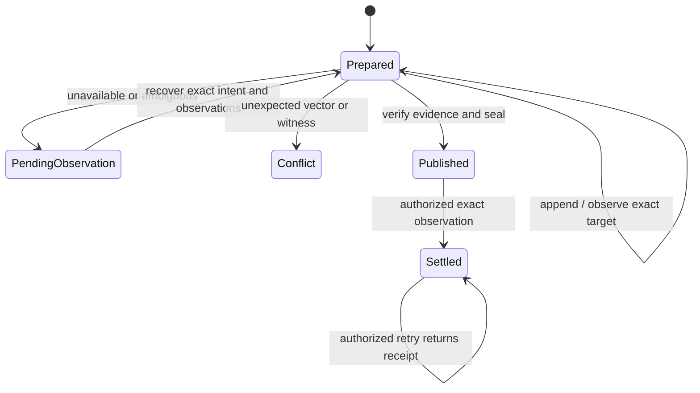

# Proposed Toolchain publication and recovery contract

[Toolchain Server issue #337](https://github.com/aivibeflow/LLMLang/issues/337) · [Toolchain API proposal](RT-19-TOOLCHAIN-SERVER-AND-SEMANTIC-DEVELOPMENT-API.md)

This candidate contract covers a Toolchain acceptance that exports a set of artifacts and publishes one or more Git refs. It defines the visible states, authority and recovery under ref contention, process failure, partial cross-repository delivery, storage faults and restored or unavailable storage. The contract is a research result. Backend selection and production durability still require deployment evidence.

## Exact inputs and visible states

An accepted operation has a scoped request ID and canonical immutable intent. The intent includes the accepted semantic snapshot and validation identities, the canonical output inventory, each authorized repository and ref, the exact expected and desired object IDs, object formats and artifact roots, and the intended publication granularity. A changed request body under the same ID is a conflict. A retry of an identical operation uses the existing receipt or prepared intent, subject to current required permissions. Validation results and bytes from another snapshot are ineligible.

Persist the accepted state and external publication intent before any external write. A single embedded transaction can coordinate those logical records. Export materialization uses private complete bytes, an exact manifest, and a separately validated publication boundary. A reader of the logical output pins its generation or receipt. Independent worktree files, physical Git refs on different hosts, and logical accepted artifacts have distinct lifetimes. Preserve externally edited files and disclose conflicts that require a new authorized operation. [Interchange and publication evidence](RT-19-INTERCHANGE-AND-PUBLICATION-BOUNDARY-2026-11-25.md) · [Embedded coordinator comparison](RT-19-TRANSACTION-RECOVERY-PROTOCOL-COMPARISON-2026-11-24.md)



The prepared record retains enough information to distinguish every retry disposition. A temporarily unreadable store leaves the operation pending. A conflicting value remains visible for explicit resolution. Seal publishes a logical immutable receipt. Local acknowledgement can be recovered independently.

| Exact observed state | Allowed recovery decision |
| --- | --- |
| No durable prepared intent or exact prior result | Refuse the retry as incomplete, or rebuild the intent from authenticated durable records under the documented reconstruction procedure. |
| Exact already published receipt, including readable immutable dependencies | An observer returns it and settles the local journal. Current append or seal authority is unnecessary for this read. |
| Exact old vector with no competing witness | Retry only through native CAS with the exact old preconditions and current scoped write rights. |
| Exact already delivered participant with its intended witness | Retain that effect and recover its acknowledgement. The remaining targets still need their own current write authority. |
| All required witnesses observed and no release | Seal with current observation and seal rights, using create-only comparison or the expected logical head as specified by the intent. |
| Mixed vector within one expected atomic group, stale or different receipt, live authority mismatch, or externally advanced target | Refuse the conflicting action and preserve existing data. Undo or forward-repair requires a new intent, new checks and current authority. |
| Ref, object, journal or provider unavailable, corrupt or behind a durability barrier whose outcome is unknown | Preserve the intent and expose an indeterminate observation. Recover from verified backups or receipts, then reclassify using exact observations. No status code or missing response is sufficient to replay a write. |

Apply observation authority at disclosure, and append or seal authority at the effect's linearization point. A completed authorization check cannot substitute for a scoped lease or fencing mechanism that holds to the write or disclosure. A local database writer can validate an authority epoch inside its transaction. A remote adapter must establish its own mechanism and scope. [Native recovery authority](RT-19-RECOVERY-AUTHORITY-2026-11-25.md)

A native same-repository batch supplies one compare-and-swap request over several refs. Its reported status can be ambiguous after an I/O failure. Recovery distinguishes all old, all new and mixed with current state and exact intent. A separate logical receipt ref can publish one coherent reader snapshot. Its immutable parent graph retains selected tips. Freshness is separately observed, and restoration of a previous logical content creates a new receipt linked to its predecessor. [Native Git fault outcomes](RT-19-GIT-REF-FAULTS-2026-11-25.md) · [Coherent multi-ref reads](RT-19-COHERENT-MULTIREF-READS-2026-11-25.md)

Across repositories each append receipt binds the request, old OID, new tip and participant. The coordinator publishes those independently observed historical deliveries in a retained release commit. A noncooperating writer can advance a participant's live ref between observation and sealing. A current-state promise across participants needs a common authority or an explicitly supported coordination and fencing protocol. [Two-repository native delivery](RT-19-TWO-REMOTE-PUBLICATION-2026-11-25.md)

After restart or configured power-loss event, treat storage observations as inputs to the same decision table. Validate backend recovery and reference reachability, reconcile durable receipts with their authenticated intent, and retain missing or conflicting dependencies as indeterminate. A production pairing must document acknowledged write guarantees, sync and rename semantics, recovery retention, clock and lease assumptions and how its storage is verified after a power event. Existing experiments use actual process exits and injected I/O faults on a running filesystem. They leave crash persistence on physical devices and third-party receiver honesty unverified. [SQLite and Git process exits](RT-19-SQLITE-GIT-PROCESS-RECOVERY-2026-11-24.md)

## Finite check

The model has one request, two participants, independently changing authority subsets and availability, and three possible live branch states. The participant witness and logical release are immutable model facts once created. The crash action discards only volatile observations. External writers can change the live refs without publishing the model's witness. Within the model, the authority conditions of each action hold atomically.

TLC and an independent Python state enumerator agree on all 4,032 distinct states, 77,401 generated states including repeated successors, and search depth 13. The five safety invariants check types, guarded write preconditions, observed witness membership, exact release evidence and settlement only after release. The same independent enumerator checks every transition in the seven native TLC counterexample traces and agrees on the shortest length.

| Control | Shortest trace in transitions | What it demonstrates |
| --- | ---: | --- |
| Admit a matching raw tip without its witness | 6 | A release can falsely claim one participant. |
| Drop the append authority check at the write | 3 | An append can follow revocation. |
| Drop the seal authority check at publication | 7 | A release can follow revocation. |
| Overwrite a divergent target | 3 | A blind write violates its compare precondition. |
| Settle before observing publication | 2 | The journal can falsely report completion. |
| Claim settlement is unreachable | 7 | Normal authorized completion is reachable. |
| Equate the released snapshot with current branch tips | 7 | The separate current-ref guarantee fails under a permitted external advance. |

The check establishes safety for the finite transition system and confirms a successful path. It makes no fairness, progress under continued outages, arbitrary cardinality or production availability claim. The native studies verify independent pieces of the proposed contract. General receiver authenticity, distributed effect fencing, power-loss evidence, unbounded retention policy and a persistent Toolchain integration remain validation gates.

## Reproduce

Run on CPython 3.12.14, OpenJDK 21.0.13 and TLC `2026.11.19.180144` ([`bc1b506`](https://github.com/tlaplus/tlaplus/tree/bc1b506bdcad80bb518bf3776a9161c34ff0fc4c)), JAR SHA-256 `fdffef247f563ef6edbfd44958d2a82db79e7564e07cb673262d896353fa6713`. The [model](PUBLICATION-CONTRACT-01/Publication.tla) and [runner](PUBLICATION-CONTRACT-01/run.py) use a single TLC worker, fingerprint profile 0 and seed 811. The [observations](PUBLICATION-CONTRACT-01/observations.json) retain the exact model identity, finite counts, trace states and independently matched transition labels. The categorical comparisons are in the table above.

```sh
study=research/toolchain-and-collaboration/RT-19/PUBLICATION-CONTRACT-01
python3 -B "$study/run.py" --tlc "$TLC_JAR" --out /tmp/rt19-publication-contract.json
cmp "$study/observations.json" /tmp/rt19-publication-contract.json
```
